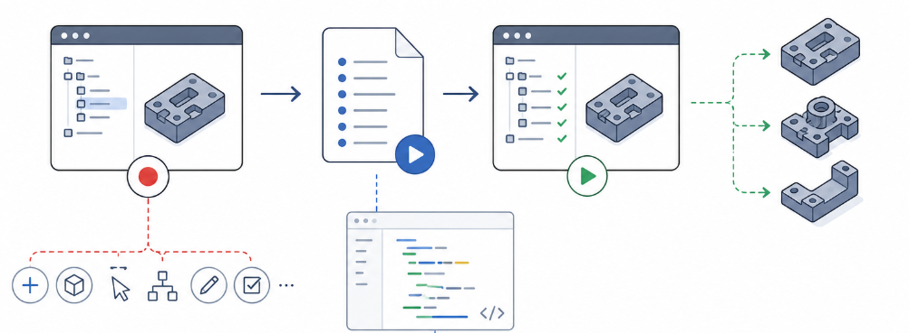
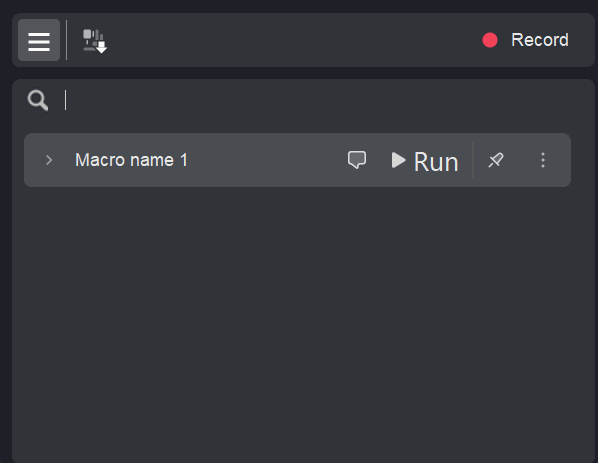

# マクロ

## 

## 適用分野:

マクロは、プロジェクト上で行った一連の操作を記録し、必要なときに再実行するための機能です。一度記録した操作（オペレーションの作成、図形の割り当て、モデルツリー内の項目の選択、プロパティの編集など）は、システムによって実行可能な小規模の拡張機能へと変換され、必要に応じて同じ操作を再現できます。また、<strong>マクロはカスタム拡張機能を作成する最も手軽な方法でもあります。</strong>記録したマクロから動作するソースコードが自動生成されるため、それをテンプレートとして利用し、さらに機能を追加/拡張していくことができます。

マクロは、同じ作業を繰り返し行う場面で活用できます。例えば、次のような用途があります。

- 類似した部品に対して、標準的な加工手順を適用する。
- プロジェクト開始時に、機械設定、ワーク設定、加工設定を定型どおりに再現する。
- 面、加工領域、曲線、<strong>穴</strong>などのジオメトリを、常に同じ方法で割り当てる。
- 再利用可能な作業手順をチームメンバーと共有する。

### マクロパネル:

マクロパネルには、保存済みのマクロと、新しいマクロを記録するための機能が用意されています。パネルは上から順に、マクロ記録用の<strong>ツールバー</strong>、<strong>検索フィールド</strong>、<strong>保存済みマクロ一覧</strong>の3つのエリアで構成されています。

<strong>ツールバーボタン</strong>

<strong>一覧表示切替 (≡)</strong> 保存済みマクロの一覧の表示/非表示を切り替えます。

<strong>プロジェクト状態</strong> マクロの記録開始時に、現在のプロジェクトのどの情報（機械設定、ワークおよび素材、加工ストラテジパラメータ）を記録するかを設定します。

<strong>記録</strong> 新しいマクロの記録を開始します。もう一度クリックすると、記録を終了します。 [詳細を見る](102457.md)

<strong>検索フィールド</strong> 一覧からマクロを検索できます。

<strong>マクロリスト</strong>

<strong>名前</strong> マクロ名が表示されます。

<strong>コメントアイコン</strong> カーソルを合わせると、マクロの説明が表示されます。

<strong>実行</strong> マクロを実行します。詳細については、関連する説明を参照してください。 [詳細を見る](102460.md)

<strong>ピン留め</strong> マクロを一覧の先頭に固定表示できます。

<strong>"…" メニュー</strong> マクロごとに次の操作を実行できます。

- <strong>エディターで開く</strong> 生成されたマクロのソースコードを開き、内容を確認したり、手動で機能を拡張したりできます。詳細については、関連する説明を参照してください。 [詳細を見る](102462.md)
- <strong>編集</strong> 編集機能を備えた画面でマクロのステップを再度開きます。変更内容を保存すると、マクロは再ビルドされます。詳細については、関連する説明を参照してください<strong>。</strong> [詳細を見る](102458.md)
- <strong>先頭にピン</strong> マクロを区切り線より上の一覧先頭に固定表示します。再度選択すると固定が解除されます。
- <strong>エクスポート</strong>
- <strong>削除</strong> マクロと関連ファイルを削除します。なお、マクロの実行中はこの操作は使用できません。

<strong>→</strong> マクロを構成する各ステップを表示します。

> ##### マクロの保存場所
>
> >
> 各マクロは、個人用CAMシステムフォルダー内のmacrosフォルダーに、それぞれ専用のフォルダーとして保存されます。このフォルダーには、生成されたソースコードと、人が読みやすい形式のマクロのステップ一覧が含まれているため、フォルダーごとコピーすることでマクロをまとめて移動または共有できます。
