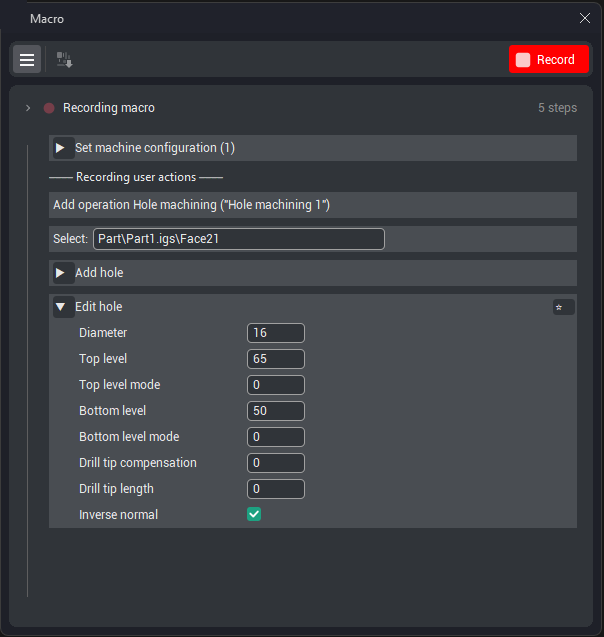

# マクロを記録

## 

## 適用分野:

新しいマクロの記録を開始します。もう一度押すと、記録を終了します。記録は、開始時にアクティブだったプロジェクトに関連付けられます。記録中にプロジェクトを切り替えると、記録は自動的に終了します。なお、マクロの記録と既存マクロの編集は同時に行うことはできません。そのため、マクロを編集用に開いている間は、新しいマクロの記録を開始できません。また、マクロの記録中は、既存マクロを編集用に開くことはできません。

### プロジェクト状態の記録

マクロは、現在のプロジェクト設定を再現した状態から開始するように記録できます。これにより、後からマクロを実行した際にも、記録時と同じ初期条件で処理を開始できます。記録するプロジェクト情報は、<strong>記録</strong>ボタンを押す前に設定します。

1. ツールバーの<strong>プロジェクト状態</strong>ドロップダウンを開きます。 2. 再現したい項目ごとにスイッチをオンにします。<strong>マシンセットアップ、ワーク、ストック、加工設定パラメータ</strong> 3. <strong>適用</strong>をクリックしてパネルを閉じます。3つのスイッチをすべて<strong>OFF</strong>のままにすると、マクロにはユーザーの操作だけが記録され、プロジェクトの初期状態は記録されません。

## 

### 操作の記録

1. <strong>記録</strong>をクリックします。ボタンは停止アイコンに変わり、パネルのヘッダーには「<strong>マクロ記録中</strong>）」と表示され、<strong>ステップ数は0</strong>に設定されます。 2. プロジェクト内で必要な操作を行います。認識された操作は、それぞれステップとして一覧に追加され、ステップ数もリアルタイムで更新されます。

- 加工オペレーションの作成
- オペレーションツリーでのオペレーションの選択
- ワークの設定（直方体、円筒、キャスティング、角柱などのワーク形状の追加/編集、およびストックの設定）
- 治具の追加（チャック、バイス、クランプ、サポートなど）および、それらのストック、色、名称の編集
- オペレーションへの図形の割り当て（面、加工領域、制限領域、曲線、穴、ドライブ面、エ領域など）
- 3Dモデル内の項目の選択

3. 記録を終了するには、<strong>停止</strong>ボタンに変わった同じボタンをクリックします。記録が完了すると、パネルのヘッダーは「<strong>記録完了</strong>」に変わります。

記録を停止すると、システムが「<strong>Macro name 1</strong>」などの候補となるマクロ名を自動的に入力し、<strong>保存</strong>パネルを表示します。保存する前に、記録されたステップを確認し、必要に応じて編集/調整することができます。 [詳細を見る](102458.md)
