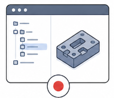
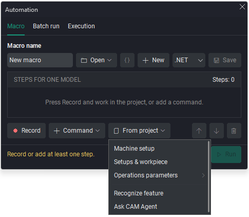
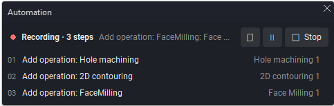

# Recording a macro

## Application area:

Macro recording captures project actions as a sequence of steps. A recording is bound to the project active at the moment it is started. When the project is switched during recording, the recording is terminated automatically. Recording and editing an existing macro are mutually exclusive: a new recording cannot be started while a macro is open for editing, and vice versa.

### Capturing the project state

A macro may begin by re-creating the current project setup, ensuring that a later run reproduces the same starting conditions. Before recording, add the required data using **From project**.

1. On the **Macro** tab of the **Automation** window, open **From project**.
2. Add the required data: **Machine setup**, **Setups & workpiece**, **Operations parameters**.

The same menu also provides **Recognize feature** and **Ask CAM Agent**.

### Recording the actions

1. Click **Record**. The panel switches to **Recording** mode. The status line shows the step count and the most recently recorded action.

2. Perform the required actions in the project. Each recognized action is added to the list as a step, and the step count updates in real time. The following actions are recorded, in particular:

   - creating an operation;

   - copying, pasting, and duplicating operations. Each action is recorded as a single step. During playback, the same operation is copied to the same position. A paste action that cannot be reproduced during playback is not recorded;

   - selecting an operation in the operations tree;

   - setting up the workpiece — adding and editing workpiece primitives (box, cylinder, casting, prism, and so on) and their stock;

   - adding fixtures — chucks, vises, clamps, supports — and editing their stock, color, and name;

   - loading fixtures from a file — **Load fixture from file**;

   - moving fixtures in the 3D view;

   - duplicating fixtures;

   - removing all fixtures and removing faces from a fixture node;

   - using or not using fixtures from the previous setup;

   - making a fixture unique to a setup or shared with its source again;

   - saving fixtures to the library;

   - changing fixture item and node properties. During playback, the macro edits and removes the same fixtures as during recording;

   - assigning geometry to an operation — faces, job and restricted zones, curves, holes, drive faces, areas;

   - selecting items in the 3D model; editing item properties;

   - moving a model tree node to another folder;

   - copying a model tree node with **Ctrl+C** and **Ctrl+V**. During playback, the copy is created in the same folder as during recording. A copied CAD group remains a CAD model.

3. To finish recording, click **Stop**.

**Pause.** Temporarily pauses the recording of actions.

After recording stops, review and refine the steps, change the macro name if necessary, and click **Save** on the **Macro** tab. [Details](102458.md)
