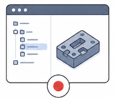
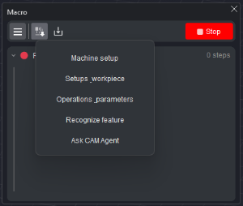
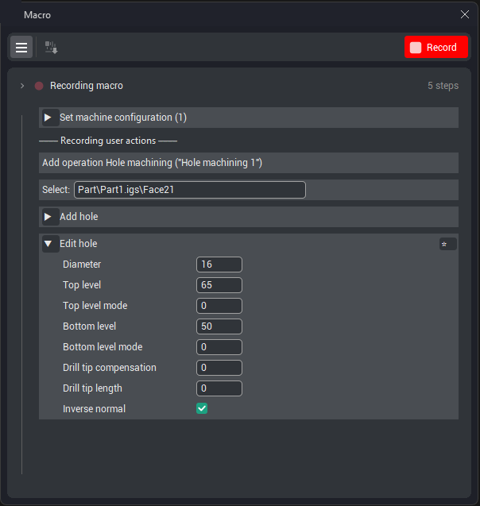

# Makro aufzeichnen

## Anwendungsbereich:

**Record** startet eine Aufzeichnung; erneutes Anklicken beendet sie. Die Aufzeichnung ist an das beim Start aktive Projekt gebunden und endet bei einem Projektwechsel automatisch. Aufzeichnung und Bearbeitung eines vorhandenen Makros sind nicht gleichzeitig möglich.

### Projektzustand übernehmen

Ein Makro kann zuerst die aktuelle Projekteinrichtung wiederherstellen. Welche Daten übernommen werden, wird vor dem Start festgelegt.

1. Öffnen Sie **Project state**.
2. Wählen Sie die benötigten Einträge: **Machine setup**, **Setups workpiece**, **Operations parameters**, **Recognize feature** oder **Ask CAM Agent**.

### Aktionen aufzeichnen

1. Klicken Sie auf **Record**. Die Schaltfläche wird zum Stoppsymbol, der Titel zeigt **Recording macro** und der Zähler **0 steps**.
2. Führen Sie die gewünschten Projektaktionen aus. Erkannte Aktionen werden als Schritte ergänzt. Erfasst werden insbesondere:

- Operationen erstellen;

- Operationen im Baum auswählen;

- Rohteilgrundkörper und ihre Aufmaße hinzufügen oder bearbeiten;

- Spannmittel hinzufügen und deren Aufmaß, Farbe oder Namen ändern;

- Flächen, Bearbeitungs- und Sperrzonen, Kurven, Bohrungen, Leitflächen und Bereiche zuweisen;

- Modellobjekte auswählen und ihre Eigenschaften ändern.

3. Klicken Sie auf **Stop**. Der Titel wechselt zu **Recording complete**.

Das System schlägt einen Makronamen vor und öffnet das Speicherpanel. Vor dem Speichern können die Schritte geprüft und angepasst werden. [Details](102458.md)
