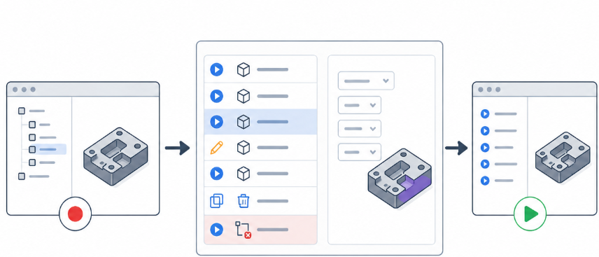
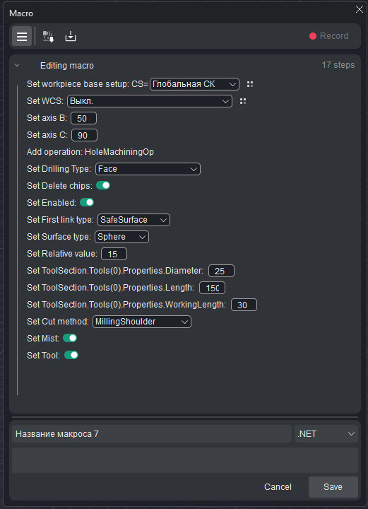
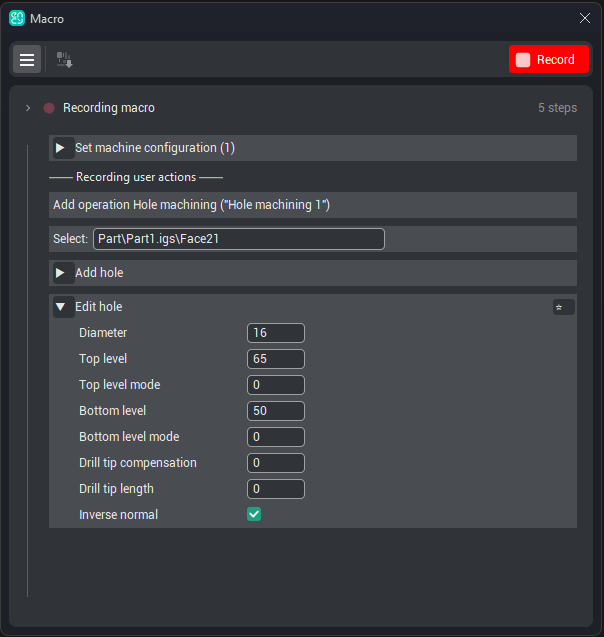

# Edição das etapas

## Área de aplicação:

A maioria das ações de edição das etapas fica disponível durante a **gravação** ou quando a macro é aberta para **edição**. Uma macro salva também pode ser ajustada para uma única execução.

### Lista de etapas

Cada ação gravada é representada por uma linha que contém:

- **Indicador de estado.** Ponto à esquerda da linha, também utilizado para definir um ponto de interrupção.

- **Descrição.** Indica a finalidade da etapa.

- **Parâmetros editáveis.** Quando disponíveis, são apresentados como listas suspensas ou campos de texto.

### Alteração do valor de um parâmetro

Selecione o valor desejado na lista suspensa ou digite-o no campo de texto. O novo valor é armazenado na etapa.

### Definição de um campo como entrada

A gravação registra os valores utilizados nas ações. Para transformar um valor fixo em uma **entrada** a ser fornecida a cada execução, marque o campo como **obrigatório**:

1. Posicione o ponteiro sobre a etapa e clique no botão  ao lado do campo.
2. O campo passa a ser uma entrada e fica realçado. A macro só pode ser executada após o preenchimento desse campo.

Use esse recurso para valores que variam entre peças, como diâmetro, nível ou sobremetal.

### Seleção de outro elemento geométrico

Nas etapas que fazem referência a um elemento do modelo, como face, curva ou furo, o elemento aparece em um campo que permite selecioná-lo novamente:

1. Clique no campo; ele ficará realçado.
2. Selecione o novo elemento no modelo 3D.

A etapa passa a utilizar o elemento selecionado. Essa alteração pode ser feita durante a edição ou antes de executar uma macro salva, permitindo aplicar a mesma macro a geometrias diferentes.

### Remoção de uma etapa

Durante a gravação ou a edição, posicione o ponteiro sobre a etapa e clique em **×**, no final da linha, para removê-la da macro.

### Etapas agrupadas

As etapas relacionadas são reunidas sob um **cabeçalho de grupo**, que apresenta seu nome, como **Edit hole (5)**. Clique na seta do cabeçalho para expandir ou recolher o grupo. O agrupamento facilita a revisão de macros extensas.

