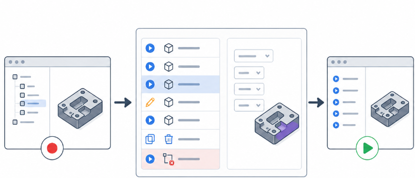
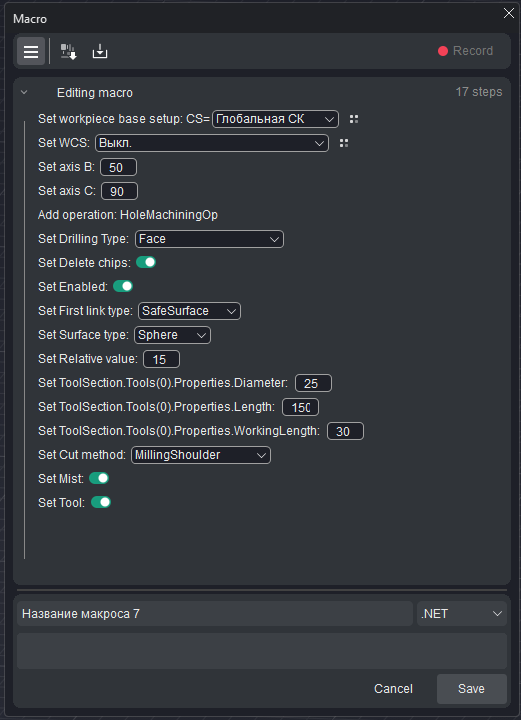
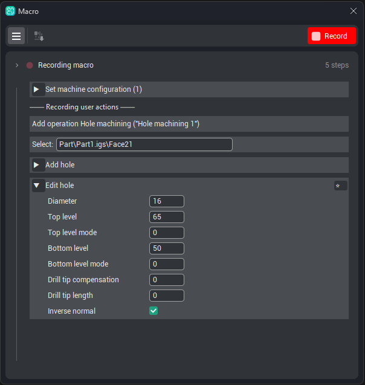

# ステップ編集

## 適用分野:

ステップ編集機能のほとんどは、マクロの<strong>記録中</strong>、または保存済みのマクロを<strong>編集用</strong>に開いた際に利用できます。 また、保存済みのマクロは、1回限りの実行用に設定を変更して使用することもできます。

### ステップ一覧

記録された各操作は、次の項目を含むステップ行として表示されます。

- <strong>ステータス点</strong> 行の左側に表示され、ブレークポイントの設定にも使用します。
- <strong>キャプション</strong> そのステップの目的を説明します。
- <strong>編集可能なパラメータ</strong> 該当する場合は、1つ以上のドロップダウンリストまたはテキスト入力フィールドが表示されます。

### パラメータ値の変更

ドロップダウン項目では、必要な値を選択します。テキスト入力欄では、値を直接入力します。変更した値は、そのステップの設定として保存されます。

### フィールドを入力項目として設定

マクロの記録時には、実際に使用した値がそのまま記録されます。固定値ではなく、マクロを実行するたびに<strong>入力</strong>する値として設定したい場合は、そのフィールドを<strong>必須</strong>入力項目として指定します。

1. ステップにカーソルを合わせ、対象フィールドの横にある  をクリックします。 2. フィールドが入力項目（ハイライト表示）になり、マクロ実行時に値の入力が必須となります。値が入力されるまで、マクロは実行できません。

3.  を再度クリックすると、入力項目の設定が解除され、記録時の値に戻ります。

この仕組みは、部品ごとに変化する値（例えば、直径、高さ、仕上げ代など）を、マクロ実行時に入力できるようにするために使用します。

### 図形項目の再指定

面、曲線、穴など、モデル内の図形を参照するステップでは、その参照先を変更できるフィールドが表示されます。

1. 対象のフィールドをクリックします（フィールドがハイライト表示されます）。 2. 3Dモデル上で新しい図形項目を選択します。

すると、そのステップは選択した図形を参照するように更新されます。この機能は、マクロの編集時だけでなく、保存済みマクロを実行する前にも利用できます。そのため、1つのマクロを異なるジオメトリに対して再利用することが可能です。

### ステップの削除

マクロの記録中または編集時に、削除したいステップへカーソルを合わせ、行の末尾にある <strong>×</strong> をクリックすると、そのステップがマクロから削除されます。

### ステップのグループ化

関連するステップは、<strong>グループヘッダー</strong>の下にまとめて表示されます。ヘッダーには、グループ名と含まれるステップ数（例：「穴を編集（5）」）が表示されます。グループヘッダーの展開／折りたたみアイコン（▶／▼）をクリックすると、グループの表示/非表示を切り替えることができます。このグループ化機能により、ステップ数の多いマクロでも内容を確認しやすくなります。

