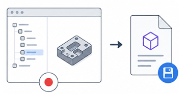
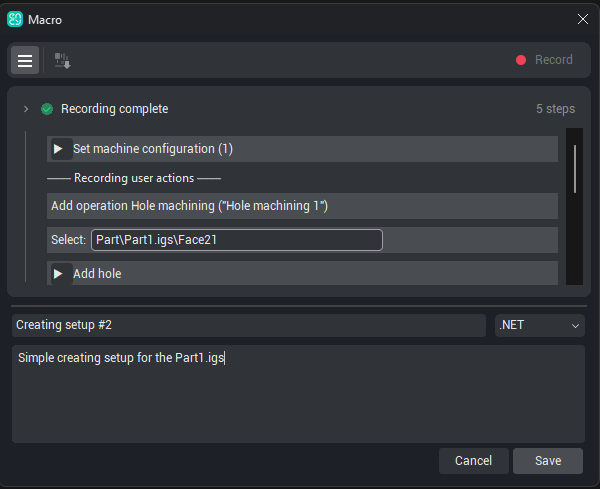

# Salvamento de uma macro

## Área de aplicação:

Iniciar uma execução, fornecer as entradas necessárias, acompanhar o progresso, pausar, parar em pontos de interrupção e substituir valores em uma única instância de execução.

### Painel Save

Ao encerrar a gravação ou concluir a edição, o painel **Save** é exibido com três campos:

- **Name.** Nome da macro, preenchido inicialmente com uma sugestão, como *Macro name 1*. Informe um nome que permita identificá-la na lista.

- **Language.** Linguagem utilizada para gerar a macro: **.NET** ou **Spr**.

- **Comment.** Descrição opcional, exibida ao posicionar o ponteiro sobre o ícone de comentário na linha da macro. O comentário torna-se a descrição da macro. Ele é exibido quando você posiciona o ponteiro sobre o ícone de comentário na linha da macro na lista; por isso, uma breve observação sobre o que a macro faz, e em que tipo de peça, será útil mais tarde.

### Escolha da linguagem

- **.NET.** A macro é compilada como uma extensão .NET.

- **Spr.** A macro é gerada em **Spr**, a linguagem de scripts integrada do ENCY.

As duas opções produzem macros executadas da mesma forma. A escolha da linguagem é relevante principalmente quando o código-fonte será aberto posteriormente para desenvolvimento. [Detalhes](102462.md)

### Verificação do ambiente de compilação

Ao abrir o painel **Save** e sempre que a linguagem é alterada, o sistema verifica se todos os componentes necessários à compilação na linguagem selecionada estão disponíveis. Se algum componente obrigatório estiver ausente:

- A mensagem *Macro build environment is not ready* é exibida, e o botão **Save** fica indisponível.

- Ao clicar na mensagem e confirmar a solicitação **Try to fix it?**, o sistema inicia a configuração do ambiente.

Em seguida, o sistema repete a verificação. Quando o ambiente estiver pronto, o botão **Save** ficará disponível novamente.

### Salvar ou cancelar

**Save.** Compila a macro e a acrescenta à lista, pronta para execução. As macros são armazenadas na pasta pessoal do ENCY, em `macros`.

**Cancel.** Descarta a gravação sem salvá-la.
