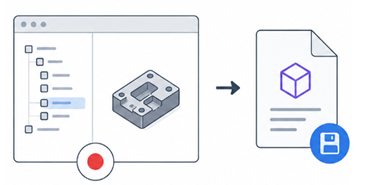
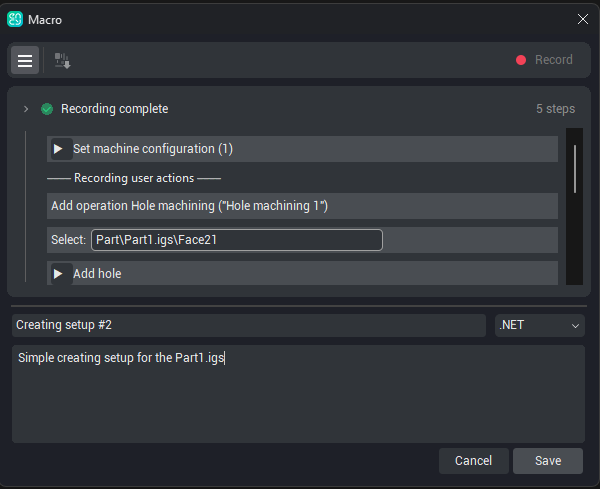

# マクロを保存

## 適用分野:

マクロの実行開始、必要な入力値の指定、実行状況の監視、一時停止、ブレークポイントでの停止、およびその実行時に限って値を変更して実行する方法について説明します。

### 保存パネル

記録を停止したとき（または編集を完了したとき）には、保存パネルが表示され、次の3つの項目が表示されます。

- <strong>名前</strong> — 「Macro name 1」のような候補名があらかじめ入力されています。一覧で識別しやすい名前に変更してください。
- <strong>言語</strong> — マクロを作成する言語を選択します。選択できる言語は <strong>.NET</strong> または <strong>Spr</strong> です。
- <strong>コメント</strong> —任意の説明を入力できます。入力したコメントはマクロの説明として保存され、マクロ一覧でコメントアイコンにカーソルを合わせると表示されます。そのため、マクロの内容や対象となる部品について簡潔に記載しておくと、後から確認するときに役立ちます。

### 言語の選択

- <strong>.NET</strong> — マクロは <strong>.</strong> NET 拡張機能として作成されます。
- <strong>Spr</strong> — マクロは ENCY に組み込まれているスクリプト言語「Spr」で作成されます。

どちらの言語で作成した場合でも、マクロの実行方法に違いはありません。言語の選択が重要になるのは、後からマクロのソースコードを開いて開発やカスタマイズを行う場合です。 [詳細を見る](102462.md)

### ビルド環境の確認

保存パネルを開いたとき、およびマクロの言語を変更するたびに、選択した言語でマクロをビルドするために必要なコンポーネントが揃っているかどうかが確認されます。

- 必要なコンポーネントが不足している場合は、「<strong>Macro build environment is not ready（マクロのビルド環境が準備できていません）</strong>」というメッセージが表示され、<strong>保存</strong>ボタンは使用できなくなります。
- このメッセージをクリックし、表示される「<strong>Try to fix it?（修正を試みますか？）</strong>」という確認画面で実行を選択すると、システムが必要なビルド環境のセットアップを開始します。

セットアップ完了後、ビルド環境の確認が再度実行されます。環境が正常に整うと、<strong>保存</strong>ボタンが再び使用できるようになります。

### 保存またはキャンセル

<strong>保存</strong> マクロがビルドされ、実行可能な状態でマクロ一覧に追加されます。作成したマクロは、個人用のENCYフォルダー内の <strong>macros</strong> フォルダーに保存されます。

<strong>キャンセル</strong> 記録した内容は保存されずに破棄されます。
