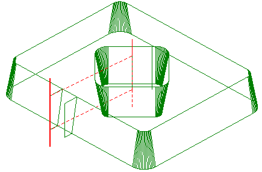
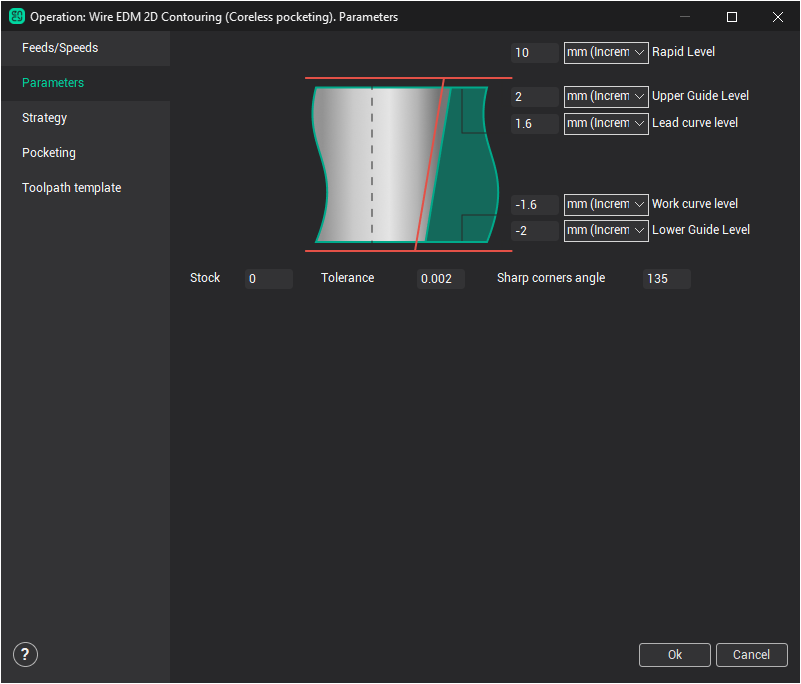

# ワイヤー放電2D輪郭加工

`ワイヤー放電2D輪郭加工`オペレーションは、平面輪郭に沿ったワイヤーパスの生成、およびワイヤー傾斜角（テーパー）を伴う平面輪郭や3D輪郭加工のためのワイヤーパスの生成に対応しています。生成されるワイヤーパスは、単一平面上にある輪郭に基づいています。これは、下側平面（加工輪郭 XY平面）と上側平面（リード輪郭 UV平面）に対して輪郭を選択する必要がある [4D輪郭加工](10247.md) オペレーションとは異なります。

各オペレーションの固有オプションは、オペレーションパラメータウィンドウの`パラメータ` ページで設定します。

次のオペレーションプロパティを使用できます。

- `加工高さ`:

- `早送り高さ` –早送り移動を行うZ高さを設定します。この高さは、治具などに干渉しない高さで早送り移動が行われるように、すべての加工高さより上に設定する必要があります。
- `上部ガイド高さ` – ワイヤー放電加工機の上側ガイドのZ高さを設定します。
- `リードカーブ高さ` – 4D加工の場合、上側ガイド（UV）輪郭のZ高さを設定します。2D加工の場合は、「仮想」上側輪郭を生成する高さを設定します。
- `ワークカーブ高さ` – 通常、加工輪郭（プログラム輪郭）のZ高さです。
- `下部ガイド高さ` – ワイヤー放電加工機の下側ガイドのZ高さを設定します。

- <ストック- オペレーション内のすべての輪郭に適用する、追加の加工代の値です。この値の算出方法は、`加工設定`ページで選択した[補正タイプ](10238.md)によって異なります。各パスの補正値は、 `送り速度／回転数` ページの [オフセット値](10237.md) と `ストック` 値の合計です。この値に基づき、[コンピュータ](10238.md)、 [両補正](10238.md)、[両補正リバース](10238.md) タイプでは、システムが等距離曲線を生成します。[制御機](10238.md) タイプでは、この値は`送り速度／回転数`ページの[オフセットコード](10237.md)番号に対応するレジスタに格納されます。

- `トレランス`ワイヤーの近似パスと理想経路との最大偏差を定義する計算許容値です。公差を大きく設定しすぎると、計算時間が長くなる可能性があります。逆に、公差を小さく設定しすぎると、パーツに許容できない食い込み（ガウジ）が発生することがあります

- `シャープコーナー角度` どのコーナーを鋭角コーナーとみなすかを設定します。角度の絶対値が定義値より大きい場合、そのコーナーは鈍角と判断され、丸め処理の対象外となります。
