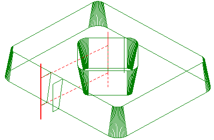
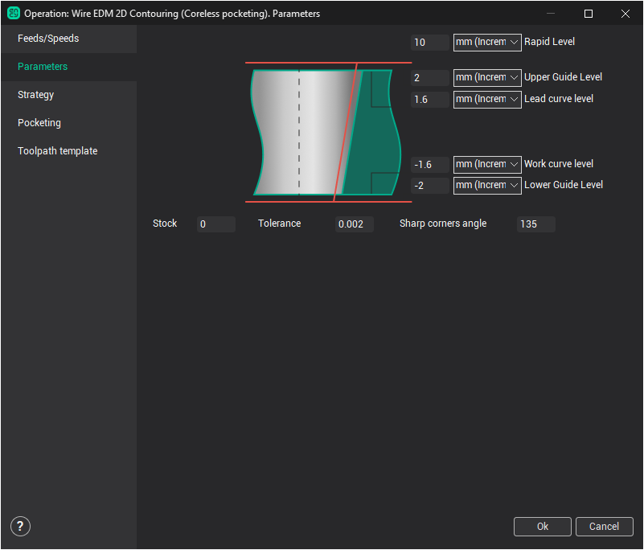

# Contornatura 2D per elettroerosione a filo

L'operazione `Wire EDM 2d Contouring` è destinata alla generazione del percorso del filo lungo contorni piani, anche con angolo di inclinazione del filo (conicità), oppure alla contornatura 3D. Il percorso del filo risultante si basa su contorni giacenti su un unico piano, a differenza dell'operazione di [contornatura 4D](10247.md), in cui i contorni devono essere selezionati per il piano inferiore (piano dei contorni di lavoro XY) e per il piano superiore (piano dei contorni guida UV).

Le opzioni specifiche di ogni operazione si definiscono nella finestra dei parametri dell'operazione, nella pagina **Parameters**.

Sono disponibili le seguenti proprietà dell'operazione:

- **Working levels** (livelli di lavoro):

- **Rapid level** – definisce il livello Z al quale vengono eseguiti i movimenti rapidi. Deve trovarsi al di sopra di tutti i livelli di lavoro, in modo che i movimenti rapidi vengano eseguiti a un'altezza libera da attrezzature di bloccaggio ecc.
- **Upper Guide** – definisce il livello Z della guida superiore della macchina per elettroerosione a filo.
- **Lead curve level** – nella lavorazione 4D definisce il livello Z del contorno guida superiore (UV). Nella lavorazione 2D definisce l'altezza alla quale viene generato il contorno superiore "virtuale".
- **Work Curve level** – di norma il livello Z del contorno di lavoro (programmato).
- **Lower Guide level** – definisce il livello Z della guida inferiore della macchina per elettroerosione a filo

- **Stock** – valore del sovrametallo aggiuntivo da utilizzare per tutti i contorni dell'operazione. Il metodo di calcolo di questo valore dipende dal [Compensation type](10238.md) (tipo di compensazione) selezionato nella pagina **Strategy**. Il valore di compensazione per ogni passata è la somma dell'[Offset Value](10237.md) della pagina `Feeds/Speeds` e del valore **Stock**. Con i tipi di compensazione [Computer](10238.md), [Both](10238.md) e [Reverse Both](10238.md) il sistema crea una curva equidistante basata su questo valore. Con il tipo [Control](10238.md) il valore viene inserito nel registro con il numero [Offset Code](10237.md) della pagina `Feeds/Speeds`.
- **Tolerance** è la tolleranza di calcolo che definisce lo scostamento massimo del percorso approssimato del filo da quello ideale. Se la tolleranza è troppo alta, il tempo di calcolo può risultare eccessivo; al contrario, se la tolleranza è troppo bassa, sul pezzo possono comparire intaccature inaccettabili.

- **Sharp corners angle** consente di stabilire quali angoli sono vivi. Se il modulo di un angolo è maggiore del valore definito, l'angolo viene considerato ottuso e non viene raccordato.
