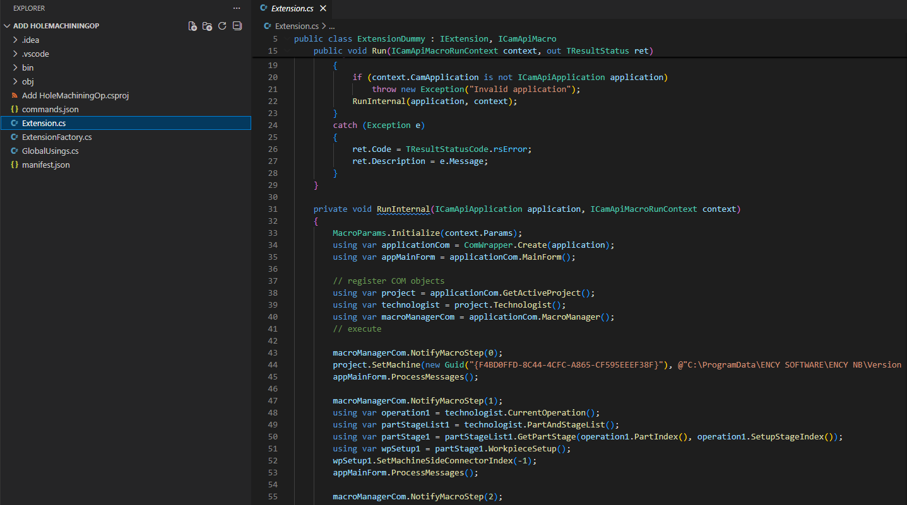
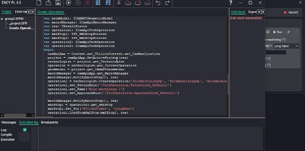

# Modifica del codice

## Ambito di applicazione:

Ogni macro è una piccola estensione generata dal sistema a partire dai passaggi registrati. La registrazione copre i casi più comuni, mentre il codice sorgente generato è un'estensione pienamente funzionante.

L'apertura del codice è indicata per:

- andare oltre le possibilità della registrazione, aggiungendo logica personalizzata, cicli o condizioni;

- studiare l'API del sistema CAM tramite un esempio concreto ed eseguibile;

- creare una nuova estensione a partire da un modello collaudato anziché da un file vuoto.

### .NET e Spr

Il linguaggio viene selezionato al salvataggio della macro e viene mantenuto dalla macro stessa. [Dettagli](102459.md)

<strong>.NET</strong>. La macro viene generata in <strong>C#</strong> e compilata come estensione .NET basata sull'API del sistema CAM. Da selezionare per sviluppare la macro in <strong>C#</strong> o per utilizzare il più ampio ecosistema <strong>.NET</strong>.

<strong>Spr.</strong> La macro viene generata in <strong>Spr</strong>, il linguaggio di scripting integrato del sistema CAM, e si apre nell'editor <strong>Spr</strong> integrato. Da selezionare quando si lavora in <strong>Spr</strong>.

Entrambe le opzioni vengono eseguite allo stesso modo dall'elenco delle macro; la differenza riguarda soltanto il codice sorgente da modificare.

### Apertura di una macro in un editor

1. Nell'elenco delle macro, aprire il menu <strong>"…"</strong> della macro e selezionare <strong>Open in editor</strong> (apri nell'editor).

2. Il sistema apre il codice sorgente generato della macro: il sorgente C# per una macro <strong>.NET</strong>, oppure lo script `.spr` nell'editor <strong>Spr</strong>.

3. Apportare le modifiche e salvare.

Il codice sorgente generato di una macro <strong>.NET</strong>: il file C# `Extension.cs` insieme ai file di progetto (`commands.json`, `manifest.json` e il `.csproj`):

Il codice generato di una macro <strong>Spr</strong>: lo script aperto nell'editor Spr:

### Quando le modifiche diventano effettive

- Una macro <strong>Spr</strong> viene eseguita direttamente dal proprio script, quindi è sufficiente salvare lo script modificato.

- Una macro <strong>.NET</strong> viene eseguita da un file compilato, quindi le modifiche al codice C# diventano effettive dopo la ricompilazione della macro. Vale la verifica dell'ambiente di compilazione analoga a quella descritta in. [Dettagli](102459.md)

### Posizione del codice sorgente

Il codice sorgente della macro e il relativo elenco di passaggi leggibile sono collocati insieme nella cartella della macro, all'interno della cartella personale del sistema CAM, sotto `macros`. Conservare la cartella nel suo insieme garantisce che la macro e il relativo codice sorgente rimangano sincronizzati.
