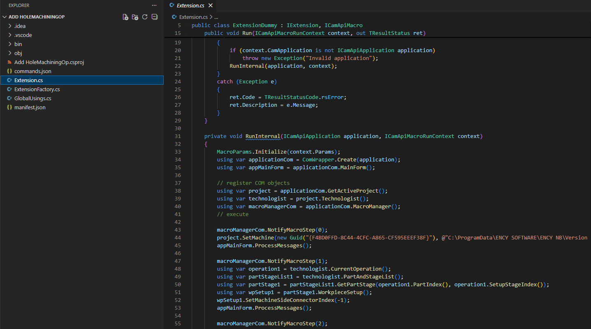
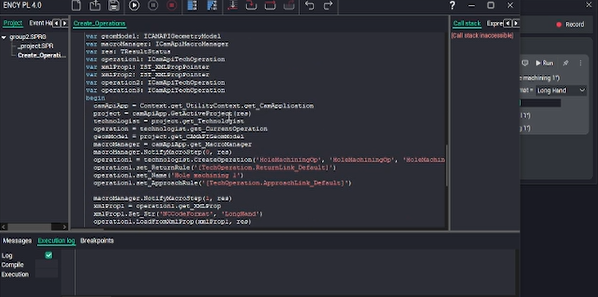

# コードを編集

## 適用分野:

各マクロは、記録されたステップをもとにシステムが自動生成する小規模な拡張機能です。マクロ記録では一般的な操作をカバーできますが、自動生成されるソースコードは、そのまま動作する完全な拡張機能となっています。

ソースコードを開くことは、次のような場合に適しています。

- マクロ記録では対応できない処理を実装したい場合（独自の処理、ループ、条件分岐などの追加）
- 実際に動作するサンプルコードを通して、CAMシステムのAPIを学習したい場合
- 空のファイルから作成するのではなく、正しく動作するテンプレートをもとに新しい拡張機能を作成したい場合

### .NET と Spr

マクロの言語は、保存時に選択され、その設定はマクロに保持されます。 [詳細を見る](102459.md)

<strong>.NET</strong> マクロは <strong>C#</strong> で生成され、CAMシステムのAPIを利用する.NET 拡張機能としてビルドされます。<strong>C#</strong>でマクロを開発したい場合や、<strong>.NET</strong>の豊富なライブラリや機能を活用したい場合に適しています。

<strong>Spr</strong> マクロは、CAMシステムに組み込まれているスクリプト言語 <strong>Spr</strong> で生成され、内蔵の<strong>Spr</strong>エディタで編集できます。<strong>Spr</strong>を使用して開発を行う場合に適しています。

どちらの言語で作成したマクロも、マクロ一覧から同じ手順で実行できます。違いは、編集するソースコードの言語のみです。

### エディタでマクロを開く

1. マクロ一覧で対象のマクロの「…」メニューを開き、「<strong>エディタで開く</strong>」を選択します。

2. システムが、マクロの生成済みソースコードを開きます。.<strong>NET</strong> マクロの場合は C# ソースコード、Spr マクロの場合は <strong>Spr</strong> エディタで.spr スクリプトが開きます。

3. 必要な変更を加え、保存します。

<strong>.NET</strong> マクロでは、生成されるソースコードとして、C# のExtension.cs` ファイルに加え、 (`commands.json`, `manifest.json`、 `.csproj`)などのプロジェクトファイルも作成されます。

<strong>Spr</strong> マクロでは、生成されたスクリプトが Spr エディタで開かれます。

### 編集内容の反映

- <strong>Spr</strong> マクロはスクリプトを直接実行するため、編集したスクリプトを保存するだけで変更内容が反映されます。
- <strong>.NET</strong> マクロはコンパイル済みのファイルを実行するため、C# ソースコードを編集した後は、マクロを再ビルドすることで変更内容が反映されます。[詳細を見る](102459.md)

### ソースコードの保存場所

マクロのソースコードと、人が読みやすい形式のステップ一覧は、個人用のCAMシステムフォルダー内にあるmacros フォルダーにまとめて保存されます。マクロフォルダー全体をそのまま保持することで、マクロ本体とソースコードを常に同期した状態で管理できます。
