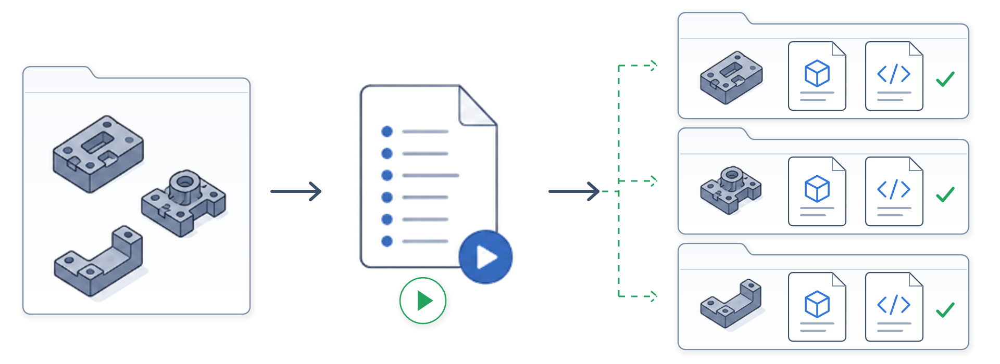
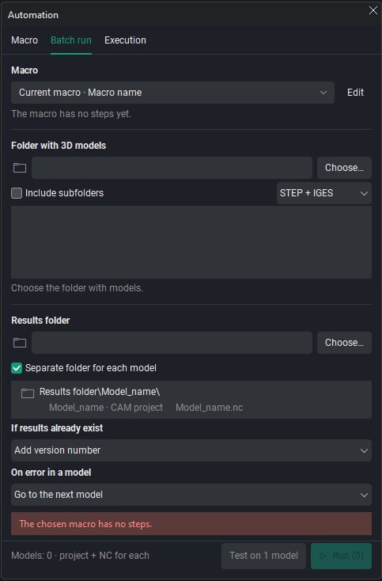

# Batch run

## Application area:

The **Batch run** tab runs the selected macro for each 3D model in a folder. A CAM project and an NC program are saved for each model.

### Setup

Open the **Batch run** tab in the **Automation** window.

**Macro.** Select a macro from the list. **Edit** opens it for editing. The macro must include a step that imports a 3D model.

**Folder with 3D models.** Click **Choose...** and select the source folder. Enable **Include subfolders** to include models from its subfolders. Select a file format filter, for example **STEP + IGES**. The models found are listed below.

**Results folder.** Select the folder for CAM projects and NC programs. Enable **Separate folder for each model** to place the results in subfolders named after the models.

**If results already exist.** Select how to handle existing results:

- **Add version number.** Adds a version number to the result name.
- **Skip models.** Skips models whose results already exist.
- **Overwrite results.** Replaces existing results.

**On error in a model.** Select how to handle a processing error:

- **Go to the next model.** Continues processing the next model.
- **Stop batch.** Stops the batch run.

### Starting a batch run

**Test on 1 model.** Runs the macro for one model before processing the entire batch.

**Run.** Starts processing all models found. The number in parentheses shows the model count.

*If the batch run cannot start, a message at the bottom of the tab explains the reason.*
