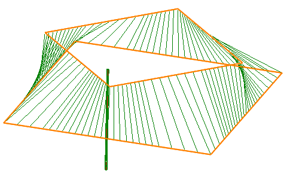
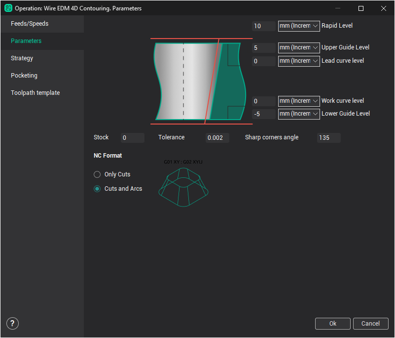

# ワイヤー放電4D輪郭加工

`ワイヤー放電4D輪郭加工` は、2つの平面輪郭に沿ったワイヤーパスを同時に生成するように設計されています。これらの輪郭のうちの1つは、ワイヤー放電加工機の下側ガイドを移動させます。より正確に言えば、加工（XY）輪郭平面を移動させます。もう1つの輪郭は、ワイヤー放電加工機の上側ガイド、すなわちリード（UV）輪郭を移動させます。このため、オペレーション内では上側ワイヤー端と下側ワイヤー端を異なるパスに沿って移動させることができます。



各オペレーションの固有のオプションは、オペレーションパラメータウィンドウの`パラメータ` ページで設定します。



利用可能なオペレーションプロパティは、以下の通りです。

- `加工高さ`:

- `早送り高さ` –
- 早送り移動を行うZ高さを設定します。この高さは、治具などに干渉しない高さで早送り移動が行われるように、すべての加工高さより上に設定する必要があります。
- `上部ガイド高さ` – ワイヤー放電機の上部ガイドのZ高さを設定します。
- `リードカーブ高さ` – ワイヤー放電加工機の上側ガイドのZ高さを設定します。
- `ワークカーブ高さ` – 通常、工程輪郭（プログラム輪郭）のZ高さです。
- `下部ガイド高さ` – ワイヤー放電加工機の下側ガイドのZ高さを設定します。

- <ストック- オペレーション内のすべての輪郭に適用する、追加の加工代の値です。この値の算出方法は、`加工設定`ページで選択した[補正タイプ](10238.md)によって異なります。各パスの補正値は、 `送り速度／回転数` ページの [オフセット値](10237.md) と `ストック` 値の合計です。この値に基づき、[コンピュータ](10238.md)、 [両補正](10238.md)、[両補正リバース](10238.md) タイプでは、システムが等距離曲線を生成します。[制御機](10238.md) タイプでは、この値は`送り速度／回転数`ページの[オフセットコード](10237.md)番号に対応するレジスタに格納されます。

- `トレランス`ワイヤーの近似パスと理想経路との最大偏差を定義する計算許容値です。公差を大きく設定しすぎると、計算時間が長くなる可能性があります。逆に、公差を小さく設定しすぎると、パーツに許容できない食い込み（ガウジ）が発生することがあります。

- <NCフォーマット- このパネルでは、Gコードのフォーマットを次の2種類から選択できます。

- `直線のみ` –元の輪郭の全ての円弧は直線セグメント (`直線`)で近似します。Gコードには直線移動のみが含まれます。この場合、NCブロックには下側輪郭（X, Y）と上側輪郭（U, V）の座標が同時に含まれます。NCブロックは以下のようになります。

```
G01 X65.852 Y89.422 U-3.902 V19.616
```

- `直線と円弧` – Gコードには直線セグメントと円弧の両方を含めることができます。通常、この形式のNCブロックはコロンで区切られた2つの部分で構成されます。ブロックの左側には下側の輪郭の移動が、右側には上側輪郭の移動が入ります。NCブロックは以下のようになります。

```
G03 X60Y90I-30J0: G03 X60Y70I-10J0
```
