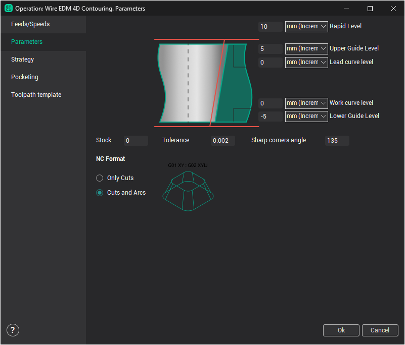

# Contornatura 4D per elettroerosione a filo

L'operazione `Wire EDM 4d Contouring` è destinata alla generazione del percorso del filo lungo due contorni piani contemporaneamente. Uno di questi contorni muove la guida inferiore della macchina per elettroerosione a filo, più precisamente il piano del contorno di lavoro (XY). Il secondo contorno muove la guida superiore della macchina, ovvero il contorno guida (UV). In questo modo, nell'operazione le estremità superiore e inferiore del filo possono muoversi lungo percorsi diversi.


Le opzioni specifiche di ogni operazione si definiscono nella finestra dei parametri dell'operazione, nella pagina **Parameters**.



Sono disponibili le seguenti proprietà dell'operazione:

- **Working levels** (livelli di lavoro):

- **Rapid Level** – definisce il livello Z al quale vengono eseguiti i movimenti rapidi. Deve trovarsi al di sopra di tutti i livelli di lavoro, in modo che i movimenti rapidi vengano eseguiti a un'altezza libera da attrezzature di bloccaggio ecc.
- **Upper Guide Level** – definisce il livello Z della guida superiore della macchina per elettroerosione a filo.
- **Lead curve level** – definisce il livello Z del contorno guida superiore (UV).
- **Work curve level** – di norma il livello Z del contorno di lavoro (programmato).
- **Lower Guide Level** – definisce il livello Z della guida inferiore della macchina per elettroerosione a filo

- **Stock** – valore del sovrametallo aggiuntivo da utilizzare per tutti i contorni dell'operazione. Il metodo di calcolo di questo valore dipende dal [Compensation type](10238.md) (tipo di compensazione) selezionato nella pagina **Strategy**. Il valore di compensazione per ogni passata è la somma dell'[Offset Value](10237.md) della pagina `Feeds/Speeds` e del valore **Stock**. Con i tipi di compensazione [Computer](10238.md), [Both](10238.md) e [Reverse Both](10238.md) il sistema crea una curva equidistante basata su questo valore. Con il tipo [Control](10238.md) il valore viene inserito nel registro con il numero [Offset Code](10237.md) della pagina `Feeds/Speeds`.

- **Tolerance** è la tolleranza di calcolo che definisce lo scostamento massimo del percorso approssimato del filo da quello ideale. Se la tolleranza è troppo alta, il tempo di calcolo può risultare eccessivo; al contrario, se la tolleranza è troppo bassa, sul pezzo possono comparire intaccature inaccettabili.

- **NC Format** – in questo pannello è possibile selezionare uno dei due formati del codice G:

- **Only Lines** – tutti gli archi dei contorni di origine vengono approssimati con segmenti lineari (**Lines**). Il codice G conterrà solo movimenti lineari. In questo caso i blocchi NC contengono contemporaneamente le coordinate del contorno inferiore (X, Y) e del contorno superiore (U, V). Il blocco NC avrà il seguente aspetto:

```
G01 X65.852 Y-89.422 U-3.902 V19.616
```

- **Lines and Arcs** – il codice G può contenere segmenti lineari e archi. Di norma il blocco NC in questo formato è composto da due parti separate da due punti. Nella parte sinistra del blocco si trovano i movimenti del contorno inferiore, in quella destra i movimenti del contorno superiore. Il blocco NC avrà il seguente aspetto:

```
G03 X60. Y90. I-30. J0. : G03 X60. Y70. I-10. J0.
```
