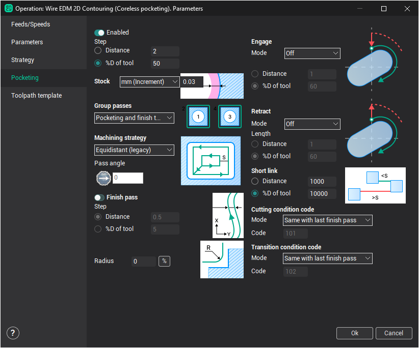
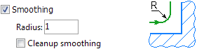

# Parameter für das Taschenerodieren

Aktivieren Sie zum Einschalten des Taschenerodierens das entsprechende Kontrollkästchen auf der Seite **Pocketing** im Parameterfenster der Drahterodieroperation.

**Machining strategy (Bearbeitungsstrategie).** Bestimmt die Form der Drahtbahn. Bei der äquidistanten Strategie folgen die Bearbeitungsbahnen der Form der Ausgangskonturen. Bei der parallelen Strategie verlaufen sie als parallele Geraden. Für diese kann zusätzlich der Winkel in der Draufsicht festgelegt werden.

**Machining step (Bahnabstand).** Legt den Abstand benachbarter Bearbeitungsbahnen fest. Es stehen mehrere Eingabearten zur Verfügung.

- **Distance.** Absoluter Abstand, der bei Änderungen anderer Einstellungen unverändert bleibt.
- **%D of wire.** Abstand als Prozentsatz des Drahtdurchmessers. Er ändert sich entsprechend, wenn ein anderer Drahtdurchmesser verwendet wird.

Bei aktiviertem **Finish pass** bleibt zunächst ein zusätzliches Aufmaß stehen. Dieses wird im letzten Schlichtdurchgang entfernt, der stets äquidistant zur Ausgangskontur verläuft. So lassen sich beispielsweise Reststege nach parallelen Schruppbahnen entfernen und eine höhere Oberflächengüte erzielen. Das zusätzliche Aufmaß bezieht sich auf das Grundaufmaß für die anschließende Schlichtbearbeitung.

**Stock (Aufmaß).** Legt fest, welches Material für die Schlichtdurchgänge entlang der Kontur stehen bleibt. Das Aufmaß kann außerdem die Differenz zwischen Drahtdurchmesser und tatsächlicher Schnittbreite berücksichtigen. Folgende Eingabearten stehen zur Verfügung:

- **Absolute.** Aufmaß in der aktuellen Systemeinheit (Millimeter oder Zoll), bezogen auf die Ausgangskontur der Auftragszuweisung.
- **Increment.** Zusätzliches Aufmaß in der aktuellen Systemeinheit. Der Bezug wird aus der Anzahl der Schlichtdurchgänge und den zugehörigen [Versatzwerten](10237.md) bestimmt. Zusätzlich wird der Drahtradius berücksichtigt.
- **%D of wire.** Aufmaß als Prozentsatz des Drahtdurchmessers, ebenfalls bezogen auf die Ausgangskontur.

**Smooth radius (Verrundungsradius).** Verrundet die Drahtbahn an Innenecken, um Schwingungen zu verringern und die Bearbeitungsgeschwindigkeit zu erhöhen. **Radius** bestimmt den Radius der eingefügten Kreisbögen. Die Verrundung im letzten Durchgang kann separat aktiviert werden.

Enthält die Operation sowohl Schruppdurchgänge zum Ausräumen der Tasche als auch Schlichtdurchgänge entlang der Kontur, bestimmt **Group passes** deren Reihenfolge. Bei **Pocketing and finish together** wird jede Kontur vollständig bearbeitet, bevor die nächste beginnt. Bei **Pocketing and finish separately** werden zunächst alle Taschen ausgeräumt und danach alle Konturen geschlichtet.

**Short link (Kurze Verbindung).** Bestimmt die Verbindung zwischen Bearbeitungsbahnen. Liegen die Verbindungspunkte weiter auseinander als der vorgegebene Grenzwert, wird der Draht getrennt und die Verbindung im Eilgang ausgeführt. Andernfalls erfolgt die kürzeste Verbindung ohne Drahttrennung mit dem dafür festgelegten Vorschub bzw. Schnittbedingungscode.

Die Schnittbedingungen können für Bearbeitungsbahnen und Verbindungen getrennt eingestellt werden. Wie beim Konturieren wird ein Technologiecode verwendet, über den die CNC-Steuerung die konkreten Schnittparameter aus einer Tabelle auswählt. Dafür stehen zwei Möglichkeiten zur Verfügung:

- **Condition code.** Direkte Eingabe einer Codenummer.
- **Same with the first finish pass.** Übernimmt automatisch den Code des ersten Schlichtdurchgangs aus der [Schnittbedingungstabelle](10237.md).

**Approach** und **Return** legen Art und Größe der Anfahrbewegung zum Bahnanfang bzw. der Abfahrbewegung vom Bahnende separat fest. Unter **Mode** stehen folgende Arten zur Verfügung:

- **Off.** Keine An- bzw. Abfahrbewegung.
- **Normal.** Bewegung senkrecht zur Bearbeitungsbahn.
- **Tangent.** Bewegung tangential zur Bearbeitungsbahn.

Bei aktivierter An- oder Abfahrbewegung kann deren Größe in der aktuellen Systemeinheit (Millimeter oder Zoll) oder als Prozentsatz des Drahtdurchmessers angegeben werden.
