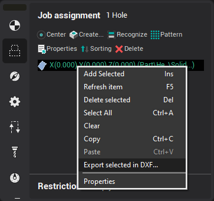

# Pontos de passagem do fio

Nas operações de eletroerosão a fio, a trajetória normalmente começa nos furos pré-usinados no bruto. Se os furos já existirem no modelo do bruto especificado para a operação, o local de entrada do fio será determinado automaticamente nos pontos sem material. Se o bruto for especificado simplesmente como um bloco maciço de material sem furos, é possível especificar explicitamente os furos pelos quais o fio deve ser passado. Para isso, selecione a operação de eletroerosão a fio desejada no modo "Technology" e, em seguida, selecione a aba "Holes" no canto inferior esquerdo da janela principal.

Os furos podem ser adicionados a essa lista por meio da inserção manual das coordenadas, da seleção de primitivos geométricos ou automaticamente durante o reconhecimento do modelo 3D. Trabalhar com essa janela não é diferente de preencher a [lista de furos da operação de usinagem Hole](705.md).

Além disso, as operações de eletroerosão a fio suportam o modo de engenharia reversa. Se, no momento do cálculo, a operação não encontrar um furo adequado nessa lista, ela criará automaticamente um novo furo a ser furado e o adicionará à lista. Em seguida, os furos dessa lista podem ser exportados para um arquivo externo (DXF). Posteriormente, esse arquivo com os furos pode ser carregado em outro projeto ou em outro aplicativo, no qual é feito o projeto do bruto para usinar essa peça.

Para exportar a lista de furos, use o menu pop-up dessa janela ou o item de menu principal `File / Export / Export holes`.
