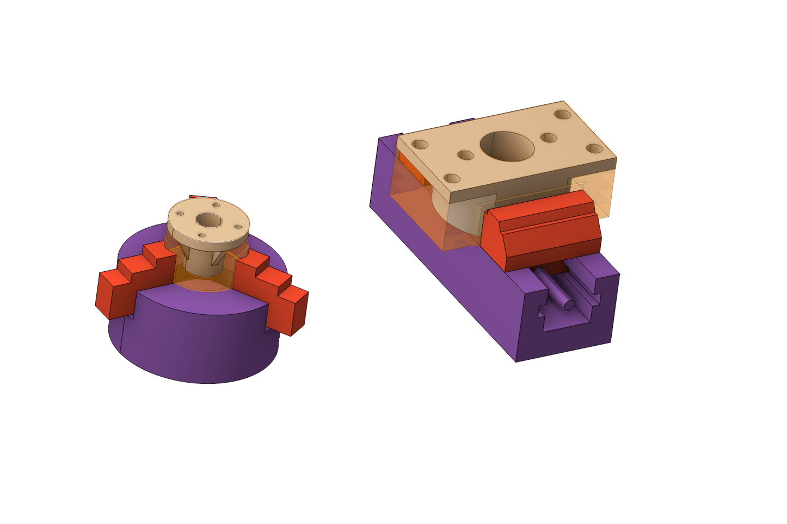
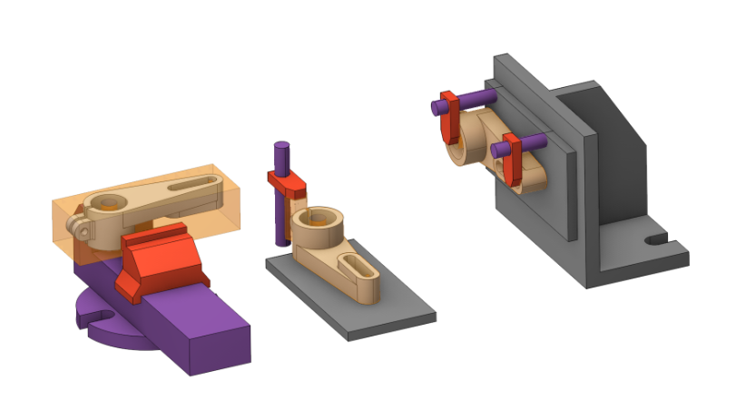

# パーツ（グループ）

 

## 適用分野：

このグループは<strong>複数部品からなるプロジェクト</strong>を作成するために必要です。 これらの部品は、複数の異なる（設計）部品、またはコンベアのように、加工工程ごとに分割された標準部品で構成されます。オペレーション を並べ替えるには、 <strong>シーケンスモード</strong>を使用します。[詳細を見る](1029.md)

## セットアップ：

<strong>セットアップ</strong>タブは、プロジェクトの主要なパラメータを設定するために使用します。これには、装置上の部品の位置、部品の座標系などが含まれます。[詳細を見る](1022.md)

## 変換：

オペレーション内で計算された工具の軌跡に対して座標変換を実行できるようにするため、オペレーション用パラメータセットです。[詳細を見る](10168.md)
