# 2Dジョブ割り当て項目のプロパティ

ジョブ割り当ての各要素には、一連のプロパティがあります。

2Dジョブ割り当て項目のプロパティを表示または編集するには、項目を選択して`プロパティ`ボタンをクリックするか、項目をダブルクリックします。

以下は項目のプロパティダイアログです。

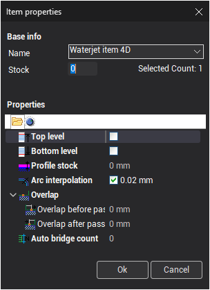

- `上部高さ` – EDM機（放電加工機）の上部ガイド用の平面です。グラフィックウィンドウで上部ガイド高さを設定するには、上面マークを移動させます。

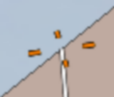

- `底部高さ` – マシンの底部ガイド用の平面です。グラフィックウィンドウで底部ガイド深さを設定するには、底面マークを移動させます:

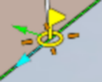 上部または底部ガイドの正確な高さを設定するには、高さマークをクリックして値を入力します。 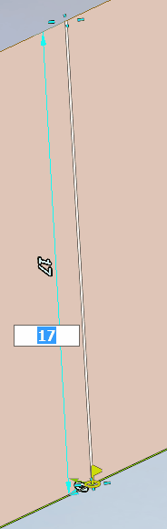

- `仕上げ代`- 生成される輪郭に対する追加ストックです。値は正または負の値を設定できます。
- <パス前のオーバーラップ- ジョブの割り当て項目の開始点におけるオーバーラップ量を設定します。
- `パス後のオーバーラップ` – ジョブ割り当て項目の終了点におけるオーバーラップ量を設定します。
- `自動ブリッジ回数`- ブリッジの回数です。ブリッジのプロパティは、グラフィックウィンドウで設定できます。
- `テーパーパラメータ` – 無効にすると、ワイヤーはXY平面に対して垂直に配置され、加工結果は円筒面になります。円錐面を加工するには、この機能を有効にし、各輪郭についてテーパー角度と方向を設定します。テーパー角度を設定するには、同期線をクリックして値を入力します。
- 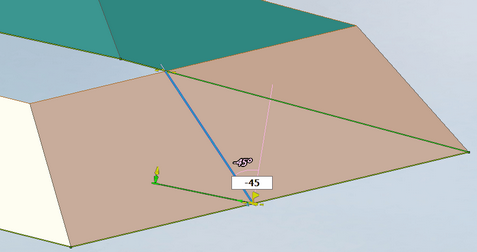 テーパーが有効な場合、テーパー角度の値が各NCフレームに出力されます。（例：G01 X30 Y45 A5）テーパー機能を有効にすると、追加のパラメーターが有効になります。

- `テーパーの適用`は、次のいずれかの値を設定できます。

- `全てのパス` – 輪郭のすべてのパスにテーパーが適用されます。
- `パスの後に適用` – `パス番号`フィールドで設定したパス番号以降にテーパーが適用されます。最初のNパスではテーパーは無効になり、N+1パス番目以降のパスではテーパーが有効になります。
- `パスの後に無効` – `パス番号`フィールドで設定したパス番号以降にテーパーが無効になります。最初のNパスではテーパーは有効となり、N+1パス目以降でテーパーが有効になります。

- `コーナーローリング` – 最新のワイヤー放電NC制御装置は、ワイヤーパス上の鋭角コーナーを自動ローリング機能をサポートしています。CAMシステムは、このNC制御機の機能を使用することができます。`コーナーローリング`パネルには、NC装置のコーナーローリング機能を設定するためのプロパティが含まれています。この機能を有効にしても、NCプログラムに出力される輪郭座標は変わりません（輪郭自体は変更されません）。ただし、コーナーローリングが必要なNCフレームでは、ローリング半径を定義する追加のコマンドが出力されます。ローリング半径は、上側輪郭と下側輪郭について個別に設定できます。例えば、 `G01 X95.24 Y53.09 R1.5 R5.3`では、最初の**R**が下側輪郭のローリング半径を定義し、2番目の**R**が上側輪郭のローリング半径 5.3 を定義しています。

備考: CAMシステムのシミュレーションでは、NC装置のコーナーローリングによって変更されたワイヤーパスの可視化がサポートされています。

CAMシステムでは、さまざまなコーナーローリングモードをサポートしており、 内側コーナー(`内側コーナーローリング`)と外側コーナー(`外側コーナーローリング`)について個別に設定可能できます。コーナーが内側か外側かは、パーツ内部の角度の値によって判断されます。内側コーナーは180°以上、外側コーナーは180°未満となります。

| `内側コーナー` | `外側コーナー` |
|---|---|
| 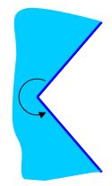 | 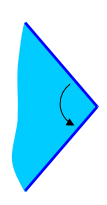 |

以下のロールモードがサポートされています。

- `オフ` – このモードでは、コーナーローリング機能が無効になります。ロール半径はNCプログラムに出力されません。

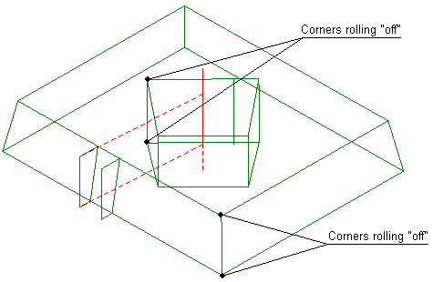

- `シャープ` – このモードでは、下側輪郭のコーナーのみがロールされ、上側のコーナーはロールされません。そのため、`底部半径`の入力フィールドのみが有効になります。

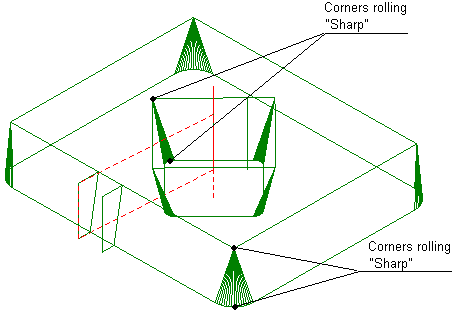

- `円錐形` – このモードでは、下側輪郭のコーナーローリング半径を対応する入力フィールドで設定します。上部輪郭のロール半径は、下側輪郭の半径と、テーパー角および上側輪郭と下側輪郭の高さの差に基づく値との和として定義されます。

```
R上 = R下 ± h · tg α
```

これにより、コーナーローリング部分には円錐面が加工されます。

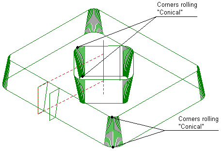

- `円筒形` – コーナーロール半径は、上側高さと下側高さで常に同じになり、 `底部半径`フィールドに入力します。これにより、コーナーローリング部分には円筒面が加工されます。

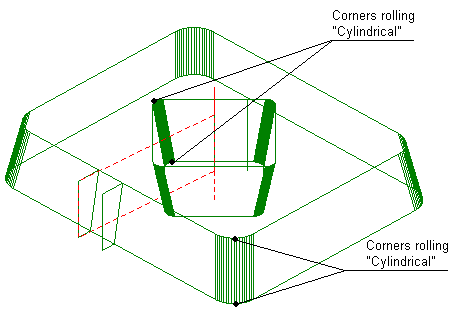

- `固定` – 上側高さと下側高さのロール半径をそれぞれの入力フィールドで個別に設定し、任意の正の値を設定できます。

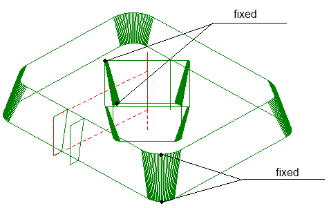

プロパティダイアログの2番目のタブを使用して、各ジョブ割り当て項目の加工方向と加工側を設定します。

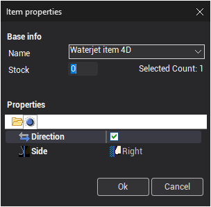

グラフィックウィンドウでは、加工方向が水色の矢印で、加工側が黄緑色の矢印で表示されます。

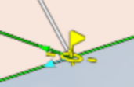

これらのパラメータは、プロパティダイアログで変更するか、グラフィックウィンドウ内の矢印をクリックして変更できます。
