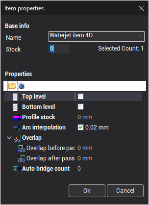

# Proprietà dell'elemento di assegnazione del lavoro 4D

Ogni elemento dell'assegnazione del lavoro dispone di un insieme di proprietà.

Per visualizzare o modificare le proprietà di un elemento dell'assegnazione del lavoro 4D, selezionare l'elemento e fare clic sul pulsante **Properties** (proprietà), oppure fare doppio clic sull'elemento.

Questa è la finestra di dialogo delle proprietà dell'elemento:

Tutte le proprietà sono le stesse delle [proprietà dell'elemento di assegnazione del lavoro 2D](10230.md).

Utilizzare la seconda scheda della finestra di dialogo per impostare la direzione e il lato di lavorazione per ciascun elemento dell'assegnazione del lavoro.

Le proprietà **Direction** (direzione) e **Side** (lato) sono le stesse delle [proprietà dell'elemento di assegnazione del lavoro 2D](10230.md).

- **Swap chains** (scambia le catene) – scambia il livello superiore e quello inferiore.
- **Inverse bottom chain** (inverti la catena inferiore) – inverte la direzione del contorno del livello inferiore.
- **Inverse top chain** (inverti la catena superiore) – inverte la direzione del contorno del livello superiore.
