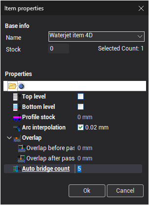
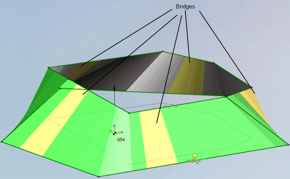
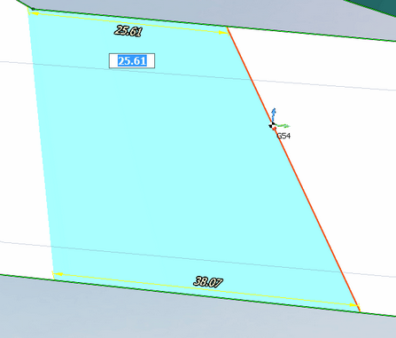

# ブリッジ

ブリッジ は、輪郭自体を加工した後に切削する必要がある輪郭の一部です。

ブリッジは、無効にするか、自動的に設定することができます。ブリッジの数を変更するには、自動ブリッジ回数 プロパティを使用します。

自動ブリッジは、互いに等間隔で配置されます。ブリッジのパラメータは、グラフィックウィンドウで変更します。

ブリッジをクリックし、目的の位置までドラッグします。

ブリッジの大きさは、寸法線で設定するか、ブリッジのエッジをドラッグして必要な長さに調整できます。ブリッジのエッジは同期線です。

同期線はグラフィックウィンドウでコピーおよび削除できます。

コピーするには、対象要素を選択し、 [Ctrl] キーとマウスの左ボタンを押したまま目的の位置にドラッグします。

要素を削除するには、対象をクリックして選択し、 [Del]キーを押します。また、ポップアップパネル上のボタンを使用することもできます。

複数のブリッジを、[複数のパラメータとともに選択](10235.md)することができます。
