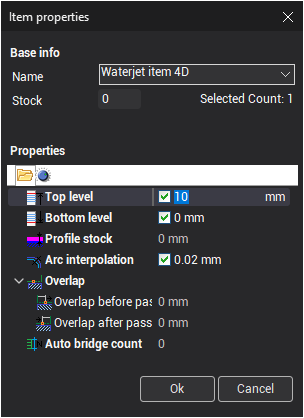

# Funzione di selezione multipla

Utilizzare la barra delle azioni mobile per selezionare gli elementi che hanno attributi comuni. Selezionare un elemento qualsiasi e attivare l'opzione di selezione multipla.

Il pannello a comparsa mostra le proprietà dell'elemento selezionato. Utilizzare le caselle di controllo per filtrare la selezione in base ai valori delle proprietà dell'elemento selezionato. Se una proprietà è spuntata, vengono selezionati solo gli elementi con lo stesso valore di tale proprietà. Ad esempio, per selezionare tutti gli elementi con sovrametallo di 0 mm, selezionare uno di tali elementi e spuntare la proprietà **Profile stock** (sovrametallo del profilo).
