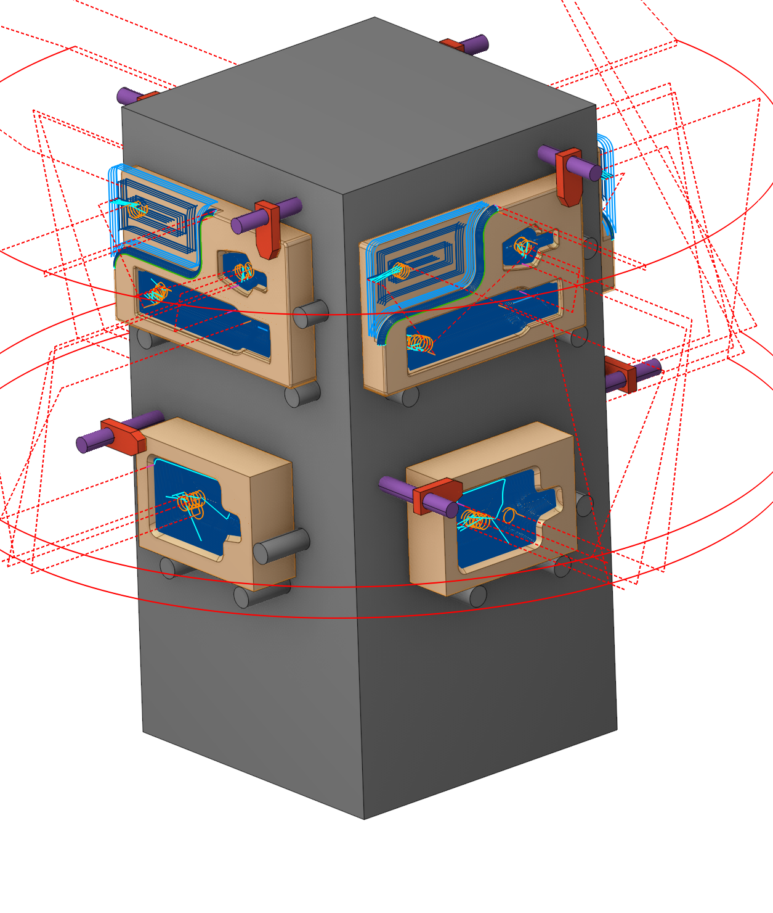
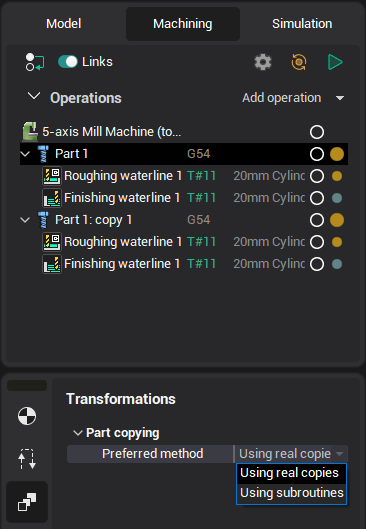
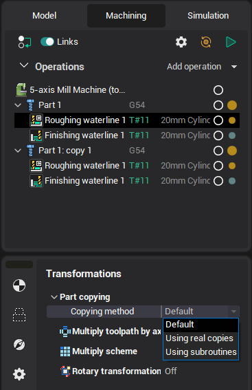

# Cópia da peça

## Área de aplicação:

<strong>Cópia da peça</strong> é um tipo especial de peça simples. Ela foi projetada para preparar projetos com várias peças idênticas. Normalmente, isso é feito com as seguintes etapas:

- Crie a <strong>peça</strong> protótipo. Adicione as operações necessárias para a usinagem.
- Crie a <strong>cópia da peça</strong>. Se o projeto contiver mais de uma peça, a cópia da peça selecionada no momento será usada como protótipo.
- Defina o <strong>posicionamento do bruto</strong> e o <strong>sistema de coordenadas do bruto</strong> da cópia.

A cópia da peça é um grupo de operações sincronizado com o grupo protótipo (peça). Não é possível adicionar ou excluir operações dentro da cópia. Se uma operação for criada/excluída na peça protótipo, a cópia dessa operação será criada/excluída em todas as cópias da peça. A cópia da peça contém cópias especiais das operações. A cópia de operação não calcula o percurso da ferramenta por conta própria. Ela apenas aplica o percurso da ferramenta da operação protótipo à posição da cópia da peça. Portanto, se a operação protótipo for redefinida, todas as cópias dessa operação serão redefinidas. O recálculo das cópias deve ser iniciado manualmente.

É possível gerar a usinagem das cópias como chamadas de sub-rotinas. A forma de saída é definida nos parâmetros da peça protótipo. Antes de usar sub-rotinas, verifique se o seu pós-processador é compatível com elas.

É possível definir parâmetros de cópia individuais para cada operação do grupo.

## Setup:

A guia <strong>Setup</strong> é usada para configurar os parâmetros principais do projeto, como o posicionamento da peça no equipamento, o sistema de coordenadas da peça e outros. [Detalhes](1022.md)

## Transformações:

Conjunto de parâmetros da operação que permite converter as coordenadas do percurso da ferramenta calculado na operação. [Detalhes](10168.md)
