# Strategie für Drahterodieren und 4D-Strahlschneiden

Die Bearbeitungsstrategie wird unter **Parameters → Strategy** eingestellt. Öffnen Sie das Fenster im Modus **Machining** über **Parameters**. Die Registerkarte **Strategy** enthält Bereiche mit Eingabefeldern und erläuternden Abbildungen. Welche Bereiche angezeigt werden, hängt vom aktuellen Operationstyp ab.

Für das Drahterodieren von Konturen stehen folgende Parameter zur Verfügung:

- **Compensation type (Korrekturart).** Legt fest, wie der Drahtversatz gegenüber der vorgegebenen Kontur berücksichtigt wird.

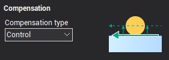

Folgende Korrekturarten stehen zur Verfügung:

- **Computer.** Das CAM-System berechnet die versetzte Drahtbahn. Es werden keine Befehle zum Einschalten der Radiuskorrektur ausgegeben und keine Versatzwerte in die Korrekturregister eingetragen.
- **Control.** Das CAM-System gibt die Befehle zum Einschalten der Radiuskorrektur aus, versetzt die Drahtbahn jedoch nicht. Die Versatzwerte jedes Durchgangs werden in die entsprechenden Korrekturregister eingetragen. Die CNC-Steuerung berechnet die korrigierte Bahn.
- **Both.** Das CAM-System gibt eine bereits versetzte Bahn und zusätzlich Befehle zum Einschalten der Radiuskorrektur aus. Die Korrekturregister werden nicht mit Werten belegt.
- **Reverse Both.** Die Berechnung entspricht **Both**, jedoch wird die Korrekturrichtung umgekehrt.
- **Off.** Die angegebenen Drahtversatzwerte werden nicht berücksichtigt. Es werden weder Korrekturbefehle ausgegeben noch Korrekturregister verwendet.

Der Korrekturwert eines Durchgangs ergibt sich aus **[Offset value](10237.md)** auf der Registerkarte **Feeds/Speeds** zuzüglich des Operationsaufmaßes. Bei **Computer**, **Both** und **Reverse Both** dient er zum Berechnen der äquidistanten Bahn. Bei **Control** wird er in das Register eingetragen, dessen Nummer unter **[Offset code](10237.md)** für den jeweiligen Durchgang auf der Registerkarte **Feeds/Speeds** angegeben ist.

Die Korrekturrichtung kann in der [Auftragszuweisung](10229.md) für jede Kontur separat festgelegt werden.

- **Reverse machining direction (Bearbeitungsrichtung umkehren).** Bei aktivierter Option wählt das System die Durchgangsrichtung mit der kürzesten Werkzeugbahn. Andernfalls gilt die für die Kontur in der [Auftragszuweisung](10230.md) festgelegte Richtung.

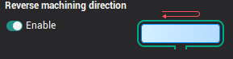

- **Optimize order (Reihenfolge optimieren).** Legt bei mehreren Konturen die Bearbeitungsreihenfolge fest. Bei aktivierter Option werden die Verbindungswege zwischen den Konturen minimiert. Andernfalls werden die Konturen in der Reihenfolge der [Auftragszuweisung](10229.md) bearbeitet.

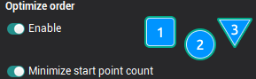

- **Passes before bridges (Durchgänge vor dem Stegtrennen).** Legt die Anzahl der Durchgänge je Kontur vor dem Trennen der Stege fest. Wenn keine Stege vorgesehen sind, bestimmen diese Parameter die Gesamtzahl der Durchgänge. Bei aktiviertem **Perform rough pass** wird je Kontur ein Schruppdurchgang sowie die unter **Finish pass count** angegebene Anzahl von Schlichtdurchgängen ausgeführt. Bei deaktivierter Option entfallen die Schrupp- und Schlichtdurchgänge vor dem Stegtrennen. **[Passes display list](10238.md)** zeigt die daraus resultierende ungefähre Reihenfolge.

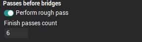

- **Bridges (Stege).** Beim vollständigen Ausschneiden geschlossener Konturen können Werkstückbereiche unkontrolliert herausfallen. Stege sind gezielt unbearbeitet bleibende Abschnitte, die diese Bereiche zunächst halten. Über **[Stop command position](10238.md)** kann vor dem Trennen ein Halt eingefügt werden, damit die ausgeschnittenen Bereiche zusätzlich gesichert werden können. Anschließend werden die Stege automatisch getrennt. Ihre Lage wird in der [Auftragszuweisung](10234.md) für jede Kontur festgelegt. Im Bereich **Bridges** werden die Durchgänge zum Stegtrennen, die anschließenden Nachschlichtdurchgänge und deren Reihenfolge eingestellt. Ist **Enabled** deaktiviert, stehen das Stegtrennen und die anschließende Nachbearbeitung nicht zur Verfügung; alle Felder dieses Bereichs sind deaktiviert.

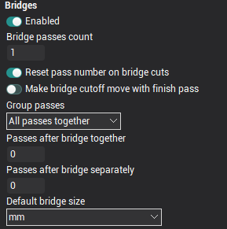

**Bridge pass count** bestimmt die Anzahl der Durchgänge zum Trennen jedes Stegs. Bei aktiviertem **Reset pass number on bridge cuts** beginnt die Nummerierung für die Auswahl der Schnittbedingungen erneut bei dem auf **Feeds/Speeds** unter **[Start pass #](10237.md)** festgelegten Wert. Andernfalls wird die Nummerierung fortgesetzt: War der letzte Konturdurchgang beispielsweise Nummer 2, erhält der erste Stegtrenndurchgang die Nummer 3, der nächste die Nummer 4 usw.

Bei aktiviertem **Make bridge cutoff move with finish pass** wird der Steg im letzten Konturdurchgang getrennt; danach folgt die Abfahrbewegung. Sind mehrere Stegtrenndurchgänge eingestellt, folgen anschließend die weiteren Durchgänge. Bei deaktivierter Option erfolgt nach dem letzten Konturdurchgang zunächst die Abfahrbewegung unter Beibehaltung des Stegs. Der Steg wird erst danach separat getrennt.

**Passes after bridge together** und **Passes after bridge separately** legen zusammen die Anzahl der Nachschlichtdurchgänge entlang der vollständigen Kontur nach dem Stegtrennen fest. Der Unterschied in der Reihenfolge wirkt sich nur bei mehreren Konturen aus. Die folgenden Abbildungen zeigen beide Varianten:

| Reihenfolge bei gemeinsam ausgeführten Nachschlichtdurchgängen | Reihenfolge bei getrennt ausgeführten Nachschlichtdurchgängen |
|---|---|
|  | 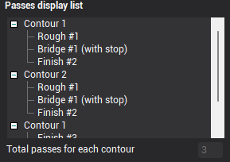 |

In der Liste **Group passes** wird festgelegt, wie die Durchgangsarten bei mehreren Konturen gruppiert werden:

- **All passes together.** Alle Schrupp-, Stegtrenn- und Schlichtdurchgänge einer Kontur werden vollständig ausgeführt, bevor die nächste Kontur beginnt.
- **Bridges and finish together.** Zunächst werden alle Konturen geschruppt. Anschließend werden je Kontur die Stegtrenn- und Schlichtdurchgänge gemeinsam ausgeführt.
- **Rough, bridges and finish separately.** Zunächst werden alle Konturen ohne Stegtrennen geschruppt, danach werden an allen Konturen die Stege getrennt und zuletzt alle Konturen geschlichtet.

Die von den Einstellungen abhängige ungefähre Durchgangsreihenfolge wird in **Passes display list** angezeigt.

- **Passes display list (Durchgangsübersicht).** Diese Informationsanzeige auf der Registerkarte **Strategy** verdeutlicht, wie die Strategieparameter die Bearbeitungsart und -reihenfolge beeinflussen. Änderungen an relevanten Parametern aktualisieren die Anzeige. Die obere Ebene des zweistufigen Baums zeigt die Konturen; darunter stehen die Durchgangsarten und die Nummern zur Auswahl der Schnittbedingungen. Unten wird die Gesamtzahl der Durchgänge je Kontur für die aktuellen Einstellungen angezeigt.

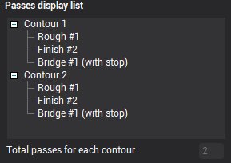

*Hinweis: **Passes display list** dient ausschließlich der Information. Alle Felder sind schreibgeschützt; Änderungen erfolgen über die Strategieparameter im Hauptfenster. Die Reihenfolge ist nur schematisch, da die tatsächliche Geometrie der Auftragszuweisung nicht berücksichtigt wird. Standardmäßig enthält die Liste stets zwei abstrakte Konturen.*

*Hinweis: Stellen Sie sicher, dass **Total passes for each contour** mit der Anzahl der Durchgänge unter **[Feeds/Speeds](10237.md)** übereinstimmt. Bei abweichenden Angaben kann nach der Bearbeitung unerwünschtes Restmaterial an den Konturen verbleiben.*

- **Stop command position (Position des Haltbefehls).** Steuert die Ausgabe von Haltbefehlen beim Stegtrennen. Die Ausgabe erfolgt nur bei aktiviertem **Enabled**. **Before bridges** fügt den Halt nach dem Anfahren des Stegs und vor dessen Trennen ein. **After bridge** fügt ihn nach dem Trennen und vor der Abfahrbewegung zum Drahttrennpunkt ein. Beide Optionen sind unabhängig und können gleichzeitig aktiviert werden.

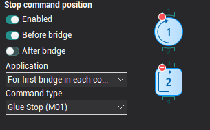

Die Liste **Application** legt fest, für welche Stege die technologischen Halte ausgegeben werden:

- **For every bridge.** Für jeden Steg der Operation.
- **For first bridge in each contour.** Nur für den ersten Steg jeder Kontur.
- **For first bridge in operation.** Nur für den ersten Steg der gesamten Operation.

**Command type (Befehlsart).** Legt die Art des Haltbefehls fest:

- **Glue stop (M01).** Optionaler Halt. Über den entsprechenden Schalter an der CNC-Steuerung entscheidet der Bediener, ob die Programmausführung angehalten wird. Üblicherweise wird dafür `M01` verwendet.
- **Stop (M00).** Unbedingter Halt der NC-Programmausführung, üblicherweise mit `M00`.

- **Correct degenerate frames (Degenerierte Bahnabschnitte korrigieren).** Diese Funktion steht beim [4D-Konturieren durch Drahterodieren](10247.md) zur Verfügung. Einem Abschnitt einer Kontur kann auf der anderen Kontur ein Abschnitt mit sehr geringer Länge oder Länge null entsprechen. Im linken Beispiel fallen die den unteren Kreisbögen zugeordneten oberen Abschnitte auf Punkte zusammen. Viele CNC-Steuerungen können daraus keine korrekte Versatzbahn berechnen, da die erforderlichen geometrischen Informationen fehlen. Dies lässt sich durch manuelles Festlegen von Zuordnungen in der [Auftragszuweisung](10229.md) oder durch die automatische Korrektur vermeiden. Die Korrekturfunktion erkennt sehr kurze Abschnitte und verlängert sie um einen einstellbaren Betrag, wie rechts dargestellt.

| Kontur mit degenerierten Abschnitten | Kontur mit korrigierten Abschnitten |
|---|---|
| 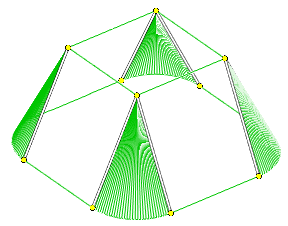 | 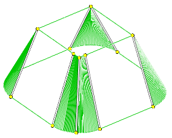 |

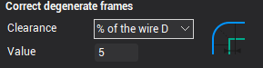

Im Bereich **Correct degenerate frames** wird die Funktion aktiviert und der Verlängerungsbetrag festgelegt. Die Liste **Clearance** bietet folgende Optionen:

- **Off.** Die Korrektur ist deaktiviert.
- **Distance.** Die Korrektur ist aktiviert. Unter **Value** wird der feste Verlängerungsbetrag in der aktuellen Längeneinheit (Millimeter oder Zoll) eingegeben.
- **% of the wire D.** Die Korrektur ist aktiviert. Unter **Value** wird der Verlängerungsbetrag als Prozentsatz des aktuellen Drahtdurchmessers eingegeben.
