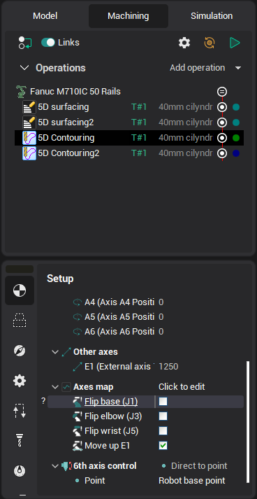

# Bearbeitung mit Industrierobotern

Das CAM-System programmiert Gelenkroboter für Schneiden, Fräsen, Lackieren, Schweißen und weitere Aufgaben. Der Ablauf ähnelt dem einer [Fräsmaschine](10098.md). Roboter besitzen jedoch meist sechs Freiheitsgrade, obwohl zur Ausrichtung eines axialen Werkzeugs fünf genügen. Hinzu kommen gegebenenfalls Rundtische oder Verfahrschienen. Dafür bieten die Operationen zusätzliche Steuerungsparameter.

Dieselbe Werkzeug-Werkstück-Lage kann außerdem mit unterschiedlichen Gelenkstellungen erreicht werden. Die gewünschte Konfiguration wird im Setup unter anderem mit **flip base**, **flip elbow** und **flip wrist** festgelegt.

Dieser Abschnitt behandelt:

[Werkzeug- und Werkstückkoordinatensysteme](10262.md)

[Steuerung der sechsten Roboterachse](10263.md)

[Position der Verfahrachse](10264.md)

[Rundtischprogrammierung](10265.md)

[Vermeidung unerreichbarer Bereiche und Singularitäten](10266.md)

[Roboterverbindungen, früheres Verfahren](10267.md)

Die Funktionen stehen in folgenden [Konfigurationen](10390.md) zur Verfügung:

- Robots
- Master
- Pro
