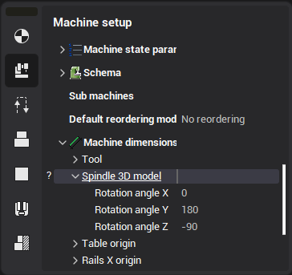
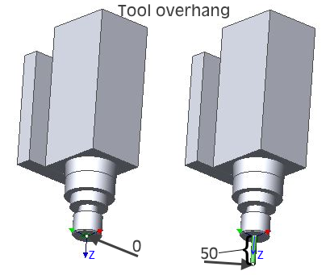
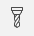
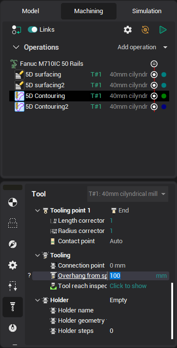
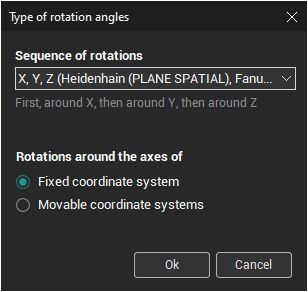
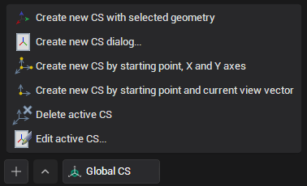
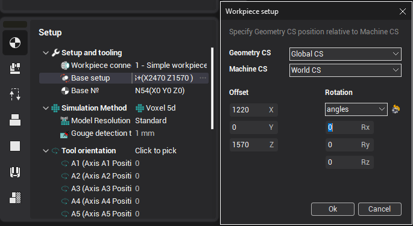
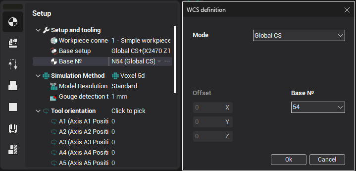

# Impostazione del sistema di coordinate dell'utensile e del grezzo

Nella programmazione di un robot è necessario definire i sistemi di coordinate dell'utensile e del grezzo (il Tool Frame e lo User Frame).

Definizione del sistema di coordinate dell'utensile

Il sistema di coordinate dell'utensile (SC utensile) si definisce specificando l'origine e gli angoli di rotazione dell'SC utensile rispetto al sistema di coordinate della flangia di base del robot, nonché la sporgenza dell'utensile.

1. Impostare la posizione e l'orientamento della testa utensile per il progetto

- Come primo passo, eseguire la calibrazione del sistema di coordinate dell'utensile sul robot reale seguendo le istruzioni del manuale del robot. Assicurarsi che, dopo la calibrazione, il semiasse Z positivo dell'SC utensile sia orientato nella direzione della sporgenza dell'utensile.
- Nel sistema CAM, nella scheda Technology (tecnologia) selezionare il nodo del robot nell'albero del lavoro e, nella scheda Machine setup (configurazione della macchina) dell'ispettore, inserire nei campi `Machine dimensions.Tool` i valori appena ottenuti dalla calibrazione dell'SC utensile (vedere la prima figura qui sotto). I valori degli angoli di rotazione A, B, C (W, P, R) di norma devono essere aggiornati solo quando cambia la configurazione della testa utensile (la testa utensile viene modificata o sostituita).
- Se durante la calibrazione del robot è stato utilizzato un utensile (vedere la seconda figura), inserire la lunghezza dell'utensile nel campo **Tool overhang** (sporgenza dell'utensile); in caso contrario lasciare in questo campo il valore 0.
- I parametri `Spindle 3D model` definiscono la trasformazione aggiuntiva del modello 3D della testa utensile rispetto al sistema di coordinate dell'utensile (a fini di visualizzazione e simulazione). Non influiscono in alcun modo sull'orientamento dell'utensile né sui percorsi utensile risultanti.
- Se si desidera che i valori inseriti vengano usati come valori predefiniti per il robot corrente in tutti i nuovi progetti, occorre modificare il file xml del robot (robot's.xml). Ad esempio:

`X DefaultValue="134.83"/`).

 

2. Impostare la sporgenza dell'utensile per un'operazione

Per ogni nuovo utensile utilizzato nelle operazioni del progetto è necessario specificare la sporgenza dell'utensile. A tale scopo, attivare la scheda **Tool** (utensile)  nell'ispettore dei parametri dell'operazione e fare clic sul parametro **Overhang** (sporgenza), come mostrato nella figura seguente. Nella vista grafica vengono mostrate la sporgenza dell'utensile (la quota di colore verde lime) e le tre coordinate del punto centrale dell'utensile (TCP) nel sistema di coordinate della flangia utensile (X rosso, Y verde, Z blu). Le quote si possono modificare facendo clic su di esse e inserendo i valori da tastiera oppure con la rotellina del mouse. Tutte e quattro le quote sono interdipendenti: quando se ne modifica una, le altre vengono ricalcolate in modo tale che cambi solo la sporgenza dell'utensile.

Diversi modi di definire i sistemi di coordinate

I robot di produttori diversi possono avere modi diversi di definire gli angoli di rotazione del sistema di coordinate. Ad esempio, nei robot Fanuc l'ordine delle rotazioni è prima attorno all'asse X, poi attorno a Y, poi attorno a Z, mentre nei robot KUKA l'ordine delle rotazioni è prima attorno all'asse Z, poi attorno a Y, poi attorno a X.

Nel sistema CAM, per impostazione predefinita viene utilizzato l'ordine di rotazione corretto per il robot specifico; tuttavia, se si desidera usare uno schema di rotazione non standard per definire un sistema di coordinate, è sempre possibile farlo selezionando lo schema di rotazione nella finestra **Type of rotation angles** (tipo di angoli di rotazione), disponibile nelle finestre di dialogo **Definition of new coordinate system**, **Spatial transformations** e **Workpiece setup** premendo il pulsante corrispondente.

Definizione del sistema di coordinate utente del grezzo

Di seguito è descritto il metodo consigliato.

1) Sul robot reale definire il nuovo sistema di coordinate utente specificando tre punti sul grezzo (la maggior parte dei robot supporta questo modo di definire un sistema di coordinate). Il primo punto è l'origine dell'SC, il secondo e il terzo punto specificano le direzioni degli assi X e Y. Come risultato si ottengono l'id (il numero) del sistema di coordinate e i parametri del sistema di coordinate XYZ ABC (WPR, RxRyRz, q1q2q3q4).

2) Nel sistema CAM creare un nuovo sistema di coordinate utilizzando esattamente lo stesso approccio impiegato sul robot reale:

- Creare un nuovo sistema di coordinate selezionando il comando **Creation of CS by setting starting point CS and direction of X and Y axes** (creazione di un SC mediante punto di origine e direzioni degli assi X e Y) e fare clic sui tre punti del modello del grezzo appena utilizzato per definire il sistema di coordinate utente sul robot reale.

- Nella finestra di dialogo **Workpiece setup** (impostazione del grezzo) selezionare il sistema di coordinate appena creato come **Geometrical CS** (SC geometrico). Nei campi della traslazione (Translation) e della rotazione (Rotation) inserire i valori XYZ ABC (WPR, RxRyRz, q1, q2, q3, q4) ottenuti sul robot.
- Nella finestra di dialogo **Workpiece CS** (SC del grezzo) selezionare il sistema di coordinate appena creato per `Mode (way of assignment):`. Inserire nel campo **LCS number** (numero dell'SC locale) il numero del sistema di coordinate che verrà utilizzato nel programma. (Il valore predefinito è 54, perché è il sistema di coordinate standard della maggior parte delle macchine).

Dopodiché la posizione del grezzo e delle attrezzature nel sistema CAM deve riflettere la posizione del grezzo reale rispetto al robot reale.

Si consiglia di impostare il sistema di coordinate utente del grezzo nella radice dell'albero del lavoro (il primo elemento in assoluto, con l'icona e la didascalia del robot nell'albero) anziché nelle operazioni.

3) La posizione del sistema di coordinate utente può essere salvata nel file robot.xml come valore predefinito per i nuovi progetti. Ciò semplifica l'uso successivo del sistema CAM, poiché i modelli dei pezzi importati successivamente verranno collocati in posizioni più prevedibili rispetto al robot.
