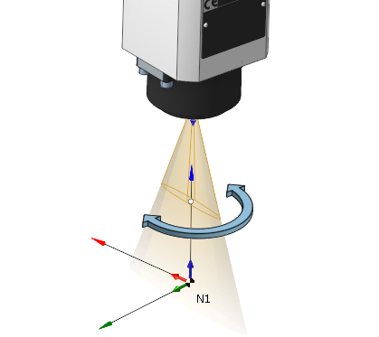
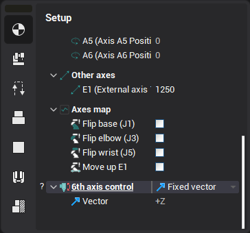
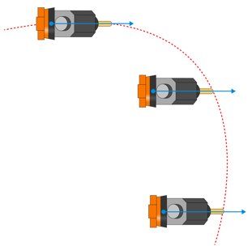
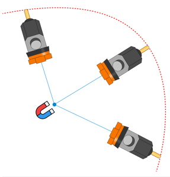
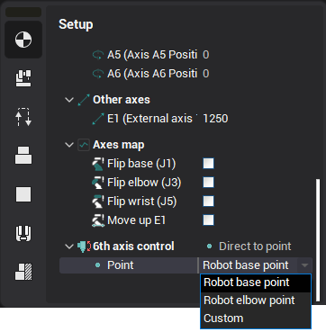
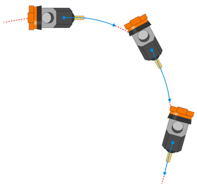
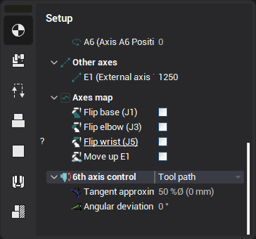

# Sechste Roboterachse programmieren

Zur Positionierung eines rotierenden Werkzeugs relativ zum Werkstück reichen fünf Freiheitsgrade aus. Die meisten Roboter besitzen jedoch sechs. Der zusätzliche Freiheitsgrad am Werkzeugflansch erweitert die Beweglichkeit und den erreichbaren Bereich. Bei festgehaltener Werkzeugposition und -ausrichtung kann eine Änderung des sechsten Gelenkwinkels zu anderen Gelenkstellungen führen und dadurch helfen, kinematische Einschränkungen oder mechanische Kollisionen zu vermeiden.

Das CAM-System bietet zwei Verfahren für die Programmierung der sechsten Achse:

- automatisch;
- manuell.

Die Einstellungen befinden sich im Eigenschafteninspektor der Operation.

Die automatische Steuerung wird über **6th axis control** festgelegt:

- **Fixed vector**;
- **Direct to point**;
- **Toolpath**.

**Fixed vector (Fester Vektor)**

Geben Sie den 3D-Vektor an, entlang dessen die Z-Achse des Werkzeugflansches ausgerichtet wird.

**Direct to point (Zu einem Punkt ausrichten)**

Geben Sie einen 3D-Punkt an, auf den der Werkzeugflanschvektor während der Bearbeitung gerichtet wird.

Als Punkt kann verwendet werden:

- der Roboterbasispunkt;
- der Punkt am Roboterellbogen;
- ein benutzerdefinierter Punkt.

**Toolpath (Werkzeugweg)**

Eine Achse des TCP-Koordinatensystems wird entlang der Tangente des Werkzeugwegs ausgerichtet.

Zusätzlich können **Tangent approximation tolerance** (Toleranz der Tangentenapproximation) und eine konstante Winkelabweichung gegenüber der lokalen Werkzeugwegtangente festgelegt werden.

Für die manuelle Steuerung verwenden Sie die [Roboterachskarte](10266.md), auch als Robot Extra Axes Optimizer bezeichnet. Beide Verfahren können kombiniert werden: Ein automatisches Steuerungsgesetz gilt für den überwiegenden Teil der Bahn; zusätzliche Korrekturen werden in der Achskarte vorgenommen.
