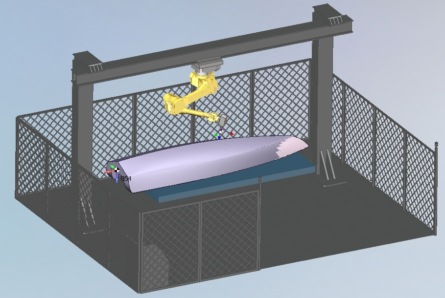
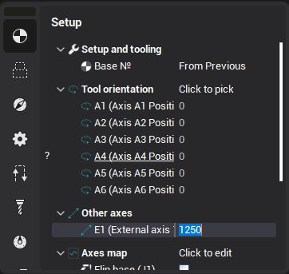

# レール位置のプログラミング

産業用ロボットでは、可動範囲を拡大するために、ロボットをレール上に搭載することがよくあります。CAMシステムにより、最大3台のレールポジショナを同時に制御できます。

ロボットセルの運動学構成に1本または複数のレールが含まれている場合、オペレーションパラメータで、各レールに対して以下のパラメータが使用可能になります。

1.オペレーションにおけるレール初期位置 （図中の「E1」 (External axis 1の位置））

2.レール軸のMove Upモード用チェックボックス (図中の Move up E1 チェックボックス)

Move Up `レール軸`

このモードを有効にすると、加工中に、ロボットはレール上を自動的に移動し、現在の工具中心のプログラミングポイントがロボットベースの原点の真下（または可能な限り近い位置）に来るように調整されます。

注意:

工具中心点をロボットベースの原点の真下に位置することが、常に最適であるとは限りません。この位置では、第1関節の特異点が発生する可能性があります。この場合は、ロボット軸マップでレール位置を調整（追加のシフト量を設定）する必要があります。
