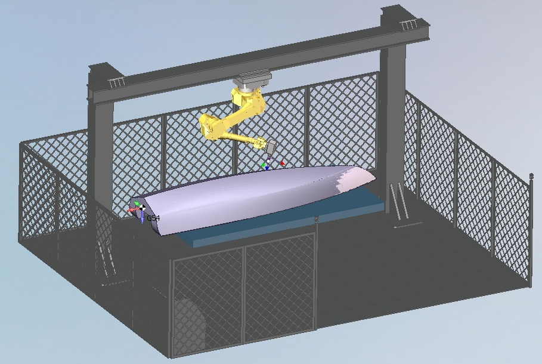
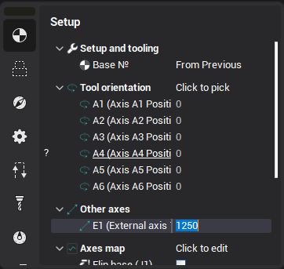

# レール位置のプログラミング

産業用ロボットでは、可動範囲を拡大するために、ロボットをレール上に搭載することがよくあります。CAMシステムにより、最大3台のレールポジショナを同時に制御できます。

2.レール軸のMove Upモード用チェックボックス (図中の Move up E1 チェックボックス)

1. オペレーションにおけるレールの初期位置（図中のE1 (External axis 1 position)）。

2. レール軸のMove Upモードのチェックボックス（図中のMove up E1）。

Move Up レール軸

このモードを有効にすると、加工中に、ロボットはレール上を自動的に移動し、現在の工具中心のプログラミングポイントがロボットベースの原点の真下（または可能な限り近い位置）に来るように調整されます。

注意:

工具中心点をロボットベースの原点の真下に位置することが、常に最適であるとは限りません。この位置では、第1関節の特異点が発生する可能性があります。この場合は、ロボット軸マップでレール位置を調整（追加のシフト量を設定）する必要があります。
