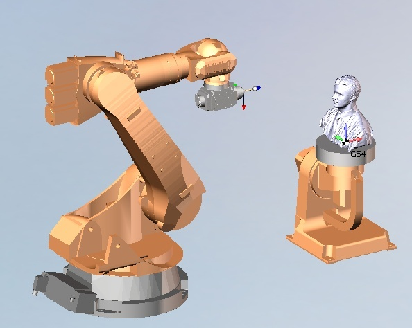
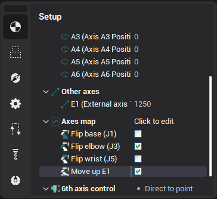
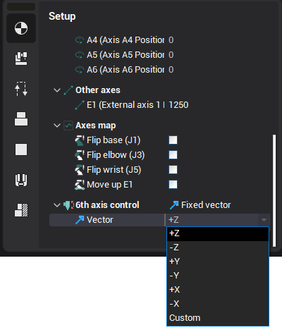
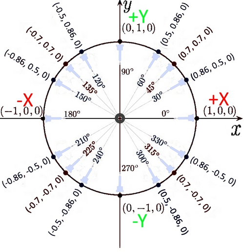

# Rundtisch programmieren

Eine Roboterzelle kann einen Rundtisch mit einer zusätzlichen Drehachse oder einen schwenkbaren Rundtisch mit zwei zusätzlichen Drehachsen enthalten.

Ist ein Rundtisch im kinematischen Schema definiert, stehen in der Operationseinrichtung folgende Parameter zur Verfügung:

1. Ausgangspositionen der Drehachsen für die Operation.
2. Optionen **Rotate** für die Drehachsen.
3. Option **Flip table**.
4. Weitere Parameter zur Rundtischsteuerung.

**Parameter der automatischen Tischdrehung**

Die automatische Tischdrehung dreht den Tisch während der Bearbeitung so, dass sich das Werkzeug stets auf derselben Tischseite befindet. Mit **Rotary table vector** wird diese Seite festgelegt. Der Vektor beschreibt die Richtung von der Werkzeugachse zur Tischmitte im globalen Roboterkoordinatensystem.

Die folgende Abbildung zeigt Vektorbeispiele für verschiedene Winkel.

