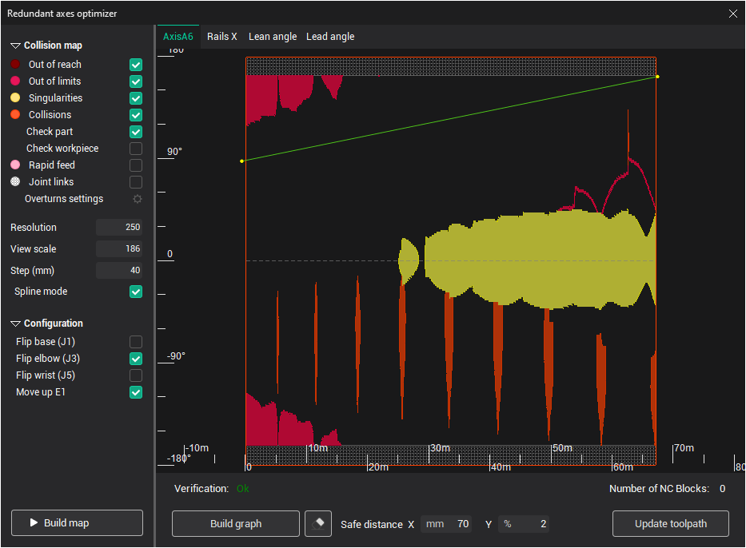
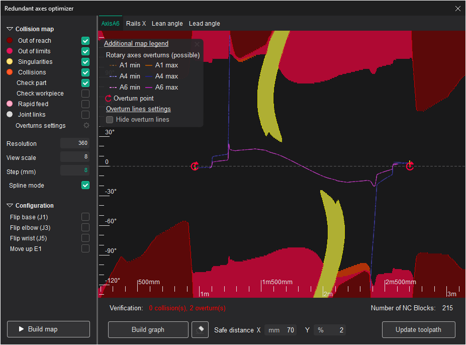
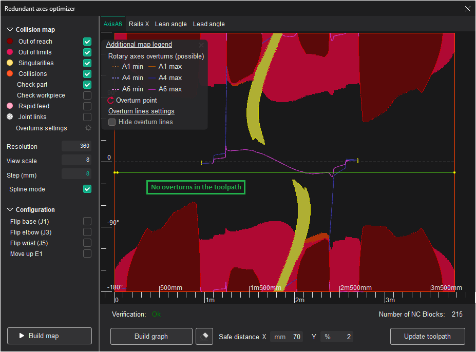
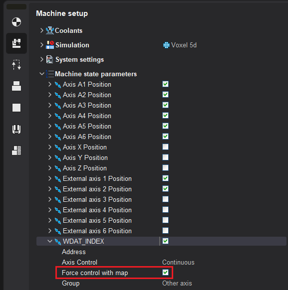
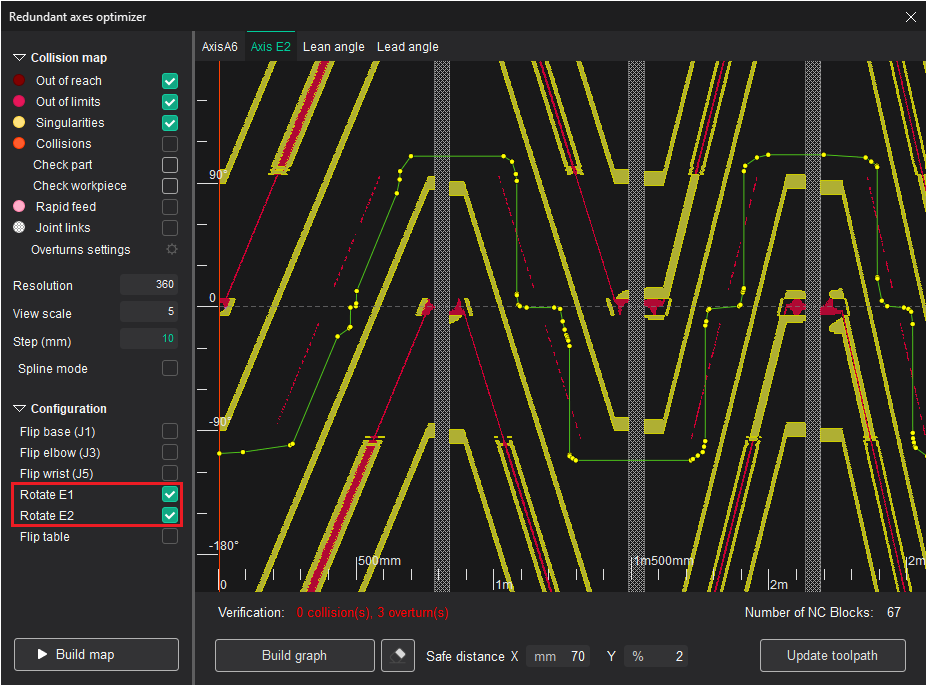
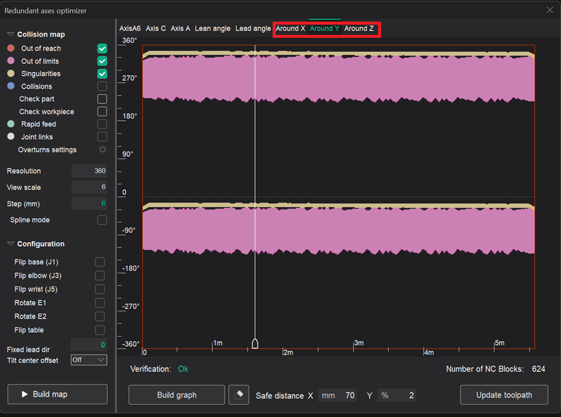
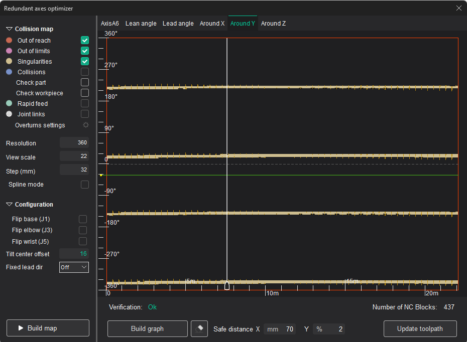
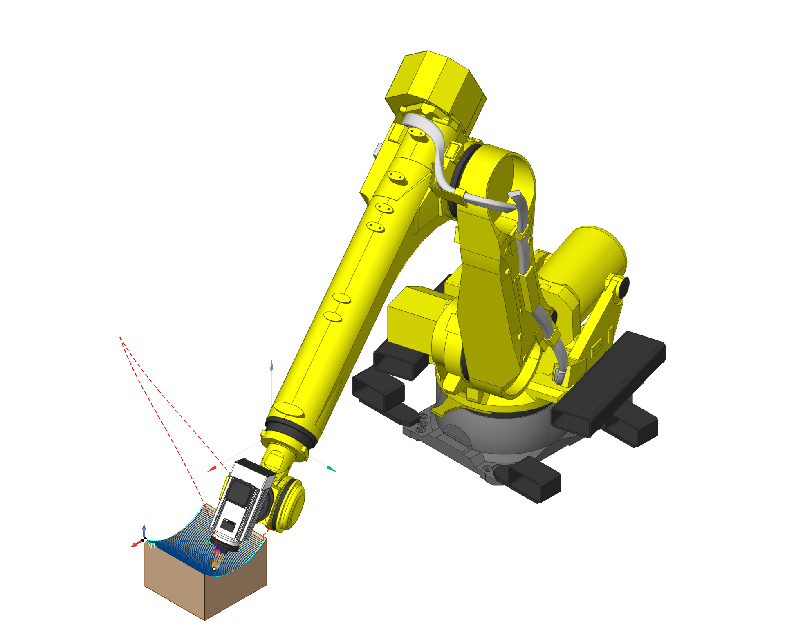
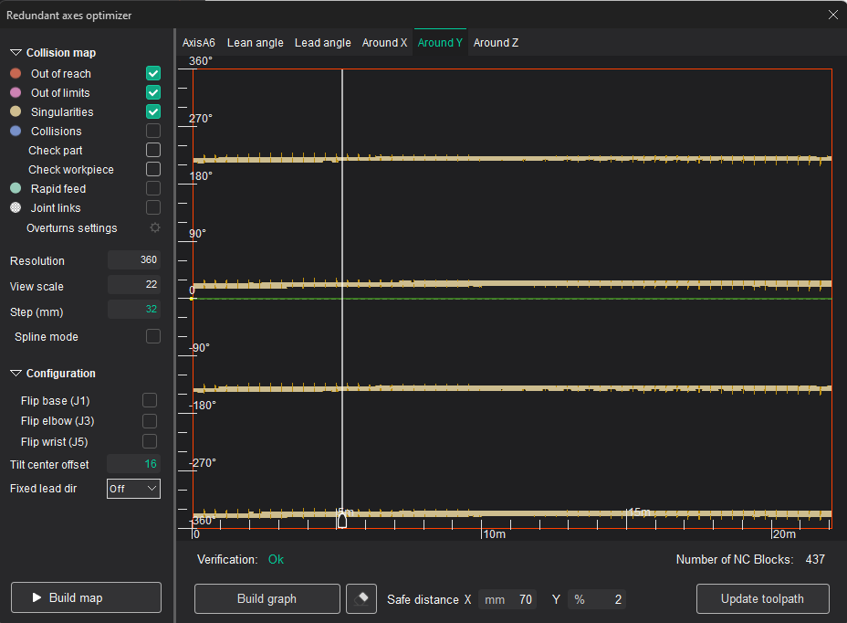
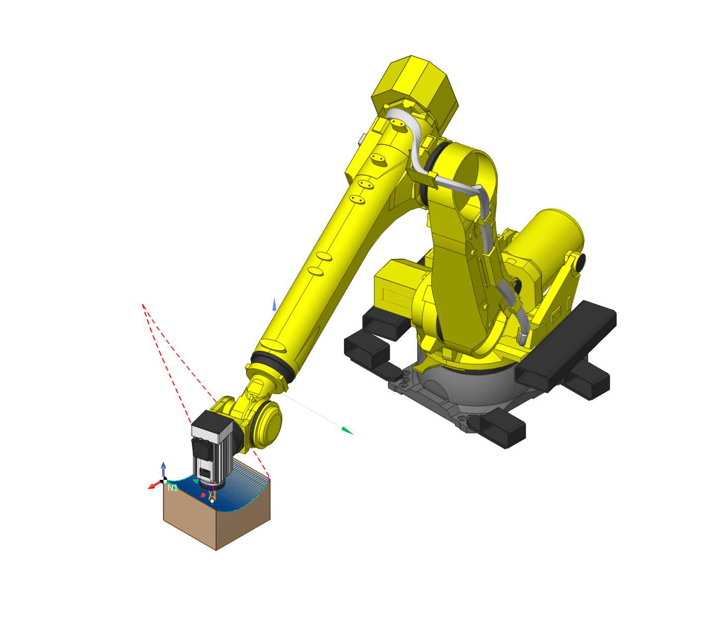

# Mapa dos eixos do robô



## Área de aplicação:

O Mapa de eixos do robô permite definir leis de controle manual e ajustar com precisão as leis de controle automático para os graus de liberdade excessivos de um robô (o 6º eixo, os eixos dos trilhos, os eixos da mesa giratória). O recurso está disponível no Setup da operação, clicando no botão de reticências ao lado do parâmetro Robot axes map.

Os seguintes eixos/parâmetros podem ser controlados por meio do mapa de eixos:

- Eixos externos do robô (mesa giratória ou trilho). Mais precisamente, são os eixos do robô que afetam a posição da ferramenta ou do bruto da operação e não são uma das juntas (eixos A1-A5)
- Eixo A6 do robô
- Ângulo Lead/Lean
- "Eixo C" da máquina de 5 eixos (veja [aqui](10147.md) para obter mais informações)
- Eixo arbitrário da máquina, com o sinalizador especial. Consulte a seção "<em>Controle de parâmetros arbitrários da máquina</em>" para obter mais informações

### Princípio de funcionamento

<strong>Configuração do robô</strong>

Primeiro, escolha a configuração/estado do robô a ser usado na operação. É a mesma configuração/estado que você pode editar no Setup da operação, no parâmetro Robot Axes Map. A configuração do robô é definida pelos "Flips" — as posições alternativas das juntas do robô (base, cotovelo, punho) que permitem a mesma posição da ferramenta em relação ao bruto — e pelos modos de posicionamento dos eixos excessivos, como trilhos e mesas giratórias (Move Up E1, Rotate E2).

#### Eixo otimizado

Na caixa de combinação Optimized Axis, selecione o eixo para o qual você está definindo a lei de controle no momento.

### Mapa de colisão

O mapa de colisão é a representação visual das zonas de colisão no percurso da ferramenta. Ao longo do eixo X está a posição da ferramenta no percurso da ferramenta desde o início, medida em comprimento. Ao longo do eixo Y está o valor do eixo otimizado. Os seguintes tipos de colisões são detectados.

1. As zonas fora de alcance (marrom) são zonas que o robô não pode alcançar.
2. As zonas fora dos limites (roxo) são zonas que o robô pode alcançar, mas alguns dos eixos do robô ficam fora de seus limites definidos.
3. As zonas de singularidade (amarelo) são zonas em que as juntas do robô se movem em velocidades extremas.
4. As zonas de colisão (laranja) são zonas em que as partes do robô colidem umas com as outras ou com o bruto.

A resolução do mapa pode ser definida na caixa Resolution como a quantidade de passos ao longo do eixo Y a ser calculada.

Para criar ou atualizar o mapa, clique no botão Build map.

### Verificar a peça e o bruto

Abaixo da caixa de seleção 'Collisions', há 2 caixas de seleção para especificar se a peça e/ou o bruto são considerados na detecção de colisões. Elas ficam ativas somente se a caixa de seleção principal 'Collisions' estiver definida como 'True'. É recomendável alterná-las de acordo com o tipo de usinagem: corte, usinagem aditiva ou soldagem.


### Spline de controle do eixo

A lei de controle do eixo é definida como uma curva spline. Por padrão, não há spline. Isso significa que o valor do eixo otimizado permanece o mesmo (no modo manual) ou é controlado automaticamente (no modo automático) para todo o percurso da ferramenta (a linha tracejada cinza horizontal).

O objetivo é criar a curva mais suave possível que passe pela zona branca livre de colisões, da esquerda para a direita.

Para criar uma nova spline, clique duas vezes nos pontos do espaço vazio pelos quais a spline deve passar. Dois pontos são suficientes. Depois que a spline for criada, você poderá alterar sua forma arrastando os pontos de controle com o mouse, excluindo pontos de controle (clicando com o botão direito do mouse em um ponto) ou adicionando novos pontos (basta puxar a spline com o mouse).

Use o botão Clear para apagar a spline.

Use o botão Build automatically para construir automaticamente a spline que evita colisões.

Verificação

Nessa área, é exibido o status do percurso da ferramenta atual. Se não houver colisões no percurso da ferramenta, será exibido Ok em verde; se houver colisões, o número de colisões será exibido em vermelho. O status é atualizado sempre que você altera a spline de controle do eixo.

Ao mesmo tempo, na visualização gráfica, as zonas de colisão na curva real do percurso da ferramenta também são marcadas com traços grossos na cor do tipo de colisão correspondente.

Você pode clicar no espaço vazio do mapa de eixos ou mover o mouse mantendo pressionado o botão esquerdo para posicionar a ferramenta na posição correspondente do percurso da ferramenta.

Regenerar percurso da ferramenta

Para aplicar a lei de controle do eixo ao percurso da ferramenta, clique no botão Regenerate toolpath.

### Detecção e prevenção de viradas dos eixos rotativos

É possível usar o mapa de eixos redundantes para verificar possíveis problemas no percurso da ferramenta causados pelas <strong>viradas</strong> (overturns) dos eixos rotativos. As viradas ocorrem quando o eixo rotativo atinge um de seus limites e, para continuar a usinagem, precisa fazer uma rotação completa (360<strong>°</strong>) para frente ou para trás. Nas versões anteriores, nenhuma informação sobre as viradas estava disponível para o usuário porque, apesar da virada, o eixo sempre permanece dentro de seus limites.

As linhas tracejadas claras e as linhas contínuas escuras mostram os possíveis locais de virada no percurso da ferramenta, caso a spline faça interseção com elas. Eixos rotativos diferentes, que podem sofrer viradas, têm cores de linha diferentes. A interseção nem sempre corresponde a uma virada; os locais reais de virada são destacados adicionalmente na spline como pontos vermelhos em negrito com o sinal "overturn". Além disso, se houver viradas no percurso da ferramenta, sua contagem será exibida na barra de status "Verification". Pode haver 2 tipos de viradas:

- a virada ocorre depois que o <strong>mínimo</strong> do eixo é atingido (mostrado com as linhas <strong>tracejadas</strong>)
- depois que o <strong>máximo</strong> do eixo é atingido (linhas <strong>contínuas</strong>)

> Marque a caixa de seleção <strong>Show map legend</strong> para ver as informações de cor/estilo das linhas de virada e outras notações adicionais do mapa

 

<strong>Captura de tela 1</strong>. O percurso da ferramenta contém 2 viradas

<strong>Captura de tela 2</strong>. A spline foi movida para baixo, de modo que não há interseções com as linhas de virada. Como resultado, não há mais viradas no percurso da ferramenta.

Se o percurso da ferramenta da operação contiver viradas, você poderá tentar <strong>evitá-las</strong> movendo a spline de modo que ela não cruze as linhas indicadas ou que as interseções sejam "falsas" (o valor do eixo rotativo ainda não atingiu seu limite nesse ponto, mas é igual ao mín./máx. do eixo módulo 360<strong>°</strong>).

Na captura de tela acima, a spline foi alterada para uma linha reta, que não cruza nenhuma das linhas azuis/roxas, o que permitiu eliminar as viradas no percurso da ferramenta. Alterar a configuração do robô (os parâmetros "Flip elbow", "Flip wrist") também pode ajudar a evitar as viradas.

### Controle de parâmetros arbitrários da máquina

Se você precisar controlar as alterações de um parâmetro arbitrário (definido como eixo no esquema da máquina), poderá ativar o sinalizador <strong>Force control with map</strong> no parâmetro de estado da máquina correspondente.

O sinalizador está disponível para cada parâmetro de estado da máquina na seção <strong>Machine Setup → Machine state parameters</strong> do inspetor. Depois disso, o eixo aparecerá na janela do mapa de eixos e, como de costume, você poderá definir o valor do parâmetro em cada ponto do percurso da ferramenta usando a spline.



Você também pode definir esse sinalizador diretamente no arquivo xml da máquina, no **Machine state parameter** que corresponde ao eixo em questão.

```
                    Ativação do controle de eixo com o mapa em xml
<SCType ID="WDATPOS" Caption="WDAT_INDEX" type="TMachineStateParameter">
	...
	<ControlWithMap DefaultValue="True"/>
</SCType>
```

### Prevenção de singularidade para a mesa giratória de 2 eixos do robô

Anteriormente, se você precisasse definir a trajetória de uma mesa giratória de 2 eixos do robô e ambos os <strong>flips</strong> da mesa giratória estivessem ativados (geralmente chamados de <strong>Rotate E1</strong> e <strong>Rotate E2</strong>), a trajetória resultante poderia conter zonas de singularidade, causando mudanças muito bruscas no estado da mesa giratória. Por isso, nesse caso, o mapa de eixos ativa um modo especial, semelhante ao [Mapa de eixos para máquinas de 5 eixos](10147.md). Nesse modo, você precisa definir a trajetória apenas para um dos eixos da mesa giratória; o valor do outro eixo será calculado automaticamente para minimizar o desvio da normal da ferramenta definida pela operação.

As zonas verticais brancas no mapa correspondem às zonas de singularidade. Usando a spline, você pode definir ali a trajetória do eixo E2 sem mudanças bruscas.



### Rotação do percurso da ferramenta pelo LocalCS no recurso Robot Map.

Permite construir mapas de rotação em relação a um sistema de coordenadas fixo.



Abaixo, um exemplo de rotação do eixo Y.

 

 
