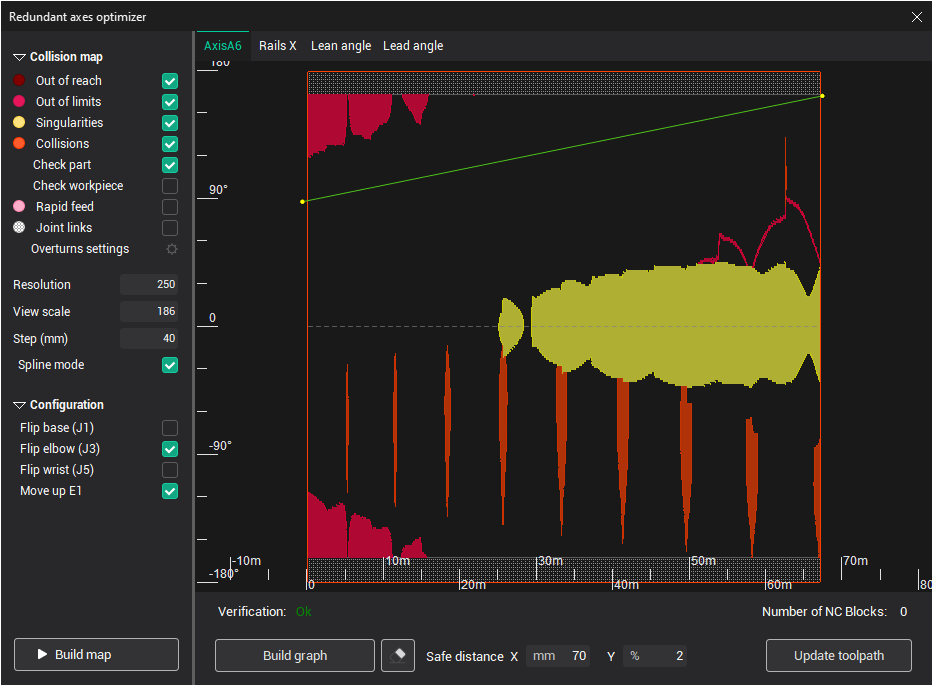
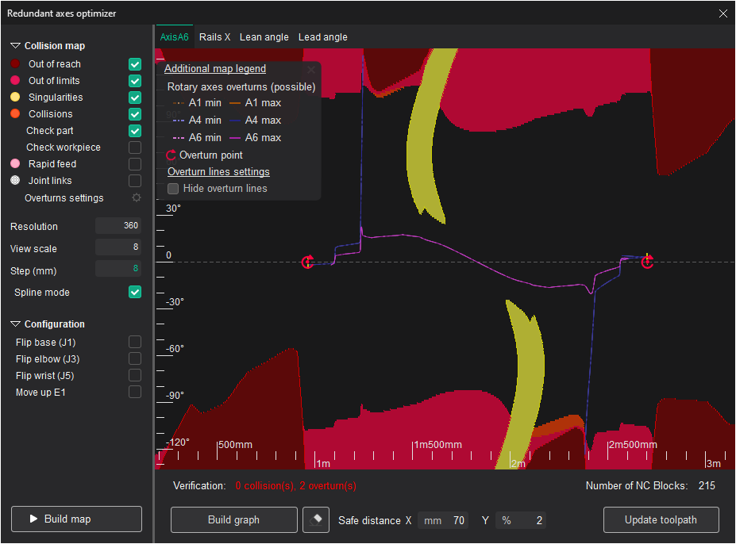
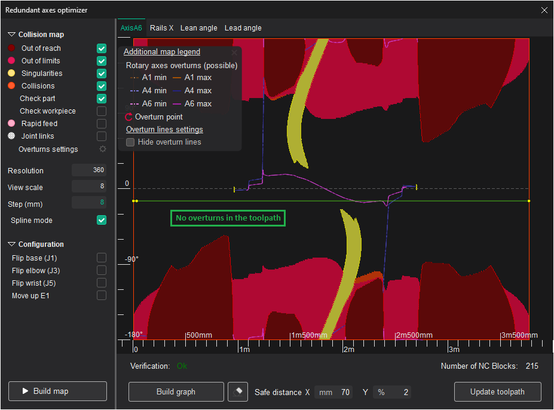
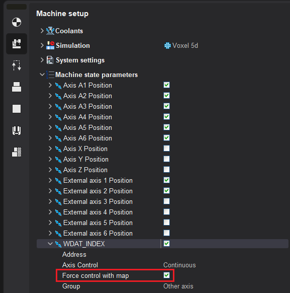
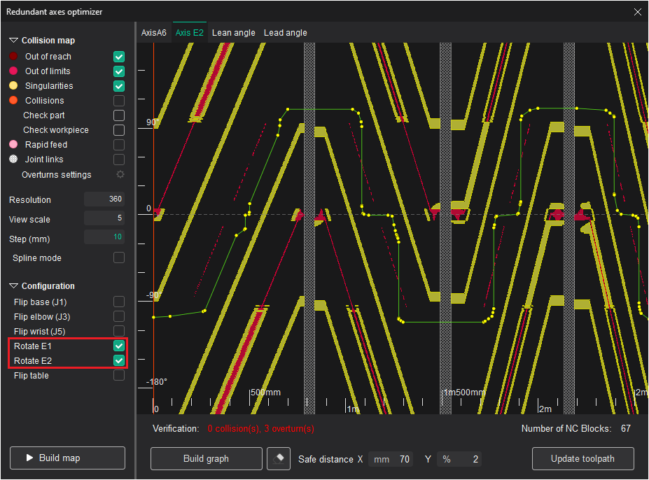
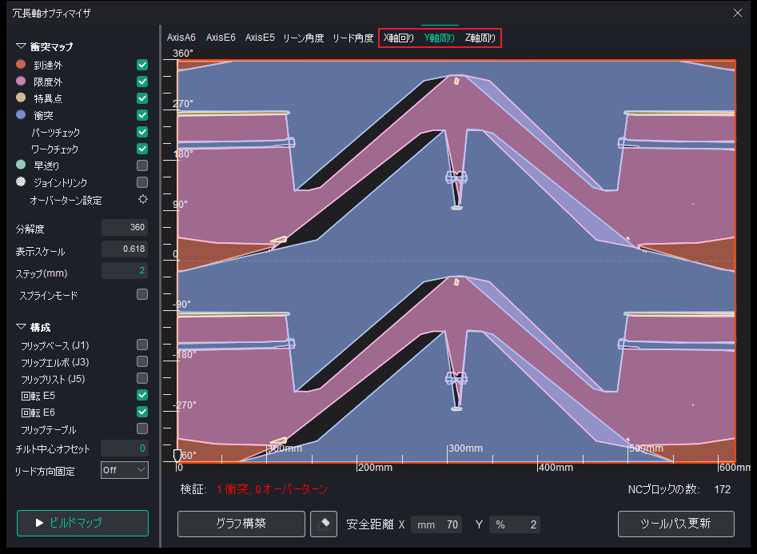
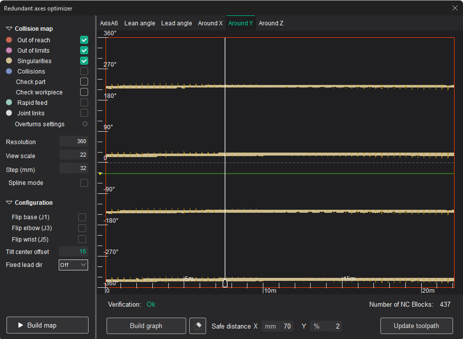
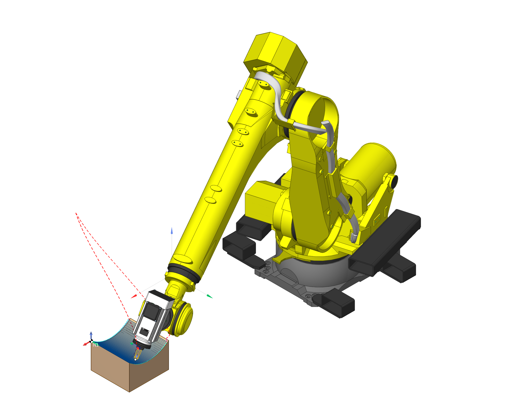
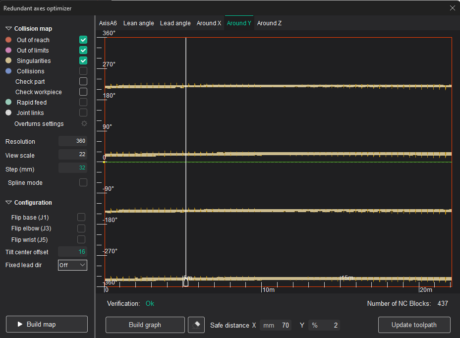
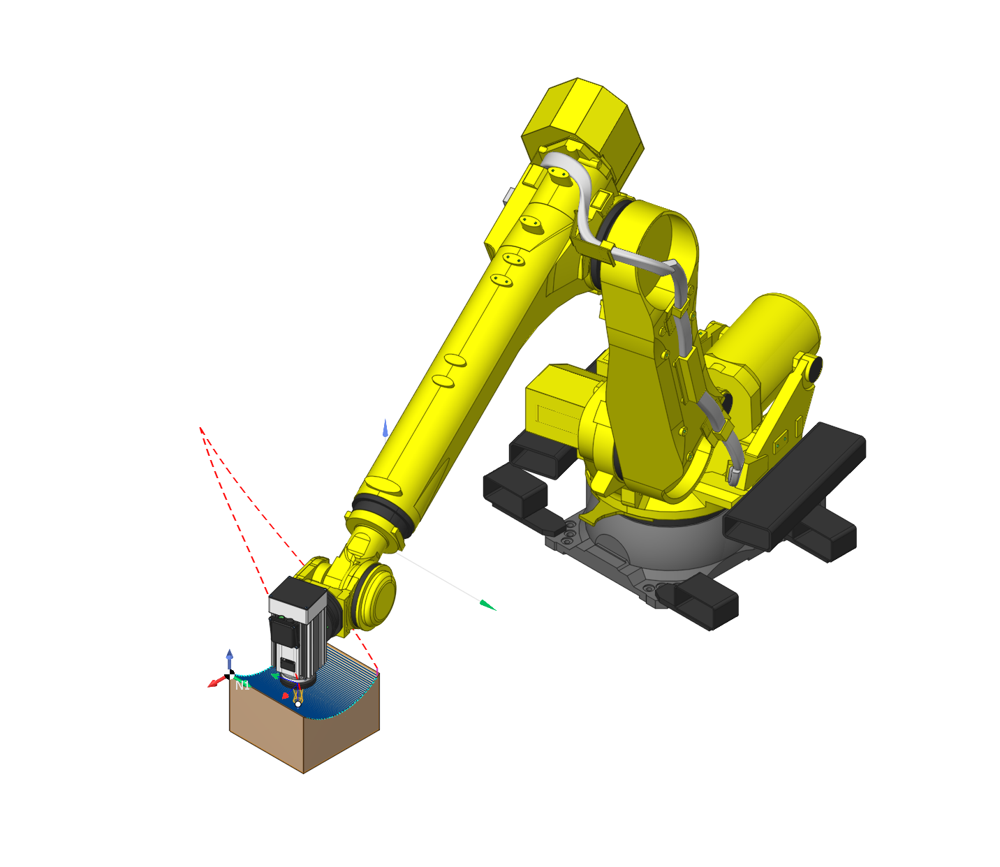

# ロボット軸マップ



## 適用分野：

ロボット軸マップは、ロボットの余剰自由度（第6軸、レール軸、回転テーブル軸）に対して、手動御則の設定および自動制御法則の微調整を行うことができます。この機能は、操作設定内の「ロボット軸マップ」パラメータ横の省略記号（…）ボタンを押すことで使用できます。

軸マップにより、以下の軸/パラメータを制御できます：

- ロボット外部軸（回転テーブルまたはレール）。より正確には、これらはオペレーションにおける工具またはワークの位置に影響を与える軸のうち、かつロボットの関節軸（A1〜A5軸）のいずれにも該当しないロボット軸です。
- ロボットA6軸
- リード/リーン角度
- 5軸マシンの「C軸」（詳細は [こちら](10147.md) を参照）
- 任意のマシン軸 – 特別なフラグ付き 詳細は「<em>任意マシンパラメータ制御</em>」セクションを参照

### 動作原理

<strong>ロボット構成</strong>

まず、オペレーションで使用するロボットの構成/状態を選択する必要があります。これは、操作設定のロボット軸マップパラメータで編集できる構成/状態と同じものです。

ロボットの構成は “フリップ” によって定義されます。これは、ロボット関節（ベース・肘・手首）が取りうる代替姿勢で、工具とワークの相対位置を同じに保つことができます。また、レールや回転テーブルなどの余剰軸の位置決めモード（Move Up E1、Rotate E2）も含まれます。

#### 最適化軸

最適化軸コンボボックスでは、現在制御法則を定義する軸を選択します。

### 衝突マップ

衝突マップは、ツールパス上の衝突加工領域を視覚的に表したものです。X軸は、ツールパス上の開始点からの工具位置を長さで示します。Y軸方向は、最適化軸の値を示します。以下の種類の衝突が検出されます。

1. 到達不能領域（マルーン色）は、ロボットが到達できない領域です。
2. リミット超過領域（パープル色）は、ロボットが到達できますが、ロボットのいずれかの軸が設定された制限範囲を超える領域です。
3. 特異点領域（黄色）は、ロボットの関節が極端な速度で動く領域です。
4. 衝突領域（オレンジ色）は、ロボットの部位が互いに、またはワークと衝突する領域です。

マップの解像度は、解像度ボックスで、Y軸方向に計算されるステップ数として設定できます。。

マップを作成または更新するには、マップ作成ボタンを押します。

### パーツとワークチェック

衝突チェックボックスの下には、パーツとワークをそれぞれ衝突検出の対象に含めるかどうかを指定する 2 つのチェックボックスがあります。これらは、親項目である'衝突' チェックボックスが 'True' に設定されている場合にのみ有効になります。 切削、付加加工、溶接など、加工の種類に応じてこれらを切り替えることを推奨します。


### 軸制御スプライン

軸制御則は、スプライン曲線として定義されます。デフォルトではスプラインはありません。これは、ツールパス全体にわたって、最適化軸の値が一定を維持する（手動モードの場合）か、自動的に制御される（自動モードの場合）ことを意味します（水平の灰色の破線で表示されます）。

目標は、衝突のない白色の領域を左から右へ通過する、できるだけ滑らかな曲線を作成することです。

新しいスプラインを作成するには、スプラインを通過させる空白領域内の点をダブルクリックします。2点あれば十分です。スプラインの作成後、スプラインの制御点をマウスでドラッグ、制御点を削除（点を右クリック）、または新しい点を追加（スプラインをマウスでドラッグ）することで、スプラインの形状を変更することができます。

スプラインを消去するには、クリアボタンを使用します。

衝突を回避するスプラインを自動的に作成するには、自動作成ボタンを使用します。

検証

このエリアには、現在のツールパスのステータスが表示されます。ツールパスに衝突がない場合は、緑色で 'Ok' り表示されます。衝突がある場合は、赤色で衝突の数が表示されます。軸制御スプラインを変更するたびに、ステータスは更新されます。

同時に、グラフィックビューでは、実際のツールパス曲線上の衝突領域も、該当する衝突タイプの色の太い線で表示されます。

ツールパスの対応する位置に工具を配置するには、軸マップの空白の領域をクリックするか、マウスの左ボタンを押したままマウスを動かします。

ツールパスの再生成

軸制御法則をツールパスに適用するには、ツールパス再生成ボタンをクリックします。

### 回転軸の反転検出と回避

冗長軸マップを使用して、回転軸の <strong>オーバーターン</strong>によってツールパスに発生する可能性のある問題を確認できます。オーバーターンは、回転軸のいずれかが限界に達し、加工を継続するために前方または後方に 1 回転 (360<strong>°</strong>) する必要がある場合に発生します。以前のバージョンでは、オーバーターンが発生しても、軸自体は常に制限範囲内に収まっていたため、オーバーターンに関する情報はユーザーに提供されませんでした。

薄い破線と濃い実線は、スプラインが交差した場合に、ツールパス上でオーバーターンが発生する可能性のある位置を示します。オーバーターンが発生する可能性のある回転軸ごとに線の色が異なります。交点の位置と、実際にオーバーターンが発生する位置は必ずしも一致しません。実際のオーバーターン位置は、スプライン上に“オーバーターン” マークが付いた太い赤色の点として追加表示されます。また、ツールパスにオーバーターンがある場合、その数が「検証」ステータスバーに表示されます。

オーバーターンには2種類あります：

- 軸が <strong>最小</strong>値に達した後にオーバーターンが発生する場合（<strong>破線</strong>で表示）。
- 軸が <strong>最大</strong>値に達した後にオーバーターンが発生する場合（<strong>実線</strong>で表示 ）。

> >
> <strong>マップ凡例を表示</strong>」チェックボックスを切り替えることで、オーバーターンを示す線の色・スタイル情報、およびその他のマップ上の補助表示を確認できます。

 

<strong>スクリーンショット 1</strong> ツールパスには2つのオーバーターンが含まれています。

<strong>スクリーンショット 2</strong> スプラインを下方向に移動したため、オーバーターン・ラインとの交差がなくなりました。その結果、ツールパスのオーバーターンはなくなりました。

オペレーションのツールパスにオーバーターンが含まれている場合は、スプラインを移動して該当するラインと交差しないようにするか、交差が ‘フェイク’（見かけ上）のものになるようにすることで、オーバーターンを<strong>回避</strong> できる場合があります。（その位置では回転軸の値が制限値にまだ達していないが、 360° 周期で換算すると、その軸値が軸の最小値/最大値と一致する場合）

上のスクリーンショットでは、スプラインを直線に変更し、青色／紫色のラインといずれも交差しないようにしたため、ツールパス上のオーバーターンを回避できました。また、ロボットの構成（"Flip elbow"、"Flip wrist "パラメーター）を変更することも、オーバーターンの回避に役立つ場合があります。

### 任意機械パラメータ制御

任意のパラメータ（マシンスキーマで軸として定義されているもの）の変化を制御する必要がある場合は、対応するマシン状態パラメータで"<strong>マップによる強制制御</strong>"フラグを有効にできます。

このフラグは、インスペクターの「<strong>マシン設定 → マシン状態パラメータ</strong>」セクションにある各マシン状態パラメータで使用できます。これを有効にすると、その軸が軸マップウィンドウに表示され、通常どおりスプラインを使用して、ツールパス上の各点におけるパラメータ値を設定できます。



また、マシンのxmlファイル内で、対象となる軸に対応する`マシン状態パラメータ`</strong>に、このフラグを直接設定することもできます。

```
                    XMLでマップによる軸制御を有効化
<SCType ID="WDATPOS" Caption="WDAT_INDEX" type="TMachineStateParameter"> 	... 	<ControlWithMap DefaultValue="True"/> </SCType>
```

### ロボットの 2軸回転テーブルにおける特異点回避

従来は、ロボットの2軸ロータリーテーブルの軌道を定義する必要があり、ロータリーテーブルの両方の <strong>フリップ</strong> (一般的に"<strong>Rotate E1</strong>"と"<strong>Rotate E2</strong>"という名前)が有効になっている場合、生成される軌道に特異点領域が含まれ、ロータリーテーブルの状態が非常に急激に変化することがありました。そのため、この場合は、[5軸加工機用軸マップ](10147.md)と同様の特殊モードが軸マップで有効になります。このモードでは、回転テーブル軸の一方の軸についてのみ軌跡を定義すればよく、もう一方の軸の値は、オペレーションで定義された工具法線からの偏差が最小になるように自動計算されます。

マップ上の白色の縦の領域は、特異点領域に対応します。スプラインを使用することで、急激な変更が生じないように E2軸の軌道を定義できます。



### ロボットマップ機能で、ツールパスを ローカルCS 基準で回転

固定座標系を基準とした回転マップを作成することができます。



以下は、Y軸を回転させた例です。

 

 

<strong>詳細を見る</strong>:

[5軸加工機用軸マップ](10147.md)
