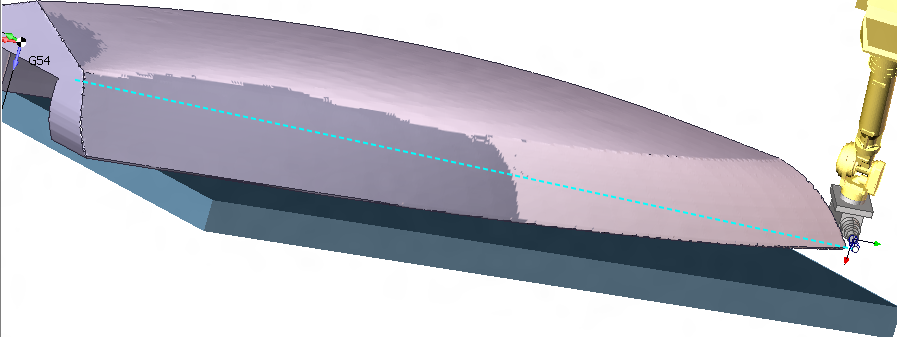
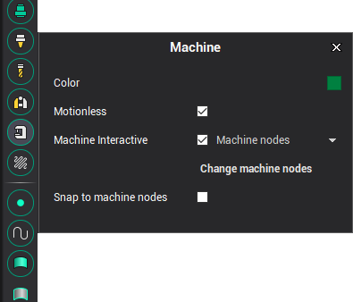
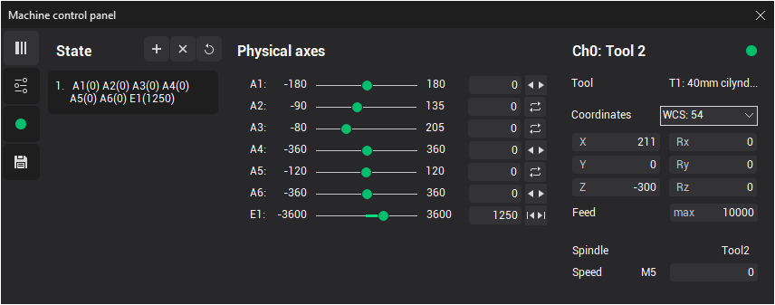
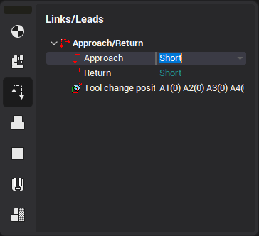
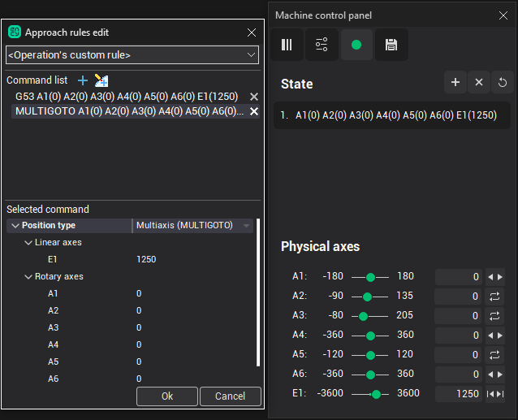

# Programmazione delle transizioni del robot (metodo obsoleto)

La programmazione delle transizioni del robot tra le operazioni si effettua specificando i punti di avvicinamento (Approach) e di ritorno (Return) nell'Operation Setup (impostazione dell'operazione). Ciò si può fare semplicemente tramite la [barra degli strumenti di modifica dei movimenti](353.md) in modalità simulazione.

Si consideri il seguente esempio.

Dopo il calcolo delle operazioni, la simulazione ha rivelato che la transizione tra due operazioni causa un'intaccatura del pezzo. Per modificare la transizione occorre formare l'elenco dei punti intermedi attraverso cui passerà il robot.

Il modo migliore per farlo è utilizzare il pannello di controllo della macchina (Machine control panel).

Prima, però, verificare che la modalità [Machine](10009.md) [Interactive](10009.md) (macchina interattiva) sia attivata.

Nella scheda **Simulation** selezionare l'ultimo comando della prima operazione (5D Contouring), come mostrato nell'immagine seguente. Per definire il primo punto di controllo, trascinare l'utensile con il mouse nella posizione desiderata.

Premere quindi il pulsante **States panel visibility** nel [pannello di controllo della macchina](10008.md) per salvare la posizione in memoria.

Ripetere poi le fasi per memorizzare i restanti punti intermedi della transizione.

Passare quindi alla scheda **Technology**, attivare la prima operazione (5D Contour) nell'albero delle lavorazioni e selezionare `Custom...` nell'elenco a discesa del parametro Return dell'Operation Setup, come mostrato nell'immagine seguente.

Verificare che il **Machine control panel** sia aperto. Selezionare nel pannello di controllo della macchina il primo punto di controllo memorizzato. Il robot deve posizionarsi nello stato memorizzato. Premere quindi il pulsante **Add current state** nella finestra `Approach/return points list edit` per aggiungere la posizione corrente del robot come punto intermedio di ritorno, come mostrato nell'immagine seguente.

Se i valori esatti degli assi non sono importanti, i punti di controllo possono essere aggiunti direttamente senza formare l'elenco.

Allo stesso modo si può definire la sequenza di avvicinamento della seconda operazione (5d Contouring2).
