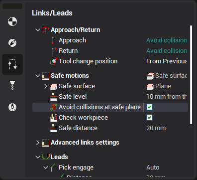
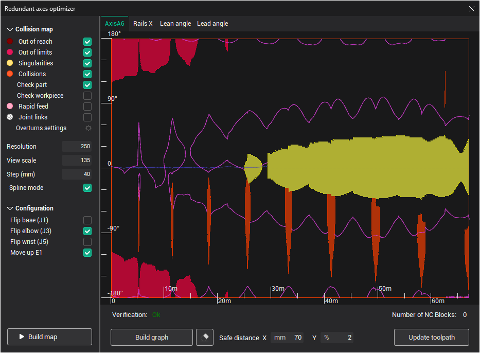
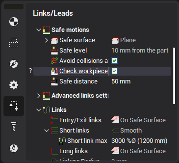
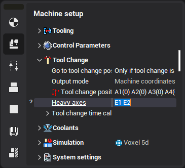

# リンクの計画

CAMシステムは衝突回避アルゴリズムを使用して、オペレーション間およびオペレーション内の早送りツールパスを計画します。このアルゴリズムは、機械ノード間の衝突チェックに基づいているため、ロボットセルの正確な記述が必要です。

オペレーション内でアルゴリズムを有効にするには、 <strong>安全平面での衝突回避</strong> をオンにします。「<strong>リンク安全距離</strong>」 パラメータでは 、衝突までの最小許容距離を定義します。この値は最小限でありながら十分である必要があります。値が小さすぎると、ツールパスの安全性が十分に確保されません。安全距離が長すぎると、リンクを生成できないか、計算時間が許容できないほど長くなります。

## 対応操作

このオプションは現在、以下のオペレーション（および意図的に無効化されていない場合は、それらから派生したオペレーション）のロボットでのみ使用可能できます。

- [モーフ加工](10138.md)
- [ロータリー仕上げ](10136.md)
- [5Dサーフェシング加工](10135.md)
- [5D輪郭と6D輪郭操作](10129.md)
- [5D、6D溶接](10271.md)
- [5Dメッシュ加工](10142.md)

## リンクの開始点と終了点

リンクの開始点と終了点が衝突しない場所に配置されていることを確認することが重要です。そうでないと、不正なツールパスが生成されます。 これは、余剰軸オプティマイザを使用して行うことができます。マップの灰色の領域は、リンクに対応しています。これらの領域には制限は表示されません。したがって、スプラインはすべての衝突を回避する必要があります。

## ワークの衝突

デフォルトでは、このアルゴリズムは衝突チェックを行う際、部品のみを考慮します。工具（または機械本体）とワークの衝突回避を有効にするには、'<strong>チェックワーク</strong>オプションを使用します。

## 軸移動を除く

衝突回避アルゴリズムは、開始点から終了点までの経路探索において、機械のすべての軸を使用します。特定の軸の動きを除外または最小化したい場合は、該当する軸を機械の〈重い軸〉リストに登録する必要があります。

リンクで重い軸の動作が必要な場合、移動は次の3段階で実行されます。： 最初に工具交換位置への移動、その後に重い軸の動作、最後に終了点への移動が行われます。

