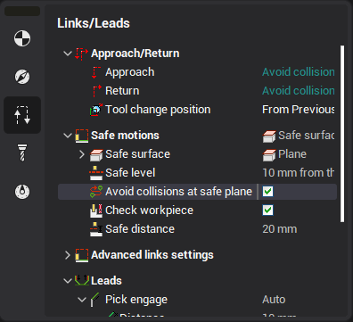
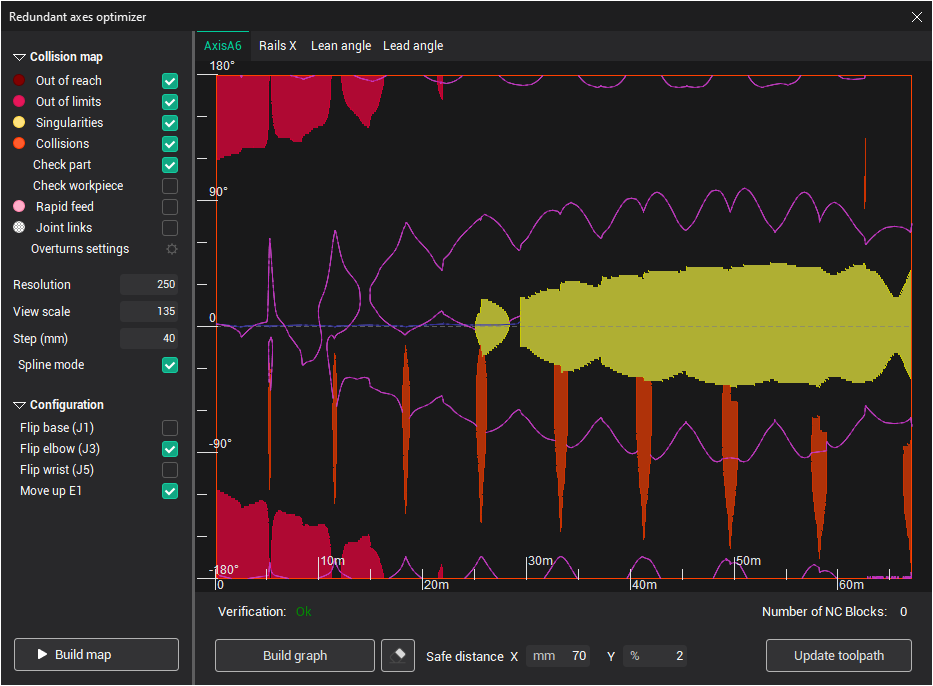
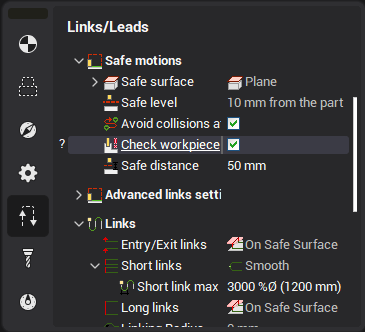
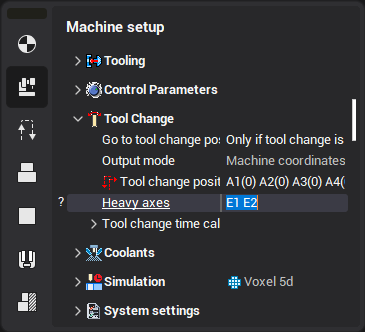

# Planejamento das ligações

O sistema CAM usa o algoritmo de prevenção de colisões para planejar o percurso da ferramenta em avanço rápido entre as operações e dentro delas. O algoritmo exige uma descrição confiável da célula robótica, pois se baseia na verificação de colisões entre os nós da máquina.

Ative <strong>Avoid collisions at safe plane</strong> para ativar o algoritmo dentro da operação. O parâmetro <strong>Links safe distance</strong> define a distância mínima permitida até a colisão. Esse valor deve ser o menor possível, porém suficiente. Se for pequeno demais, o percurso da ferramenta não será suficientemente seguro. Se a distância de segurança for grande demais, a ligação não poderá ser construída ou o tempo de cálculo será inaceitável.

## Operações suportadas

Atualmente, essa opção está disponível apenas para robôs, nas seguintes operações (e nas operações derivadas delas, se não tiver sido desativada intencionalmente):

- [Morph](10138.md)
- [Acabamento rotativo](10136.md)
- [Usinagem de superfícies 5D](10135.md)
- [Contorno 5D e contorno 6D](10129.md)
- [Soldagem 5D e soldagem 6D](10271.md)
- [5D por malhas](10142.md)

## Pontos inicial e final da ligação

É importante garantir que os pontos inicial e final de uma ligação estejam fora de colisão; caso contrário, será gerado um percurso da ferramenta incorreto. Isso pode ser feito com o otimizador de eixos adicionais. As zonas em cinza do mapa correspondem às ligações. As restrições não são mostradas nessas zonas. Portanto, a spline precisa evitar todas as colisões.

## Colisões com o bruto

Por padrão, o algoritmo considera apenas a peça ao verificar colisões. Para ativar a prevenção de colisões entre a ferramenta (ou a máquina) e o bruto, use a opção <strong>Check workpiece</strong>.

## Exclusão do movimento de eixos

O algoritmo de prevenção de colisões usa todos os eixos da máquina para procurar o caminho do ponto inicial ao ponto final. Para excluir ou minimizar os movimentos de alguns eixos, esses eixos devem constar na lista de eixos pesados da máquina. Se a ligação exigir movimento dos eixos pesados, ela será executada em três etapas: primeiro, o movimento até a posição de troca da ferramenta; depois, o movimento dos eixos pesados; e, em seguida, o movimento até o ponto final.

