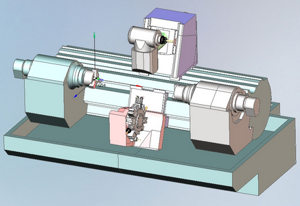
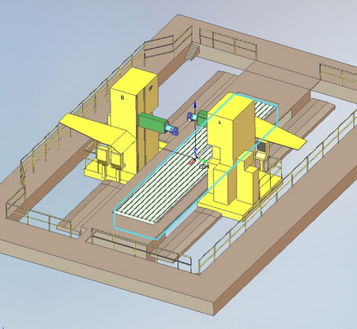
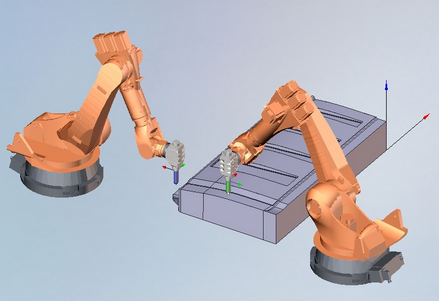
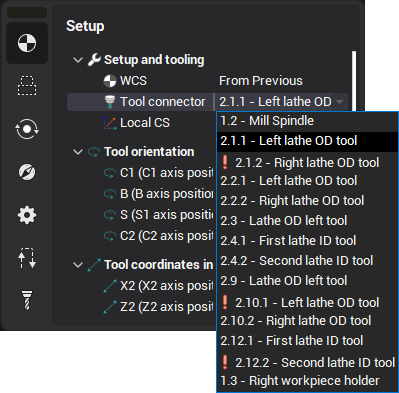
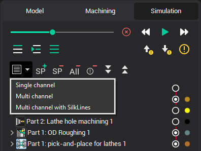
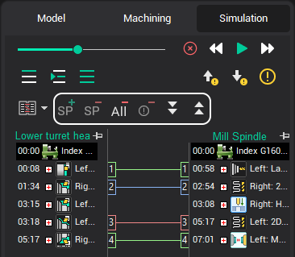
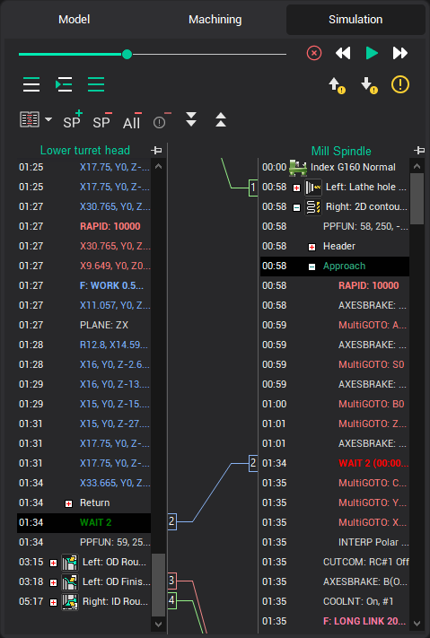

# Lavorazione multitask

Le macchine multitask (MTM) consentono di lavorare con più utensili contemporaneamente. Le MTM possono essere molto diverse tra loro. Ad esempio, un centro di tornitura-fresatura multitask dispone di più mandrini e/o teste a torretta all'interno di un unico corpo macchina. A volte una macchina multitask è costituita da due o più macchine identiche che lavorano sullo stesso grezzo.

| centro di tornitura-fresatura multitask |  |
|---|---|
| fresatrice multitask |  |
| due robot che lavorano insieme |  |

Nella lavorazione multitask ogni utensile è controllato da un proprio programma. Tale programma è detto canale di controllo. La macchina multitask dispone quindi di più di un canale. A volte il compito di programmare una macchina multitask può essere ricondotto alla creazione di progetti separati e indipendenti per ciascun canale. Questo approccio semplificato non è accettabile se occorre tenere conto in un canale dei risultati di un altro canale, oppure se i canali lavorano insieme nello stesso punto.

Il sistema CAM consente di programmare macchine multicanale. Per attivare queste funzioni è necessario [caricare lo schema cinematico](341.md) della macchina multicanale. Il pacchetto standard comprende lo schema per il centro di tornitura-fresatura multicanale Index G160 e lo schema per la fresatrice doppia FPT. Sono sufficienti per provare il sistema CAM. Se serve lo schema della propria attrezzatura, rivolgersi al proprio rivenditore.

Nella pagina "Technology" il processo di programmazione della macchina multicanale è identico a quello di una macchina monocanale. L'utente deve tenere presente che la definizione del portautensile dell'operazione determina il canale di lavorazione. L'utente deve fare in modo che il tempo di lavorazione sia uguale per ogni canale.

Nella pagina "Simulation" per le macchine multitask è presente il pulsante per scegliere la modalità di simulazione:

In modalità monocanale la simulazione viene eseguita in sequenza, operazione per operazione. In questa modalità è comodo analizzare il percorso utensile di una singola operazione senza preoccuparsi degli altri canali.

In modalità multicanale la simulazione viene eseguita contemporaneamente in ogni canale, come avverrebbe sulla macchina reale. In questa modalità è comodo verificare la presenza di collisioni tenendo conto dei movimenti in tutti i canali. Le collisioni rilevate possono essere eliminate aggiungendo punti di sincronizzazione.

La modalità multicanale con Silk lines è comoda per aggiungere, rimuovere e modificare i punti di sincronizzazione.

Punti di sincronizzazione

Il punto di sincronizzazione sospende l'esecuzione di un canale finché un altro canale non raggiunge un determinato blocco. In molti CNC i punti di sincronizzazione sono codificati con codici M. Se, ad esempio, M500 indica il punto di sincronizzazione, esso deve essere scritto in più di un canale. Il canale che raggiunge per primo M500 sospende l'esecuzione e attende che l'altro canale raggiunga lo stesso punto di sincronizzazione. Dopodiché entrambi i canali iniziano a eseguire insieme i comandi successivi.

I pulsanti seguenti servono a inserire o rimuovere i punti di sincronizzazione nel sistema CAM.

Per aggiungere un punto di sincronizzazione, scegliere in ogni canale i comandi che devono partire insieme e premere il pulsante "Add sync point" (aggiungi punto di sincronizzazione). Prima dei comandi selezionati viene inserito "WAIT". Nel canale in cui il tempo stimato per raggiungere il punto è inferiore, WAIT viene scritto in rosso e il tempo di attesa viene riportato tra parentesi.

L'elenco dei punti di sincronizzazione è un attributo del progetto, non dell'operazione. Ciò permette di ripristinare i punti di sincronizzazione dopo il ricalcolo del percorso utensile. Il ripristino si basa sulle informazioni sulla posizione della macchina. Il punto verrà quindi ripristinato correttamente dopo una modifica della velocità di avanzamento, della tolleranza di approssimazione o di altre modifiche che non alterano eccessivamente il percorso utensile. Se il percorso utensile è stato modificato in misura eccessiva, si consiglia di reinserire i punti di sincronizzazione.

Per rimuovere un punto di sincronizzazione è necessario scegliere il comando "WAIT" in uno qualsiasi dei canali e fare clic sul pulsante "Delete sync point" (elimina punto di sincronizzazione).

Se dopo l'inserimento dei punti di sincronizzazione un'operazione è stata eliminata, disattivata o spostata, può verificarsi che un punto di sincronizzazione non possa essere ripristinato in ogni canale. Tali punti vengono contrassegnati come "invalid" (non validi). Tutti i punti di sincronizzazione non validi possono essere rimossi con il pulsante "Delete invalid sync points" (elimina punti di sincronizzazione non validi).

Per rimuovere tutti i punti di sincronizzazione utilizzare il pulsante "Delete all sync points" (elimina tutti i punti di sincronizzazione).

Per un esempio di utilizzo di una MTM, vedere YouTube:

[https://www.youtube.com/watch?v=52WkyXPuxEU](https://www.youtube.com/watch?v=52WkyXPuxEU)
