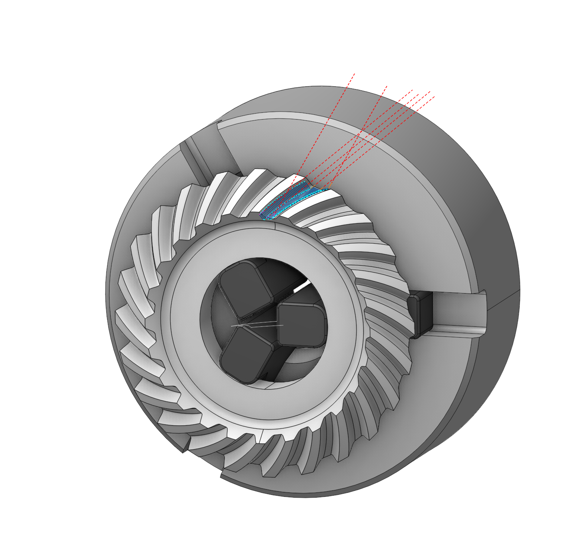
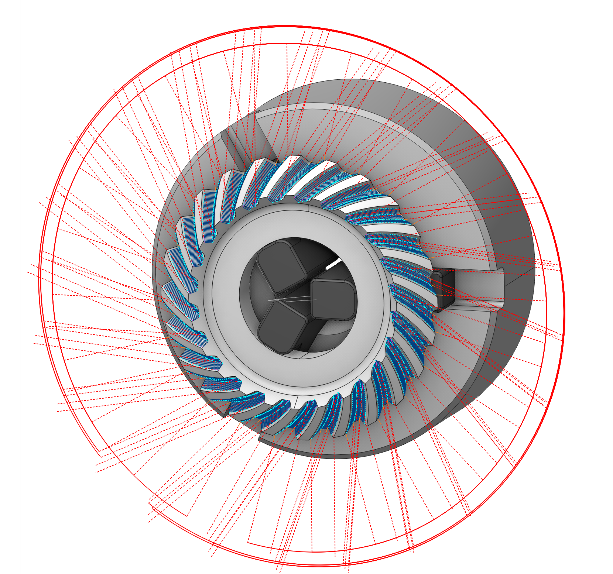

# Multiplicação de grupos

 

## Área de aplicação:

Nesse grupo, são definidos métodos de cópia para trajetórias, que são herdados por operações dentro desse grupo. Essa abordagem permite que as operações processem elementos de detalhes individuais, enquanto o grupo garante sua propagação automática para todos os elementos padrão de acordo com as regras estabelecidas. A cópia é realizada de acordo com as regras da guia Transformação. Para classificar as operações, use o <strong>modo Sequencing.</strong> [Detalhes](1029.md)

## Setup:

A guia <strong>Setup</strong> é usada para configurar os parâmetros primários do projeto. Isso pode envolver o posicionamento da peça no equipamento, o sistema de coordenadas da peça, entre outros. [Detalhes](1022.md)

## Transformações:

Conjunto de parâmetros da operação que permite converter as coordenadas do percurso da ferramenta calculado na operação. [Detalhes](10168.md)
