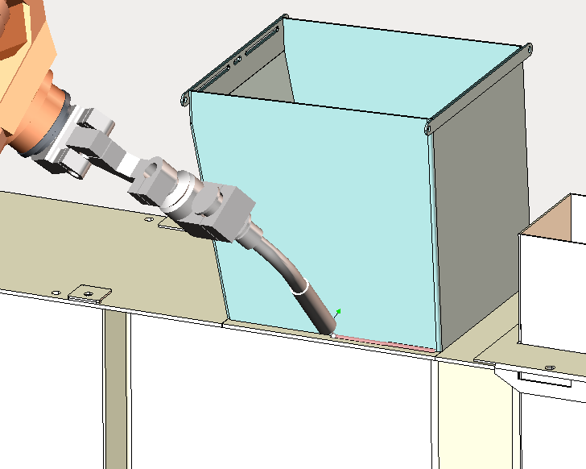
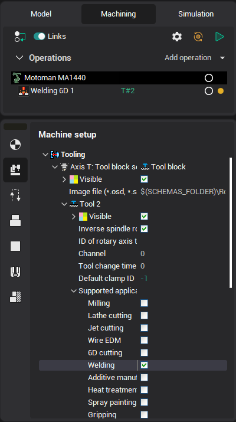

# Soldagem



Para trabalhar com equipamentos de soldagem, foi desenvolvida uma [operação universal de soldagem 5D](10271.md). Ela implementa o cálculo automático da geometria do cordão de solda sem vínculo com um tipo específico de equipamento de soldagem, ou seja, não gera comandos específicos para laser, arco elétrico, maçaricos a gás, emissores ultrassônicos etc.

Para que a operação de soldagem fique disponível para criação, é necessário selecionar uma máquina ou um robô que suporte esse tipo de usinagem. Para garantir o suporte à soldagem nas configurações da máquina, marque a caixa de seleção correspondente para o porta-ferramentas, conforme mostrado abaixo.



Também é possível escrever no esquema da máquina, para o porta-ferramentas, linhas semelhantes às seguintes.

```
<SCType ID="WeldingToolHolder" Caption="Welding tool holder" Type="TToolHolderNode">
<SupportedToolTypes>
<Welder DefaultValue="true"/>
</SupportedToolTypes>
</SCType>
```

A configuração da operação para trabalhar com um tipo específico de equipamento pode ser feita escrevendo no pós-processador os comandos apropriados para controlar o equipamento ou, se isso não for suficiente, adicionando uma operação especial baseada na operação Welding 5D e adaptada para controlar o equipamento específico.
