# Soldagem 5D e soldagem 6D

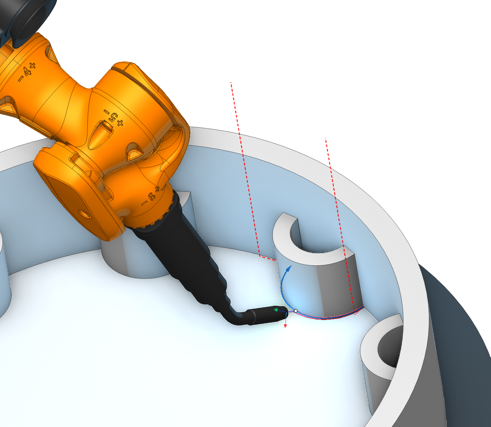

## Área de aplicação:

As operações Welding 5D e Welding 6D calculam automaticamente a geometria do cordão de solda, sem vínculo com um tipo específico de equipamento de soldagem. As operações não geram comandos específicos do equipamento para o laser, o arco elétrico, o maçarico a gás, o emissor ultrassônico etc.; elas geram o percurso da ferramenta e a orientação da ferramenta ao longo do cordão.

As operações são usadas nos seguintes casos:

- Soldagem contínua e intermitente de cordões definidos ao longo das arestas entre as peças unidas.
- Soldagem robotizada e multieixos, em que a orientação da ferramenta deve ser mantida em relação às paredes adjacentes da junta.
- Processos que exigem um padrão específico de cordão (intermitente, de ponteamento ou por pontos), configurado pelo parâmetro Welding type da operação Welding 6D.

Mude para o <strong>Simulation mode</strong> para visualizar a deposição de material no ponto em que a ponta da cabeça de soldagem toca o bruto. A espessura da camada simulada é determinada pela propriedade de comprimento de trabalho da ferramenta; se essa propriedade não estiver definida ou se o seu valor exceder o diâmetro da ferramenta, a espessura da camada será igual ao diâmetro da ferramenta.

O comando <strong>Effector On/Off</strong> liga e desliga a <strong>soldagem</strong>. O comando é definido quando o <strong>tipo de simulação</strong> ([Detalhes](100112.md)) é aditivo ou pintura, de acordo com os <strong>Effective Feeds</strong> selecionados. Nas operações <strong>aditivas</strong> e de <strong>soldagem</strong>, o comando é definido automaticamente. [Detalhes](https://docs.encycam.com/Inp/2/en/142669108.html)

### Setup:

A aba <strong>Setup</strong> é usada para configurar os parâmetros primários do projeto. Isso pode envolver o posicionamento da peça no equipamento, o sistema de coordenadas da peça, entre outros. [Detalhes](1022.md)

### Definição da tarefa:

<strong>Weld seam.</strong> Para definir o percurso de soldagem, basta especificar a aresta entre as peças soldadas. O sistema calcula automaticamente os ângulos de orientação da cabeça de soldagem para cada ponto da curva gerada. O cálculo garante que a cabeça de soldagem fique posicionada o mais próximo possível do centro da folga entre as paredes adjacentes dos componentes soldados e, ao mesmo tempo, evita qualquer colisão com as paredes.

<strong>5d Curve.</strong> O sistema gera o percurso da ferramenta de 5 eixos como a projeção de curvas arbitrárias sobre a superfície da peça. Nesse caso, o ponto de contato da ferramenta se move em contato com a superfície. As passadas podem ser deslocadas da curva pelo sobremetal ou pelos níveis. O eixo da ferramenta fica perpendicular à superfície. [Detalhes](10131.md)

<strong>Properties.</strong> Exibe as propriedades de um elemento. É possível adicionar sobremetal. Esse menu também pode ser aberto com um clique duplo em um item da lista.

<strong>Delete.</strong> Remove um item da lista.

<strong>Restrictions.</strong> Permite restringir as áreas que não devem ser usinadas. [Detalhes](101231.md)

### Estratégia:

#### Ponto de contato da ferramenta.

O ponto de contato da ferramenta (Tool Contact Point, TCP) é o ponto da ferramenta de corte que define a interação principal entre a ferramenta e a superfície do bruto ou as entidades geométricas durante a usinagem.

Os parâmetros deste grupo são os mesmos da <strong>operação 5D Surfacing</strong>. [Detalhes.](10135.md)

#### Múltiplas passadas.

Permite soldar o cordão em várias passadas.

Clique aqui para expandir...

<strong>Pass count.</strong> Número de passadas para todos os cordões de solda da operação. Esse parâmetro também pode ser definido separadamente para cada cordão na página de definição da tarefa.

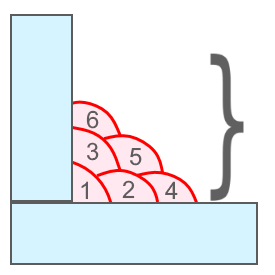

<strong>Pass.</strong> Parâmetros de uma passada individual.

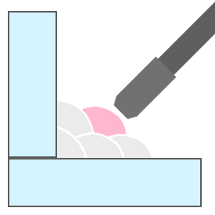

<strong>Axial offset.</strong> Distância da aresta principal até a passada ao longo do eixo da ferramenta.

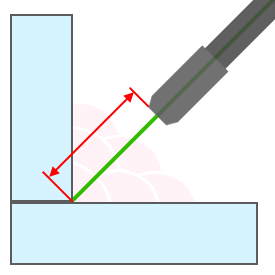

<strong>Side offset.</strong> Deslocamento lateral da passada em relação à aresta.

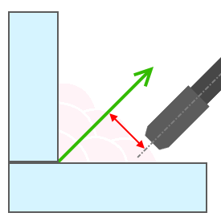

<strong>Lean offset.</strong> Inclinação adicional do eixo da ferramenta em relação à direção principal.

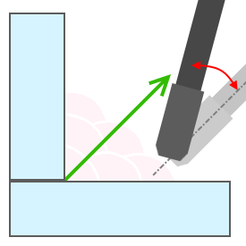

<strong>Offset return.</strong> Define o deslocamento de retorno entre as passadas.

#### Ordenação.

Controla a sequência das passadas do percurso da ferramenta durante a usinagem de superfícies.

Clique aqui para expandir...

<strong>Start Point.</strong> A ativação do sinalizador permite inserir as coordenadas do ponto inicial das passadas de trabalho na usinagem de superfícies.

 

<strong>Idling minimization.</strong> A ordem de usinagem dos perfis é definida de modo a minimizar os movimentos em vazio. Os parâmetros desse recurso são os mesmos da <strong>operação 2D Contouring</strong>. [Detalhes.](404.md)

<strong>Machining direction.</strong> Pode ser definido em quase todas as operações, exceto nas operações de usinagem de curvas. Permite controlar o tipo de fresamento necessário (concordante ou discordante) durante o cálculo do percurso da ferramenta.

<strong>Climb.</strong> Na usinagem, refere-se a uma estratégia de corte em que a ferramenta se move no mesmo sentido da rotação do bruto. Normalmente, resulta em menor desgaste da ferramenta e em um acabamento mais liso em comparação com o corte "Conventional", em que a ferramenta se move contra a rotação do bruto. O corte concordante costuma ser preferido quando a precisão e o acabamento superficial são críticos.

<strong>Conventional.</strong> Na usinagem, refere-se a uma estratégia em que a ferramenta se move contra a rotação do bruto. Esse método de corte é usado em operações de usinagem, mas pode resultar em maior desgaste da ferramenta e em um acabamento mais áspero em comparação com o corte "Climb", em que a ferramenta se move no mesmo sentido da rotação do bruto. O corte discordante às vezes é escolhido quando outros fatores, como a vida útil da ferramenta ou a evacuação de cavacos, são mais importantes do que o acabamento superficial.

<strong>Both.</strong> Refere-se ao uso das estratégias de corte "Climb" e "Conventional" em uma mesma operação de usinagem. Essa abordagem pode ser empregada para otimizar o desempenho da ferramenta, o acabamento superficial e outros fatores de usinagem, de acordo com os requisitos específicos de diferentes partes do bruto ou de diferentes etapas do processo de usinagem. Ela oferece maior flexibilidade e controle para obter os resultados desejados.

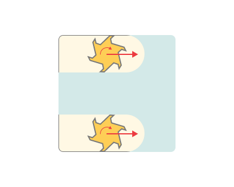

#### Orientação da ferramenta.

Controla a orientação do eixo da ferramenta. Os principais parâmetros dessa função são os mesmos da operação 5D Surfacing. [Detalhes.](10135.md)

#### Tipo de soldagem.

Seleciona o tipo de processo de soldagem.

Clique aqui para expandir...

<strong>Seam welding.</strong> Soldagem contínua ao longo da curva.

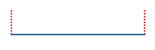

<strong>Stitch welding.</strong> Soldagem intermitente, em segmentos de cordão.

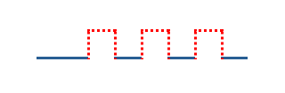

<strong>Tack welding.</strong> Pequenas soldas provisórias (ponteamento) que mantêm as peças unidas.

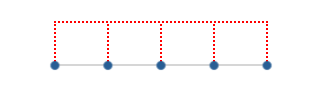

<strong>Spot welding.</strong> Soldagem em pontos isolados.

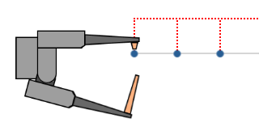

A seguir são descritos os principais parâmetros; o conjunto disponível pode variar de acordo com o <strong>Welding type</strong> selecionado.

<strong>Stitch length.</strong> Comprimento de um segmento de cordão.

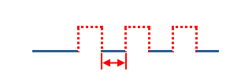

<strong>Start stitch length.</strong> Comprimento do primeiro segmento.

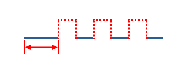

<strong>End stitch length.</strong> Comprimento do último segmento.

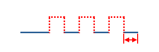

<strong>Spacing size.</strong> Define a forma de especificar o espaçamento entre os segmentos.

<strong>ISO spacing length.</strong> É definido o tamanho do próprio espaçamento.

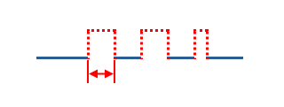

<strong>AWS center to center.</strong> Define a distância entre os centros dos segmentos.

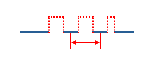

<strong>Even (stitch count).</strong> É definido o número de segmentos; os espaçamentos são distribuídos uniformemente pelo comprimento restante.

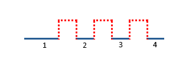

<strong>Spacing length, Center to center distance, Stitches count.</strong> Valor numérico do espaçamento, inserido no campo abaixo de <strong>Spacing size</strong>. O significado do valor depende do <strong>Spacing size mode</strong> selecionado: em <strong>ISO spacing length</strong>, é o <strong>comprimento</strong> da folga entre segmentos adjacentes; em <strong>AWS center to center</strong>, é a distância entre os centros de segmentos adjacentes; em <strong>Even (stitch count)</strong>, é o número de segmentos.

<strong>Adjustment.</strong> Alinhamento dos segmentos ao longo do contorno.

<strong>from start.</strong>

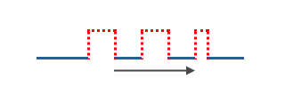

<strong>from center.</strong>

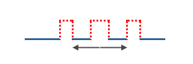

<strong>from end.</strong>

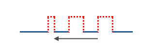

<strong>Auto resize spacing.</strong> O espaçamento entre os segmentos é ajustado automaticamente para que um número inteiro de segmentos caiba no comprimento do contorno sem sobra, mantendo o comprimento do segmento especificado.

<strong>Additional shift.</strong> Deslocamento adicional dos segmentos ao longo do contorno.

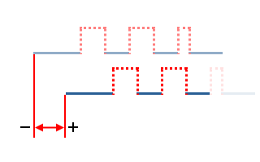

<strong>Invert stitches.</strong> Inverte a distribuição dos segmentos ao longo do contorno.

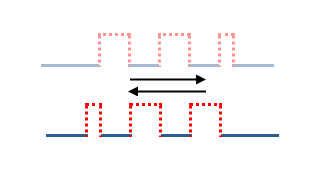

<strong>Retract distance.</strong> Distância do recuo axial em relação ao contorno na transição entre segmentos.

<strong>Points step.</strong> Passo entre os pontos.

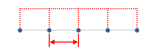

<strong>Delay at point.</strong> Tempo de permanência em cada ponto, em segundos.

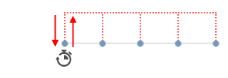

<strong>Effector axis id.</strong> ID do eixo da máquina que corresponde ao órgão de trabalho, isto é, à pinça de soldagem.

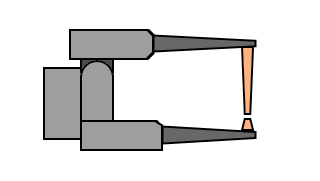

<strong>Value when off.</strong> Valor do eixo no estado desligado.

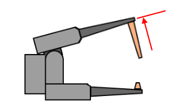

<strong>Value when On.</strong> Valor do eixo no estado ligado.

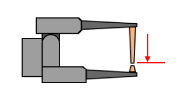

<strong>Pullback.</strong> Quando ativada, a ferramenta retorna ao longo da solda concluída por uma distância configurável antes de se afastar. Assim, a energia residual permanece sobre o material já soldado e não marca a superfície intacta. É útil na soldagem a laser, em que o feixe pode não desligar instantaneamente.

 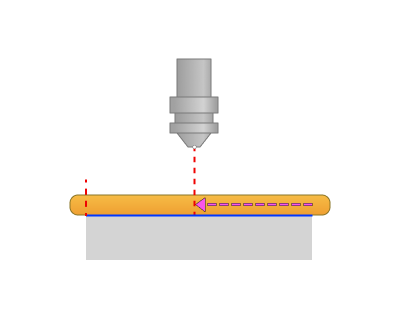

<strong>Pullback distance.</strong> Distância que a ferramenta percorre de volta ao longo da solda concluída, medida a partir do ponto final da solda no sentido oposto ao da soldagem.

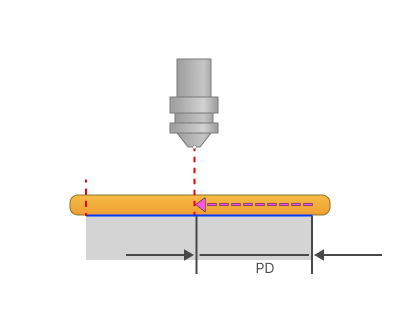

<strong>PD -</strong> Pullback distance

<strong>Dwell time.</strong> Tempo de permanência (espera) no ponto de retorno antes de a ferramenta se afastar, para que a fonte de energia desligue completamente enquanto a ferramenta está posicionada sobre o material já soldado.

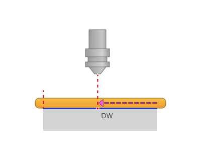

<strong>DW</strong> - Dwell time

#### Recorte.

Permite ignorar superfícies que não devem ser usinadas e estender o percurso da ferramenta.

Clique aqui para expandir...

<strong>Extend (+)/Trim (-) passes.</strong> Permite estender ou encurtar os segmentos inicial e final do percurso da ferramenta.

__Trim_(-)_passes.png)

<strong>Start</strong>. Com um valor positivo, o sistema estende o início das passadas de trabalho do percurso da ferramenta pelo valor especificado. Um valor negativo encurta o início das passadas.

<strong>End</strong>. Com um valor positivo, o sistema estende o final das passadas de trabalho do percurso da ferramenta pelo valor especificado. Um valor negativo encurta o final das passadas.

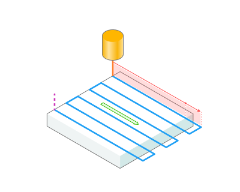

### Parâmetros:

Esta aba contém os principais parâmetros de controle da peça, do bruto, dos dispositivos de fixação e de outros elementos que permitem modificar o percurso da ferramenta. [Detalhes](100112.md)

### Ligações e entradas/saídas:

Na aba **Links/Leads**, são definidos os parâmetros dos movimentos rápidos: aproximação a partir da posição de troca da ferramenta, entrada no início do movimento de trabalho, saída após o último corte, transições entre passadas e retorno ao ponto de troca. É possível configurar a sequência dos movimentos ao longo das coordenadas, seus percursos e as distâncias dos deslocamentos.

Clique aqui para expandir...

<strong>Componentes:</strong>

<strong>Aproximação/retorno.</strong> Controla os movimentos da ferramenta entre a posição de troca e o início do percurso de entrada, nos dois sentidos. [Detalhes](100116.md).

<strong>Ligações.</strong> Define as regras das ligações de entrada e saída e das ligações entre movimentos de trabalho. [Detalhes](100130.md).

<strong>Entradas e saídas.</strong> Acrescenta movimentos de entrada e saída aos movimentos de trabalho, usando os avanços correspondentes. [Detalhes](100136.md).

<strong>Movimentos seguros.</strong> Define o tipo de <strong>Safety Surface</strong> e sua distância ao bruto. Essa superfície permite as transições entre superfícies ou percursos usinados; a primeira etapa da aproximação ou do retorno é realizada em direção a ela. [Detalhes](100117.md).

<strong>Configurações avançadas de ligações.</strong> Define as características de formação do percurso, principalmente para operações de cinco eixos, considerando os movimentos ideais dos eixos rotativos. [Detalhes](100118.md).

<strong>Distâncias.</strong> Distâncias usadas nas regras de ligação. [Detalhes](100140.md).

### Avanços e velocidades:

Esta janela permite definir a rotação do fuso, o avanço rápido e os avanços dos diferentes trechos do percurso. A rotação do fuso pode ser definida em rotações por minuto ou pela velocidade de corte. O valor de referência fica sublinhado; o outro valor é recalculado a partir dele, considerando o diâmetro da ferramenta. [Detalhes](100142.md)

### Transformações:

Conjunto de parâmetros da operação que permite transformar as coordenadas do percurso da ferramenta calculado na operação. [Detalhes](10168.md)

### Peça:

A peça é um grupo de elementos geométricos que define a região a ser verificada quanto a cortes indevidos. [Detalhes](330.md)

### Bruto:

O modelo do bruto de uma operação define o material a ser usinado. [Detalhes](738.md)

### Dispositivos de fixação:

Os dispositivos de fixação normalmente incluem mandris, garras, grampos e outros elementos de fixação, além de áreas de restrição de qualquer natureza. [Detalhes](10283.md)
