# 5D、6D溶接

5D溶接オペレーションには、特定の種類の溶接装置に依存せず、溶接シーム（継ぎ目）の形状を自動計算する機能が実装されています。つまり、レーザー、アーク溶接、ガスバーナー、超音波発生器などへの個別のコマンドは生成されません。

溶接シームは、ジョブ割り当てウィンドウで指定します。ここでの作業プロセスは、5D輪郭オペレーションの曲線定義と非常によく似ています。

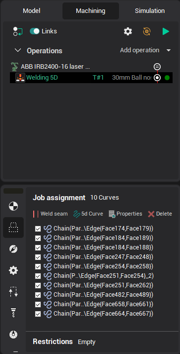

溶接するパーツ間のエッジを追加するだけで、システムは自動的に各曲線点の角度を計算します。この際、溶接ヘッドが隣接する壁面の中間位置に可能な限り近づきつつ、壁面と干渉しないような角度が算出されます。すると、工具ベクトルを伴うカーブが画面に表示されます。システムが自動計算した角度が意図したものでない場合は、任意のベクトルを掴んで希望する方向へドラッグすることで調整可能です。同時に画面に寸法が表示され、それをクリックするとベクトルの傾斜角を正確な値で入力することができます。カーブの方向を変えるには、カーブの開始点にある青い矢印をクリックします。また、対応するマーカーを掴んでドラッグすることで、曲線の始点と終点を移動することもできます。

このようなプロパティは、オペレーションのプロパティインスペクターで確認できます。

- リード/リーン角度 ジョブ割り当てで指定したすべてのカーブについて、カーブの側面およびカーブに沿った追加の工具傾斜角度を定義します。
- 空送り最小化 複数のカーブがある場合、カーブを結合する順序に影響します。無効の場合、カーブは指定された順序に従います。有効にすると、空走動作を減らすためにカーブの順序が変更されることがあります。
- 円弧補間 短い直線を指定した精度で円弧に統合することにより、NC コードのフレーム数を削減します。生成される円弧は多くの場合、直交しない平面上に配置されるため、この機能は空間円弧に対応した機械（ロボットなど）を使用する場合にのみ有効です。
- パス延長（＋）／トリム（-） カーブごとに開始点と終了点を別々にドラッグすることなく、定義したすべてのカーブの長さを変更（延長または短縮）できます。 デフォルトでは、工具直径（溶接シームの幅）の50%です。
- 接近／退避 各カーブの開始点または終了点に追加区間を定義できます。
- 安全動作、安全サーフェス、リンク カーブ間のリンクの種類と寸法を定義します。

その後、シミュレーションモードに切り替えることで、溶接ヘッドの先端がワークに触れている位置に材料がどのように付加されるかを確認できます。シミュレーションにおける層の厚さは、工具の刃長プロパティで定義されます。設定されていない場合（工具直径より大きい場合）は、層の厚さは工具直径と等しくなります。

<strong>6D 溶接</strong>

<strong>6D 溶接</strong>オペレーションでは、 <strong>溶接タイプ</strong> パラメータが追加で使用できます。

以下の溶接プロセスタイプに対応しています。

1.  シーム溶接
2.  ステッチ溶接
3.  タック溶接
4.  スポット溶接

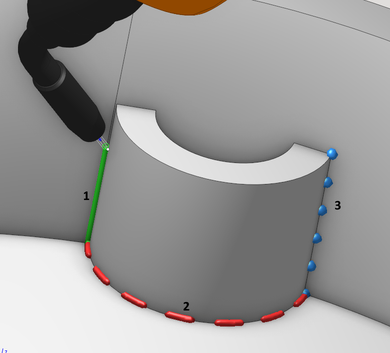

<strong>1 シーム溶接</strong>

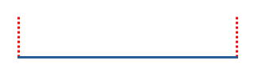

連続したカーブに沿った溶接です。

<strong>2  ステッチ溶接</strong>

断続的な溶接です。 以下のオプションがあります。

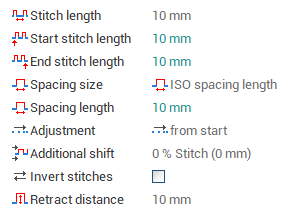

|  ステッチの長さ | 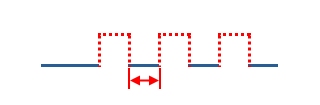 |   |
|---|---|---|
|  ステッチ開始の長さ | 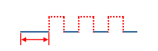 |   |
|  ステッチ終了の長さ | 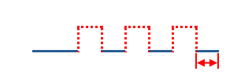 |   |
|  <strong>間隔サイズ：</strong> |   |   |
|   |  ISO 間隔長 間隔そのものの大きさを設定します。 | 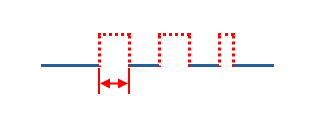 |
|  AWS中心間距離 ストロークの中心間の距離を設定します。 | 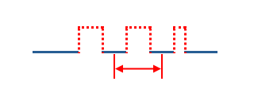 |   |
|  偶数（ステッチ数） ストロークの本数を設定し、残りの長さに対して均等に間隔を分配します。 | 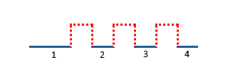 |   |
|  調整: 輪郭に沿ったステッチの配置 |   |   |
|   |  開始位置から | 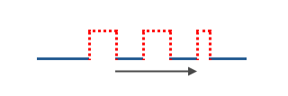 |
|  中央から | 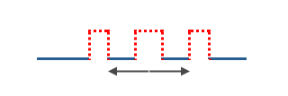 |   |
|  終了位置から | 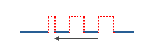 |   |
|  間隔の自動調整 |   |   |
|  追加シフト 輪郭に沿ったステッチを追加で移動します。 | 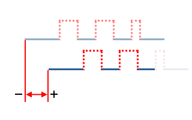 |   |
|  ステッチ反転 輪郭に沿ったステッチの配置を反転します。 | 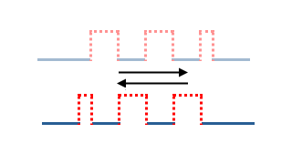 |   |
|  退避距離 ステッチ間の移行時における、輪郭からの軸方向へ退避する距離です。 | 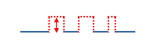 |   |

<strong>3</strong>  <strong>タック溶接</strong>

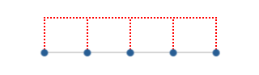

タック溶接は、パーツを一時的に固定するために行う小さな溶接です。

以下のオプションがあります。

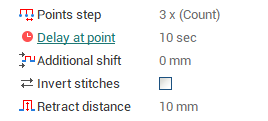

|  点ステップ 点間のピッチ距離 | 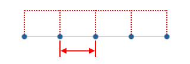 |
|---|---|
|  点で遅延 各点でのドウェル時間（秒） | 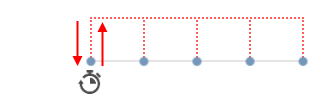 |

その他のパラメータはステッチ溶接と同様です。

<strong>4</strong>  <strong>スポット溶接</strong>

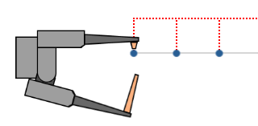

以下のオプションがあります。

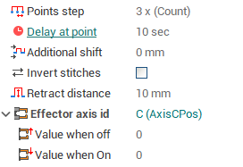

|  エフェクター軸ID 作動部（溶接クランプ）の軸に該当する機械軸の ID | 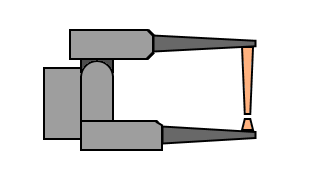 |
|---|---|
|  オフ時の値 | 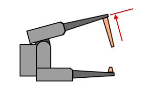 |
|  オン時の値 | 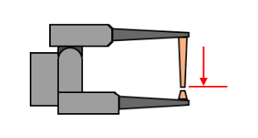 |

その他のパラメータは仮付け溶接と同様です。

<strong>エフェクター オン/オフ</strong> <strong>コマンド</strong>

このコマンドは溶接のオンとオフを切り替えます。

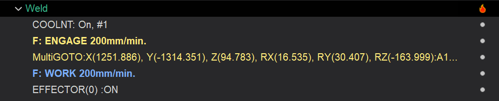

<strong>シミュレーションタイプ</strong>が積層または塗布の場合、選択した<strong>エフェクター送り速度</strong>に従って設定されます。積層オペレーションおよび溶接の場合、コマンドは自動的に設定されます。

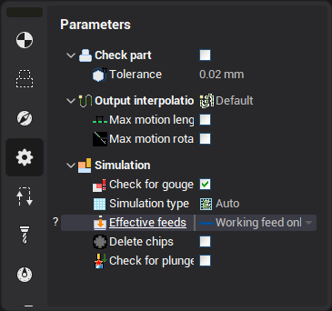
