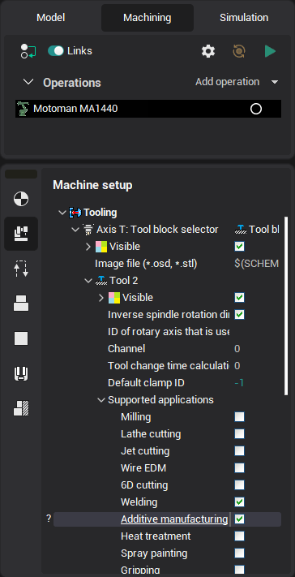

# 積層造形

積層造形は、工具作用点で材料を除去する切削加工とは異なり、ワークに材料を付加していく加工方法です。クラッディングは積層造形の一種であり、ワーク表面に追加の金属または合金層を溶融して形成する加工です。これにより、高硬度、高強度、耐摩耗性、低摩擦特性、耐腐食性、耐熱性などの特性を持つ材料層をワーク表面に形成することができます。また、高価なパーツや工具の寸法復元、ブレード、金型、モールド、ギア、シャフトなどの補修・修復にも利用できます。

クラッディング加工の主な特徴:

- 母材への溶け込みが最小限であること
- 付加された層と母材との混合が最小限であること
- 加工領域における残留応力と変形が最小限であること
- 後工程の機械加工に必要な仕上げ代を大幅に削減できること

クラッドにはさまざまな種類があります。

- 被覆アーク溶接（手動）
- サブマージアーク溶接（ワイヤー、リボン材使用）
- フラックス入りワイヤーによるアーク溶接
- 電気スラグ溶接
- プラズマサーフェーシング
- レーザークラッディング
- 電子ビーム溶接
- 誘導クラッディング

CAMに実装されている積層加工オペレーションは汎用的なものであり、特定のクラッディング技術や使用する装置の種類に依存しません。これらのオペレーションは、プロセスの形状のみを実装し、指定されたサーフェス上を層ごとに順次通過して、下から上へと形状を再現するツールパスを生成します。特定の装置に対応させるためのオペレーション設定は、装置を制御する適切なコマンドをポストプロセッサーに記述することで行えます。それだけでは不十分な場合は、汎用的な積層オペレーションを基に、特定の装置の制御に対応した専用オペレーションを追加することで対応できます。

積層オペレーションを作成できるようにするには、この種類の加工に対応したマシンまたはロボットを選択する必要があります。積層加工オペレーションに対応させるには、マシン設定で工具ホルダーにおいて「<strong>積層造形</strong>」のチェックボックスを有効にする必要があります。下図に示しています。



または、マシンスキーマの工具ホルダ定義に、以下のような記述を追加することもできます。

```
<SCType ID="AdditiveToolHolder" Caption="Additive tool holder" Type="TToolHolderNode">
<SupportedToolTypes>
<AdditiveTool DefaultValue="true"/>
</SupportedToolTypes>
</SCType>
```
