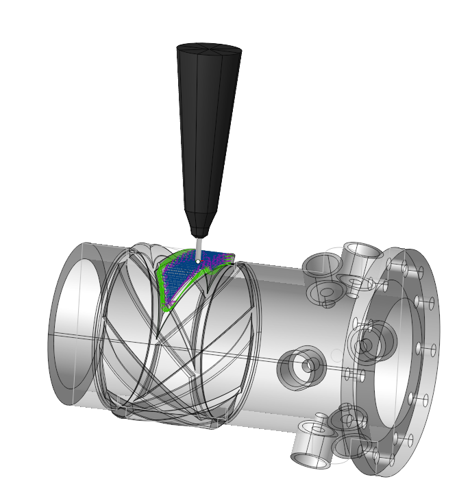

# Revestimento de área

## Área de aplicação:

Esta operação deposita material em uma área da peça delimitada por curvas. A interface e a definição da tarefa da operação são semelhantes às da operação [Pocketing](256.md).

A operação é realizada em várias etapas. Primeiro, selecione a superfície de base sobre a qual o revestimento será feito. Para isso, clique no botão "Base surface" e selecione a superfície desejada na tela. Ela pode ser um plano, um cilindro ou um corpo de revolução. O sistema preenche automaticamente as opções necessárias, mas, se desejar, é possível ajustar as propriedades da superfície de base e, em seguida, clicar em "Yes". Agora, para especificar a área local, selecione na tela as curvas ou as arestas do modelo 3D ao longo do perímetro da área desejada e adicione-as com o botão "Add boss". Da mesma forma, é possível adicionar bolsões (furos) às ilhas criadas anteriormente. Para limitar os níveis superior e inferior, selecione na tela qualquer elemento geométrico situado no nível desejado e clique no botão "Top level" ou "Bottom level", respectivamente. Os níveis superior e inferior também podem ser definidos por valores numéricos na janela do inspetor de propriedades.

### Definição da tarefa:

<strong>Base Surface.</strong> É a superfície sobre a qual o percurso da ferramenta é construído de acordo com a curva projetada nela. [Detalhes](10156.md)

<strong>Add Boss.</strong> Selecione a curva fechada dentro da qual o material será depositado. [Detalhes](806.md)

<strong>Add Pocket.</strong> Selecione a curva fechada fora da qual o material deve ser depositado. Esta tarefa só funciona se um <strong>Boss</strong> também estiver especificado na <strong>definição da tarefa</strong>. [Detalhes](806.md)

<strong>Add Inversion.</strong> Indica uma área fechada dentro da qual as regras de usinagem serão invertidas, ou seja, as áreas processadas passarão a não processadas e vice-versa. [Detalhes](806.md)

<strong>Top Level.</strong> Especifica o nível superior de deposição de material por elementos do modelo. [Detalhes](10153.md)

<strong>Bottom Level.</strong> Especifica o nível inferior de deposição de material por elementos do modelo. [Detalhes](10153.md)

<strong>Properties.</strong> Exibe as propriedades de um elemento. É possível adicionar sobremetal. Esse menu também pode ser aberto com um clique duplo em um item da lista. Também é possível alterar o tipo de tarefa. Ao alterar o tipo de tarefa para <strong>Ridge</strong> ou <strong>Ditch</strong>, especifique o <strong>Stock</strong> para definir a espessura ou a largura do elemento. [Detalhes](806.md)

<strong>Delete.</strong> Remove um item da lista.

### Estratégia:

#### Estratégia de usinagem.

Este parâmetro permite obter o percurso da ferramenta necessário:

Clique aqui para expandir...

<strong>Type of Strategy:</strong>

<strong>Parallel</strong>. Preenche a área da <strong>definição da tarefa</strong> com passadas lineares da ferramenta em um <strong>Angle</strong> especificado em relação ao eixo escolhido.

<strong>Offset</strong>. Os percursos da ferramenta são linhas equidistantes às curvas da <strong>definição da tarefa</strong>.

<strong>Step</strong>. É a distância entre as passadas da ferramenta, medida ao longo da <strong>Base Surface</strong>.

<strong>Parallel Passes Stock</strong>. O sistema expande a área de processamento para fora da curva selecionada (com valor positivo do parâmetro) ou para dentro (com valor negativo).

<strong>Smooth Radius.</strong> O sistema arredonda os cantos internos da área de processamento com o raio especificado.

Gap to Prevent Overlapping. Ao processar um contorno fechado, deixa uma folga na junção do início e do fim do contorno para evitar a sobreposição de camadas. A folga deve ser aproximadamente igual ao diâmetro do ponto de fusão.

<strong>Angle</strong>. É o ângulo entre o eixo X do sistema de coordenadas selecionado e a direção do percurso da ferramenta na estratégia <strong>Parallel</strong>.

<strong>Number of Fill Repetitions</strong>. Quantidade de passadas adicionais da ferramenta em cada camada.

<strong>Angular Step</strong>. Ângulo da passada adicional em relação à passada anterior.

<strong>Turn Angle Between Layers</strong>. Ângulo das passadas da ferramenta na camada atual em relação à camada anterior.

<strong>Offset Pass Count.</strong> Quantidade de passadas da ferramenta ao longo do contorno da <strong>definição da tarefa</strong>. Se a quantidade for maior que um, o sistema gera percursos equidistantes com o <strong>Offset Pass Step</strong> definido. Permite melhorar a qualidade da superfície externa.

<strong>Offset Pass Step</strong>. Distância entre as passadas equidistantes do percurso da ferramenta ao longo do contorno da <strong>definição da tarefa</strong>.

<strong>Passes Order</strong>. Define a ordem das passadas no nível: de fora para dentro ou o contrário. Se <strong>Zigzag</strong> for selecionado, a ordem muda de um nível para outro.

<strong>Parallel Passes Sorting</strong>. Controla a ordem das passadas de trabalho no revestimento de várias áreas.

<strong>By Regions</strong>. Ao preencher cada camada, o sistema forma cada área separadamente das demais.

<strong>Sequentally</strong>. Quando a passada de trabalho atravessa várias áreas, o revestimento é feito em várias áreas durante uma única passada.

Machining direction. Especifica a direção dos percursos da ferramenta.

<strong>Forward.</strong> Na estratégia <strong>Parallel</strong>, as passadas da ferramenta seguem o <strong>Angle</strong>. Na estratégia <strong>Offset</strong>, o percurso segue no sentido anti-horário.

<strong>Backward.</strong> Na estratégia <strong>Parallel</strong>, as passadas da ferramenta seguem no sentido oposto ao <strong>Angle</strong>. Na estratégia <strong>Offset</strong>, o percurso segue no sentido horário.

<strong>Zigzag</strong>. As passadas da ferramenta alternam a direção a cada linha.

<strong>Fill Thin Zones.</strong> Com esta opção ativada, o sistema tenta preencher as lacunas que ficaram sem preenchimento com o passo definido.

#### Níveis de usinagem:

Define o intervalo de usinagem ao longo do eixo da ferramenta.

Clique aqui para expandir...

<strong>Top Level.</strong> Nível no qual é feita a passada final.

<strong>Bottom Level.</strong> Arraste o plano com o mouse ou arraste o círculo central do plano e use o 'Smart snap' para alinhá-lo a um elemento, ou clique na cota na vista gráfica para definir o nível inferior de usinagem desejado. Se o texto no campo estiver verde, o nível é calculado automaticamente como o topo da peça, do bruto e dos dispositivos de fixação. Para voltar ao modo automático, basta limpar o campo e pressionar 'Enter'.

<strong>Depth Step</strong>. Material depositado em uma passada ao longo do eixo da ferramenta entre os níveis <strong>Top</strong> e <strong>Bottom</strong>.

Initial depth. Profundidade do primeiro nível.

<strong>Side Angle.</strong> Ângulo de inclinação das paredes da superfície depositada.

#### Recorte:

Permite ignorar as superfícies não destinadas à usinagem e estender o percurso da ferramenta. Os parâmetros de <strong>Trimming</strong> são os mesmos da <strong>operação de desbaste por linhas de nível</strong>. [Detalhes.](736.md)

#### Transformações.

Caixa de diálogo para transformar o percurso da ferramenta. Os parâmetros de <strong>Transformations</strong> são os mesmos da <strong>operação de contorno 2D</strong>. [Detalhes.](404.md)

### Parâmetros:

Esta aba contém os parâmetros principais de controle da peça, do bruto, dos dispositivos de fixação e de outros elementos, que permitem alterar o percurso da ferramenta. [Detalhes](100112.md)

### Ligações e entradas/saídas:

Na aba Links/Leads, são definidos os parâmetros dos movimentos rápidos. Esses movimentos incluem a aproximação da ferramenta a partir da posição de troca de ferramenta, a entrada no início do curso de trabalho, a saída após o último movimento de corte, as transições entre as passadas de trabalho e o retorno ao ponto de troca de ferramenta. É possível configurar a sequência dos movimentos ao longo das coordenadas, a trajetória desses movimentos e a magnitude dos deslocamentos.

Clique aqui para expandir...

<strong>Consiste em:</strong>

<strong>Approach/Return.</strong> Este grupo de parâmetros controla os movimentos da ferramenta da posição de troca de ferramenta até o início dos percursos de entrada e de volta. [Detalhes](100116.md).

<strong>Links.</strong> Define as regras das ligações de entrada/saída e das ligações entre movimentos de trabalho. [Detalhes](157862569.md).

<strong>Leads.</strong> Permite adicionar movimentos adicionais de entrada e saída aos movimentos de trabalho, usando os avanços correspondentes. [Detalhes](100149.md).

<strong>Safe motions.</strong> Define o tipo de <strong>Safety Surface</strong> e a distância dela até o bruto. Essa superfície facilita as transições entre as superfícies usinadas ou os percursos da ferramenta, e a primeira etapa da aproximação ou do retorno é feita em direção a ela. [Detalhes](100117.md).

<strong>Advanced links settings.</strong> Este grupo de parâmetros define as particularidades da formação do percurso, principalmente para operações de cinco eixos, considerando os movimentos ideais dos eixos rotativos. [Detalhes](100118.md).

<strong>Distances.</strong> Distâncias usadas nas regras de ligação [Detalhes](100140.md).

### Transformações:

Conjunto de parâmetros da operação que permite converter as coordenadas do percurso da ferramenta calculado na operação. [Detalhes](10168.md)

### Peça:

A peça é um grupo de elementos geométricos que define o espaço a ser verificado quanto a cortes indevidos. [Detalhes](330.md)

### Bruto:

O modelo do bruto de uma operação define o material a ser usinado. [Detalhes](738.md)

### Dispositivos de fixação:

Como dispositivos de fixação, normalmente são especificados meios de fixação, como placas, garras, grampos etc., e áreas de restrição de qualquer outra natureza. [Detalhes](10283.md)
