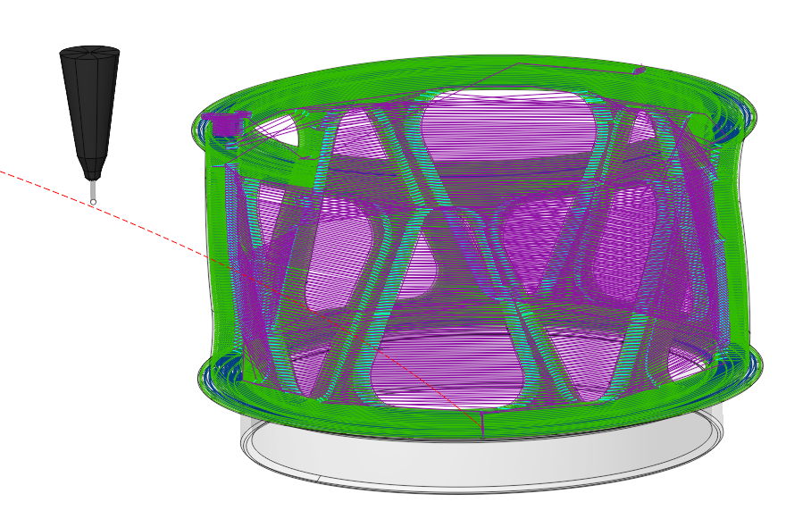

# Riporto 3D

## Ambito di applicazione:

Si tratta di un'operazione di produzione additiva che utilizza come dato di ingresso un modello 3D. È analoga all'operazione <strong>[Roughing Waterline](736.md)</strong> (sgrossatura a Z costante), con la differenza che procede dal basso verso l'alto. Interseca il modello di origine strato per strato e genera per ogni livello un percorso utensile che riempie l'area di intersezione calcolata. Per il riempimento dell'area l'operazione dispone delle strategie Parallel (parallela) e Offset. Per impostazione predefinita, il modello da lavorare è l'intero pezzo. Se si desidera far crescere solo una geometria locale, occorre aggiungere le facce desiderate all'assegnazione del lavoro. Il sistema imposta automaticamente i livelli superiore e inferiore in base alla geometria definita; se invece si desidera limitare manualmente i livelli superiore e inferiore, selezionare sullo schermo un qualsiasi elemento geometrico che si trovi al livello desiderato e premere rispettivamente il pulsante "Top level" o "Bottom level". I livelli superiore e inferiore possono essere impostati anche con valori numerici nella finestra dell'inspector Properties.

### Assegnazione del lavoro:

<strong>Faces.</strong> (facce) Selezionare diverse superfici del pezzo che delimitano l'area di riempimento del materiale. Il sistema calcolerà il percorso utensile in base alle superfici scelte.

<strong>Pocket.</strong> (tasca) Selezionare il fondo della tasca. Il sistema crea le pareti adiacenti della tasca tenendo conto del sovrametallo specificato nelle <strong>Properties</strong> (proprietà) dell'elemento. [Dettagli](10154.md)

<strong>Job Zone.</strong> (zona di lavoro) Selezionare le curve o gli spigoli del pezzo che definiscono l'area di riempimento del materiale. [Dettagli](10151.md)

<strong>Restrict Zone.</strong> (zona di esclusione) Oltre alle <strong>Job Zones</strong>, nel sistema è possibile utilizzare le <strong>Restrict Zones</strong> per specificare le aree del grezzo che non devono essere lavorate nell'operazione corrente. [Dettagli](10152.md)

<strong>Top Level.</strong> (livello superiore) Definizione del livello superiore di deposizione del materiale mediante elementi del modello. [Dettagli](10153.md)

<strong>Bottom Level.</strong> (livello inferiore) Definizione del livello inferiore di deposizione del materiale mediante elementi del modello. [Dettagli](10153.md)

<strong>Properties.</strong> (proprietà) Visualizza le proprietà di un elemento. È possibile aggiungere il sovrametallo. Questo menu può essere richiamato anche facendo doppio clic su un elemento dell'elenco.

<strong>Delete.</strong> (elimina) Rimuove un elemento dall'elenco.

### Strategia:

#### Machining Strategy (strategia di lavorazione).

Questo gruppo di parametri consente all'utente di ottenere il percorso utensile richiesto. Funziona in modo analogo all'operazione <strong>Area Cladding operation</strong> (riporto su area). [Dettagli](10273.md).

#### Machining levels (livelli di lavorazione):

Definisce l'intervallo di lavorazione lungo l'asse dell'utensile. Questo gruppo di parametri funziona in modo analogo all'operazione <strong>Area Cladding operation</strong> (riporto su area). [Dettagli](10273.md).

#### Trimming (rifilatura):

Consente di escludere le superfici che non devono essere lavorate e di estendere il percorso utensile. I parametri di <strong>Trimming</strong> sono gli stessi dell'operazione <strong>Waterline Roughing operation</strong> (sgrossatura a Z costante). [Dettagli.](736.md)

### Parametri:

Questa scheda contiene i parametri principali per il controllo del pezzo, del grezzo, delle attrezzature di bloccaggio e di altri elementi, che consentono di modificare il percorso utensile. [Dettagli](100112.md)

### Collegamenti/Attacchi:

Nella scheda Links/Leads si definiscono i parametri dei movimenti rapidi. Questi movimenti comprendono l'avvicinamento dell'utensile dalla posizione di cambio utensile, l'attacco all'inizio della corsa di lavoro, la retrazione dopo l'ultimo movimento di taglio, i collegamenti tra le passate di lavoro e il ritorno al punto di cambio utensile. È possibile configurare la sequenza dei movimenti lungo le coordinate, la traiettoria di questi movimenti e l'entità degli spostamenti.

Fare clic qui per espandere..

<strong>Comprende:</strong>

<strong>Approach/Return.</strong> (avvicinamento/ritorno) Questo gruppo di parametri gestisce i movimenti dell'utensile dalla posizione di cambio utensile all'inizio dei percorsi di attacco e viceversa. [Dettagli](100116.md).

<strong>Links.</strong> (collegamenti) Definisce le regole che governano i collegamenti di entrata/uscita e i collegamenti tra i movimenti di lavoro. [Dettagli](157862569.md).

<strong>Leads.</strong> (attacchi) Consente di aggiungere ai movimenti di lavoro ulteriori attacchi e retrazioni eseguiti con il relativo avanzamento. [Dettagli](100149.md).

<strong>Safe motions.</strong> (movimenti di sicurezza) Definisce il tipo di <strong>Safety Surface</strong> (superficie di sicurezza) e la sua distanza dal grezzo. Questa superficie agevola i collegamenti tra le superfici lavorate o tra i percorsi utensile, e la prima fase dell'avvicinamento o del ritorno avviene verso di essa. [Dettagli](100117.md).

<strong>Advanced links settings.</strong> (impostazioni avanzate dei collegamenti) Questo gruppo di parametri specifica le caratteristiche della formazione della traiettoria soprattutto per le operazioni a cinque assi, tenendo conto dei movimenti ottimali degli assi rotativi. [Dettagli](100118.md).

<strong>Distances.</strong> (distanze) Distanze utilizzate nelle regole dei collegamenti (Links) [Dettagli](100140.md).

### Trasformazioni:

Insieme di parametri dell'operazione che consentono di eseguire trasformazioni di coordinate sul percorso utensile calcolato nell'ambito dell'operazione. [Dettagli](10168.md).

### Pezzo:

Il pezzo (Part) è un gruppo di elementi geometrici che definisce lo spazio in cui controllare le intaccature. [Dettagli](330.md)

### Grezzo:

Il modello del grezzo (Workpiece) di un'operazione definisce il materiale da lavorare. [Dettagli](738.md)

### Attrezzature:

Come attrezzature (Fixtures) si specificano di solito i dispositivi di bloccaggio, come mandrini autocentranti, griffe, staffe, ecc., e le aree di esclusione di qualsiasi altra natura. [Dettagli](10283.md)
