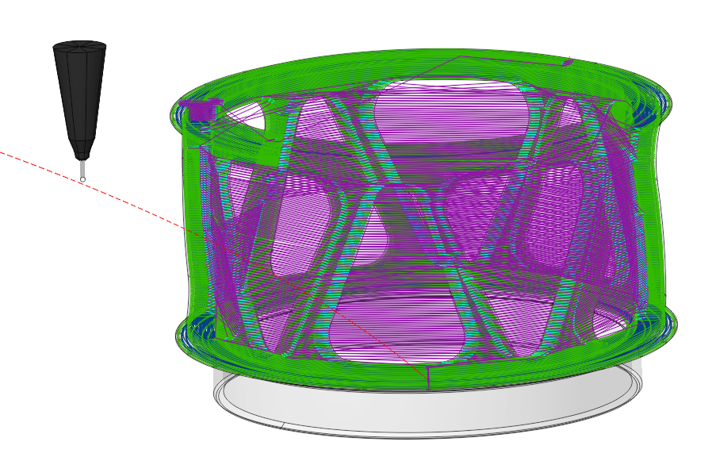

# 3Dクラッディング

## 適用分野：

これは、3Dモデルを入力データとして使用する積層造形オペレーションです。 下から上に向かって操作する点を除き、<strong>[ウォーターライン荒加工](736.md)</strong>と同様の動作をします。ソースモデルをレイヤーごとに交差させ、各高さで計算された交差領域を埋めるためのツールパスを生成します。このオペレーションでは、領域を埋めるための平行およびオフセット方法を使用できます。デフォルトでは、パーツ全体が加工対象モデルとなります。特定の部分にのみ材料を積層させたい場合は、目的のサーフェスをジョブ割り当てに追加する必要があります。通常、システムは定義された形状に基づいて自動的に上限高さおよび下限高さを設定しますが、手動で高さを制限したい場合は、画面上で目的の高さに位置する任意の要素を選択し、それぞれ［上限高さ］または［下限高さ］ボタンを押してください。上限および下限高さは、プロパティインスペクターウィンドウで数値入力によって設定することもできます。

## ジョブ割り当て：

<strong>フェイス</strong> 材料を付加する領域を制限するため、パーツ上の各サーフェスを選択します。システムは、選択されたサーフェスに基づいて軌道を計算します。

<strong>ポケット</strong> ポケットの底面を選択します。システムは、項目の<strong>プロパティ</strong>で指定されたストックを考慮して、隣接するポケットの側壁を生成します。[詳細を見る](10154.md)

<strong>ジョブゾーン</strong> 材料を付加する領域をエリアを定義する、パーツのカーブまたはエッジを選択します。[詳細を見る](10151.md)

<strong>制限領域</strong> <strong>ジョブゾーン</strong>に加えて、 <strong>制限領域</strong>を使用し、現在のオペレーションで加工しないワークの領域を指定できます。[詳細を見る](10152.md)

<strong>上部高さ</strong> モデルの要素を使用して、材料を付加する上限高さを指定します。[詳細を見る](10153.md)

<strong>底部高さ</strong> モデルの要素を使用して、材料を付加する下限高さを指定します。[詳細を見る](10153.md)

<strong>プロパティ</strong> 要素のプロパティを表示します。ストックを追加することも可能です。リスト内の項目をダブルクリックして、このメニューを開くこともできます。

<strong>削除</strong> リストから項目を削除します。

## 加工設定：

### 加工設定：

これらのパラメータにより、ユーザーは目的のツールパスを生成できます。このパラメーターグループは <strong>エリアクラッディングオペレーション</strong>と同様に機能します。[詳細を見る](10273.md)

### 加工深さ：

工具軸に沿った加工範囲を定義します。このパラメーターグループは <strong>エリアクラッディングオペレーション</strong>と同様に機能します。[詳細を見る](10273.md)

### トリミング

加工対象外のサーフェスをスキップしたり、ツールパスを延長したりすることができます。<strong>トリミング</strong>のパラメータは、<strong>ウォータライン荒加工オペレーション</strong>と同じです。[詳細を見る](736.md)

## 変換：

オペレーション内で計算された工具の軌跡に対して座標変換 を行うためのパラメータグループです。 [詳細を見る](10168.md)

## パーツ：

パーツは、干渉をチェックする空間を定義する幾何要素のグループです。[詳細を見る](330.md)

## ワーク：

オペレーションのワークモデルでは、加工する素材を設定します。[詳細を見る](738.md)

## 治具：

治具には通常、チャック、グリップ、クランプなどの固定補助具と、その他の種類の制限領域を指定します。[詳細を見る](10283.md)
