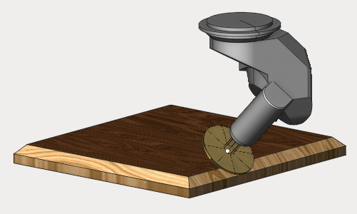
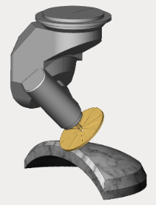
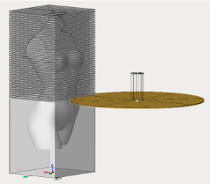

# Lavorazione con utensile a disco

Questo gruppo di operazioni è destinato al taglio con sega e alla lavorazione di materiali quali legno, pietra e simili con un [utensile a disco](10278.md).

L'operazione <strong></strong><strong>Disc cutting 2D<strong></strong></strong> è destinata principalmente al taglio di materiali in lastra, alla lavorazione di facciate piane di mobili e di pannelli.

L'operazione <strong>Disc cutting 6D</strong> è destinata al taglio di pezzi sia piani sia volumetrici. Come assegnazione del lavoro in questa operazione si possono indicare sia curve piane e spaziali, sia spigoli di facce.

L'operazione <strong></strong><strong>Disc Roughing</strong> è destinata a preparare un blocco di pietra eseguendo tagli con un utensile a disco nella zona in cui occorre asportare il materiale e rimuovendo poi manualmente per scheggiatura gli strati di materiale assottigliati, seguita di norma da un'operazione di finitura con l'utensile appropriato.

Il gruppo di operazioni con utensile a disco, come alcuni altri gruppi di operazioni, è disponibile con una licenza speciale.

Per utilizzare queste operazioni, la possibilità di lavorare con questo gruppo di operazioni deve essere specificata nello schema della macchina. Pertanto, se il gruppo di operazioni con utensile a disco manca nell'elenco delle operazioni disponibili, la causa è una licenza non corretta oppure uno schema della macchina non corretto, che non può lavorare con questo gruppo di operazioni.
