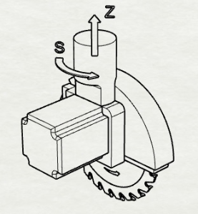
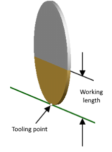
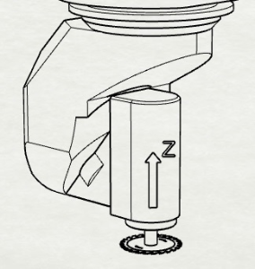
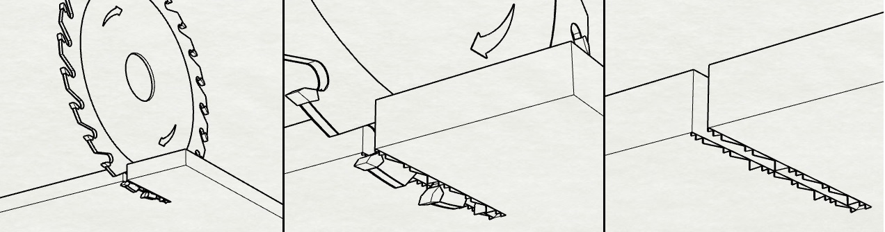

# ディスク工具

ディスクツールのオペレーションでは、工具の取り付け方式に応じて、2種類の工具タイプが用意されています。

<strong>ソーブレード</strong>

このタイプでは、S 軸（Z 軸を中心に工具を回転させる軸）があることを前提としています。Z 軸の方向は、工具の回転面に沿っています。

ソーブレード（鋸刃）の工具点は、回転軸上の先端に工具点があるミーリング工具とは異なり、ソーブレードの縁（外周部）に位置します。また、ソーブレード型の工具には、ソーブレードの加工領域の高さを定義する「有効長」パラメータがあります。工具の残りの部分は、カバー（フード）で覆われているものとみなされます。このパラメータは、生成されるツールパスに直接影響するため、工具の非加工領域がワークの材料除去に使用されることはありません。

<strong>Mill用の工具</strong>

このタイプの工具は、直径が大きく高さが低い一般的なカッターです。このタイプの工具は主軸に取り付けられます。S軸の機能は工作機械の他の回転軸によって実現されるため、S軸は必要ありません。工具のZ軸は、回転面の法線方向を向いています。

ディスク工具によるソーイングオペレーションでは、重要な注意点があります。木製パネルや大理石の板材を1回のパスで貫通切断する場合、ソーブレードの歯が材料から抜ける側のパネルの端部（下図では下端）で、欠けやバリが発生することがあります。（大理石の場合は欠けのみ）

この状況を回避するために、2回のパスで切断する場合を例にすると、

最初の切断パスでは、パネルの下端からソーブレードが抜けないように加工します。このとき、パネルの上端はソーブレードの刃先が材料に進入する側となるため、上端には欠陥が発生しないようになります。

2 回目のパスでは、パネルの下端から刃が抜けるように加工しますが、工具を反対方向に移動させます。（ソーブレード型工具であれば S 軸を回転させて同じ方向に移動させます。）この方法を用いると、2 回目のパスではパネルの下端がソーブレードの刃先の進入側となるため下端にも欠陥が発生せず、上面の縁は最初のパスですでに形成されているため、両端とも縁が欠けないように仕上げることができます。

次に注意すべき点は、内側コーナーおよび外側コーナーにおけるオーバーラップの概念です。

外側コーナーのオーバーラップ機能を使用すると、面に沿った輪郭の長さを指定した分だけ伸ばすことができます。これは、輪郭に沿ってワークの切りくずを除去する際に必要となる場合があります。

例を挙げてみましょう。

ストックのあるワークから長方形のパネルを切り出す必要があるとします。

外側コーナーオーバーラップを使用しない場合、ツールパスはワークのストック量を考慮せず、指定された輪郭に基づいて生成されます。そのため、パーツから切りくずが除去されるのは、工具がすべての面を通過した後になります。

オーバーラップを使用すると、各面の加工が完了した後に切りくずを除去することができます。

もうひとつの目的は、内側輪郭の加工に関するものです。オーバーラップパラメータを変更しない場合、ツールパスの軌道は、ワーク上端の輪郭の角に鋸刃の形状が接する位置に制限されます。

オーバーラップを使用することで、ワークの上面と下面の両方の高さで、パーツの輪郭全体を加工することができます。

