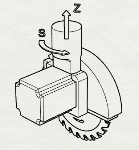
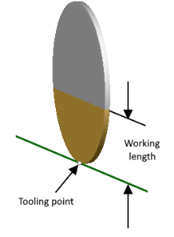
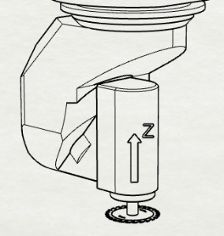
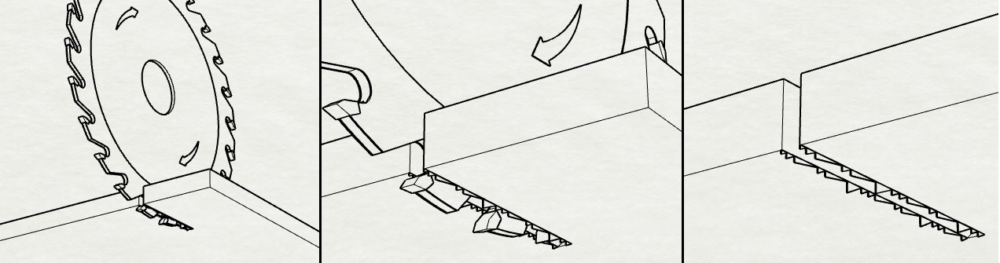
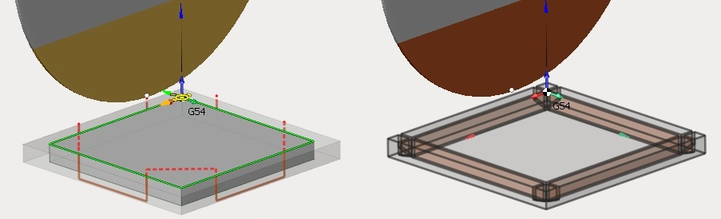
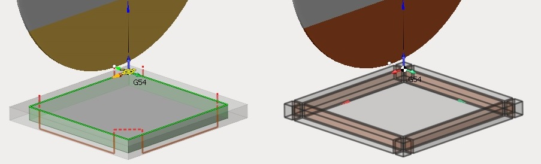
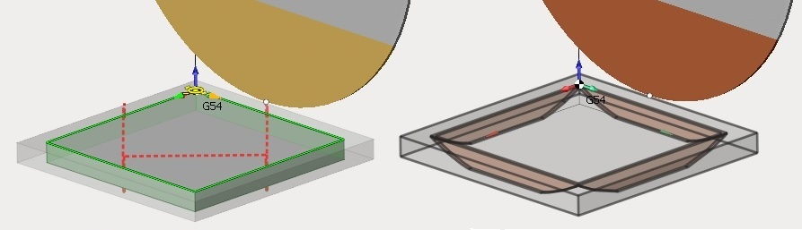
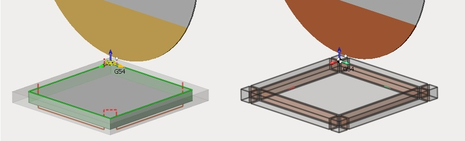

# Utensile a disco

Per le operazioni con utensile a disco sono disponibili due tipi di utensile, a seconda del tipo di montaggio.

<strong>Saw Blade</strong> (lama circolare).

Questo tipo presuppone la presenza di un asse S (per la rotazione dell'utensile attorno all'asse Z). L'asse Z è diretto lungo il piano di rotazione dell'utensile.

Il punto utensile di una lama circolare si trova sul bordo della lama, a differenza di un utensile da fresatura, per il quale tale punto si trova sull'estremità dell'utensile, sul suo asse di rotazione. Gli utensili di tipo lama circolare hanno inoltre il parametro 'Working length' (lunghezza di lavoro), che definisce l'altezza della zona di lavoro della lama. Si assume che il resto dell'utensile sia coperto dalla cuffia. Questo parametro influisce direttamente sul percorso utensile generato, in modo che la zona non lavorante dell'utensile non venga impiegata per l'asportazione del materiale del grezzo.

<strong>Milling Tool</strong> (utensile da fresatura).

Gli utensili di questo tipo sono comuni frese di grande diametro e di altezza ridotta. Vengono montati nel mandrino; l'asse S non è necessario, perché la sua funzione è svolta da altri assi rotativi della macchina. L'asse Z dell'utensile è diretto lungo la normale al piano di rotazione.

Un aspetto importante riguarda l'operazione di taglio con utensile a disco. Se si taglia un pannello di legno o una lastra di marmo in un'unica passata (passante), sul bordo del pannello, nella zona in cui i denti della lama escono dal materiale (nell'immagine seguente è il bordo inferiore), possono formarsi scheggiature e bave (nel caso del marmo solo scheggiature).

Per evitare questa situazione (si consideri la variante a due passate), la prima passata di taglio viene eseguita senza uscire dal materiale, al livello inferiore del pannello (in modo da garantire che il bordo superiore non presenti difetti, poiché il livello superiore del pannello sarà la zona in cui i denti della lama entrano nel materiale), mentre la seconda passata viene eseguita con uscita al livello inferiore, ma spostando l'utensile in direzione opposta (oppure nella stessa direzione ruotando l'asse S per gli utensili di tipo lama circolare). Ciò consente di ottenere un bordo inferiore privo di difetti perché, con questa strategia, nella seconda passata il livello inferiore del pannello sarà la zona di ingresso dei denti della lama nel materiale, mentre il bordo superiore è stato formato nella prima passata.

Un altro aspetto a cui prestare attenzione è il concetto di sovrapposizione degli angoli interni ed esterni.

La sovrapposizione degli angoli esterni (Outer corner overlap) consente di aumentare della quantità specificata la lunghezza del contorno lungo le facce. Può essere necessaria per rimuovere i residui di grezzo lungo le facce del contorno.

Si consideri un esempio. Si supponga di dover tagliare un pannello rettangolare da un grezzo con sovrametallo.

Se la sovrapposizione degli angoli esterni ("Outer corner overlap") non viene utilizzata, i residui di materiale verranno rimossi dal pezzo solo dopo che l'utensile avrà percorso tutte le facce, perché il percorso utensile viene generato in base al contorno specificato, senza tenere conto del sovrametallo del grezzo.

Se si utilizza la sovrapposizione, i residui di materiale possono essere tagliati al termine di ciascuna faccia.

Un altro caso riguarda la lavorazione di un contorno interno. Senza modificare i parametri di sovrapposizione, il percorso utensile sarà limitato dal profilo della lama, che tocca l'angolo del contorno al livello superiore del grezzo.

Utilizzando la sovrapposizione, è possibile ottenere il contorno completo del pezzo sia al livello superiore sia a quello inferiore del grezzo.

