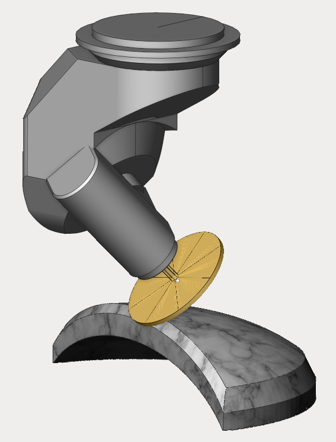
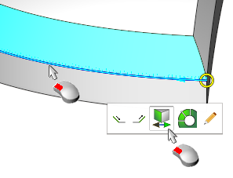
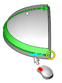
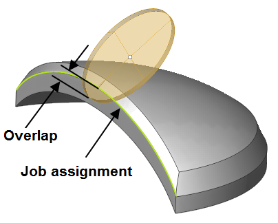
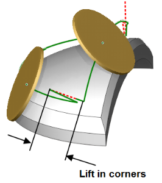
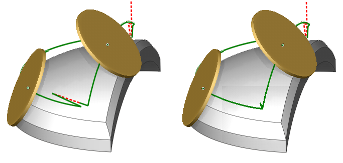
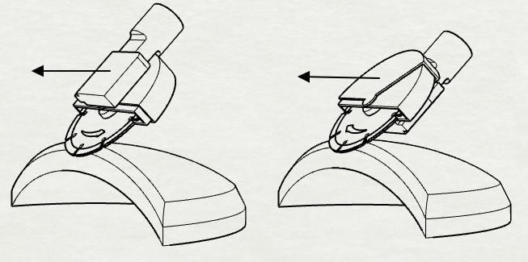
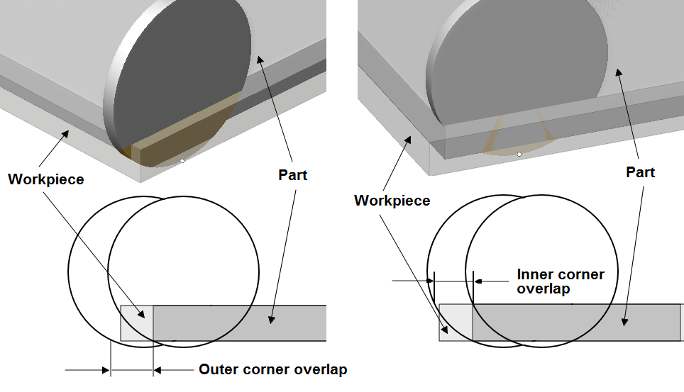
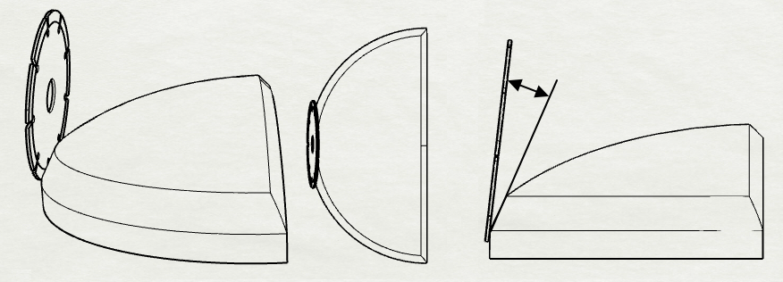
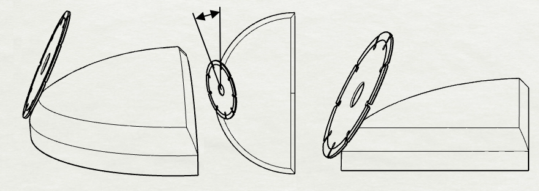

# Taglio con disco 6D

L'operazione "Disc cutting 6D" è destinata al taglio con sega di pezzi sia piani sia volumetrici.

L'interfaccia per l'impostazione dei parametri e delle zone di lavoro è simile a quella dell'operazione "5D Contour".

Nell'assegnazione del lavoro si definiscono i contorni o gli spigoli del modello 3D lungo i quali viene generato il percorso del disco. Per impostare l'assegnazione del lavoro, selezionare i contorni o gli spigoli nella finestra grafica e aggiungerli all'elenco premendo il pulsante corrispondente al tipo di oggetto selezionato: "Edge / Curve", "5D Curve", "Tilt Curve". Poiché uno spigolo può appartenere a due facce adiacenti, dopo averlo definito nell'assegnazione del lavoro occorre specificare quale delle due facce verrà lavorata. A tale scopo, fare clic con il tasto sinistro del mouse sullo spigolo nella finestra grafica: in questo modo si cambia la faccia a cui lo spigolo appartiene.

Quando la scheda "Job assignment" è aperta e l'elemento è stato aggiunto, è inoltre possibile selezionare in modo interattivo la direzione di movimento dell'utensile lungo la curva facendo clic con il tasto sinistro sulla freccia nella finestra grafica.

Nell'inspector (scheda "Strategy") sono disponibili i seguenti parametri dell'operazione.

- <strong>Overlap (deepening).</strong> (sovrapposizione, approfondimento) Il parametro consente alla sega, alla fine, di oltrepassare il livello definito nell'assegnazione del lavoro (da uno spigolo/curva).

- <strong>Lift in corners</strong> (sollevamento negli spigoli). Il parametro consente di specificare l'altezza alla quale viene eseguito il ribaltamento dell'utensile quando si passa da un lato all'altro dello spigolo lavorato.

- <strong>Sharp corner</strong> (spigolo vivo) definisce il valore minimo dell'angolo oltre il quale uno spigolo è considerato vivo, cioè quando è necessario il ribaltamento dell'utensile. Nell'esempio seguente sono mostrati due diversi percorsi attorno a uno spigolo (nel primo caso il valore di spigolo vivo è inferiore a 90 gradi, nel secondo è superiore a 90).

- <strong>Sawing mode</strong> (modalità di taglio). Definisce il tipo di taglio: concorde, discorde, lato posteriore o lato anteriore. <strong>Climb/conventional</strong> (concorde/discorde): garantisce la rispettiva modalità di taglio. Quando cambia la direzione del contorno, la sega si ribalta e inizia a lavorare il pezzo con il lato opposto. <strong>Back/front side</strong> (lato posteriore/anteriore): la sega lavora sempre il pezzo con il lato specificato, indipendentemente dalla direzione del contorno.

- <strong>Overlaps</strong> (sovracorse): parametri che determinano la distanza di oltrecorsa per gli spigoli esterni e interni (rispettivamente sovracorsa dello spigolo esterno e interno).

- <strong>Lean angle</strong> (angolo di inclinazione laterale). Il parametro definisce l'angolo di deviazione della superficie laterale della sega rispetto alla faccia lavorata.

- <strong>Lead angle</strong> (angolo di anticipo). Il parametro definisce un angolo aggiuntivo tra la superficie della sega e la tangente al contorno di lavoro in ciascun punto del percorso utensile.

