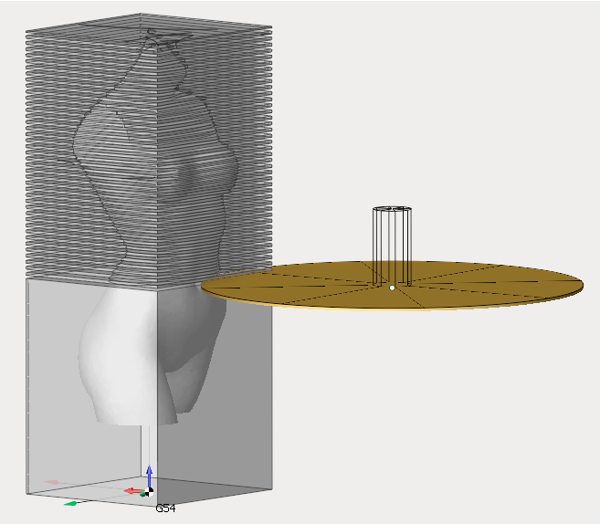
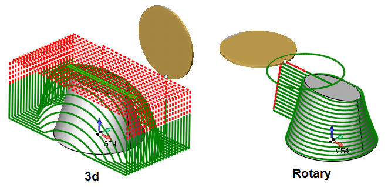
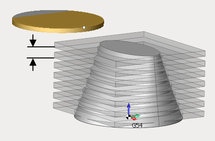
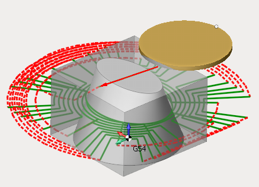
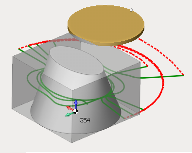
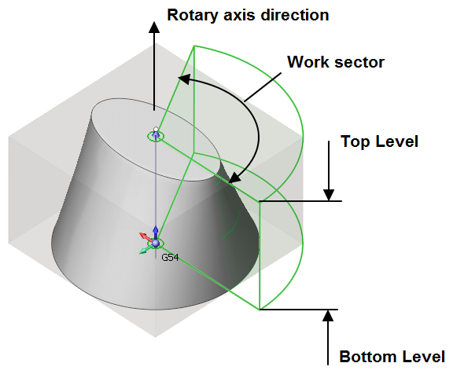

# Sgrossatura con disco

L'operazione Disc Roughing (sgrossatura con disco) è destinata alla preparazione del materiale lapideo mediante tagli con utensile a disco nell'area di asportazione del materiale e alla successiva rimozione manuale del materiale assottigliato per scheggiatura; di norma segue poi un'operazione di finitura con l'utensile adatto.

Il modello geometrico importato viene utilizzato automaticamente come assegnazione del lavoro. Per limitare il livello superiore e inferiore di lavorazione è possibile selezionare un qualsiasi elemento geometrico situato al livello richiesto e premere il pulsante "Top level" (livello superiore) o "Bottom level" (livello inferiore).

Inoltre, nella scheda 'Strategy' (strategia) dell'inspector sono disponibili i parametri seguenti.

- <strong>Trajectory</strong> (traiettoria). Il parametro definisce il modo di formazione del percorso utensile: tridimensionale (3D) o relativa all'asse (rotativa).

- <strong>Step</strong> (passo). Il parametro definisce il valore del passo tra gli strati di materiale asportati.

- <strong>Strategy</strong> (strategia). Il parametro definisce la strategia di formazione del percorso utensile.

<strong>By layers</strong> (per strati). Distanza costante tra le passate dell'utensile.

<strong>Adaptive</strong> (adattiva). Con questa strategia viene garantito il non superamento della larghezza di taglio impostata. Il materiale viene asportato con percorsi elicoidali. Il percorso utensile non contiene spigoli vivi. La regolarità del percorso utensile è controllata da appositi parametri per i raggi di raccordo delle passate di sgrossatura, della passata di finitura e delle transizioni. I movimenti a vuoto, se possibile, vengono eseguiti nel piano di lavoro con un piccolo gioco aggiuntivo. L'affondamento all'interno del grezzo viene eseguito con la tecnologia di rotolamento che preserva l'utensile.

- <strong>Job zone</strong> (zona di lavoro). Questo gruppo di parametri definisce il livello superiore/inferiore di lavorazione, la direzione di lavorazione e il settore di lavorazione.

