# ディスク荒加工

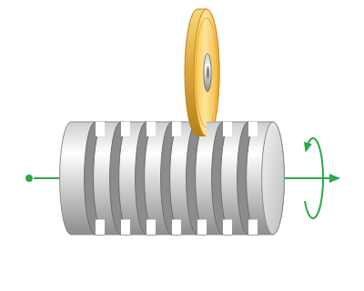

## 適用分野：

このオペレーションは、ソーブレードで切り込みを入れることにより、仕上げ加工に向けて石材を準備します。切り込みの間に薄く残った材料の壁は、その後手作業で割り取って除去（スパリング）し、適切な工具で仕上げ加工を行います。

主に使用する工具は<strong>ソーブレード</strong>です。このオペレーションでは、エンドミルとアンダーカット工具も使用できます。以下の説明と図は、ソーブレードを対象としています。

### セットアップ：

<strong>セットアップ</strong>タブでは、機械上のパーツの位置、座標系、およびプロジェクトの主要なパラメータを定義します。[詳細](1022.md)

### ジョブ割り当て：

加工するモデルは、オペレーションの<strong>パーツ</strong>で定義します。ジョブ割り当てでは、加工高さと制限を定義します。

<strong>上部高さ</strong> 選択した幾何要素によって加工の上限を設定します。[詳細](10153.md)

<strong>底部高さ</strong> 選択した幾何要素によって加工の下限を設定します。[詳細](10153.md)

<strong>制限</strong> 指定した領域を加工対象から除外します。[詳細](101231.md)

### 加工設定：

#### ツールパス：

切り込みの配置を定義します。

詳細を表示

<strong>回転</strong> 切り込みは回転軸の周りに生成され、回転軸に沿って配置されます。

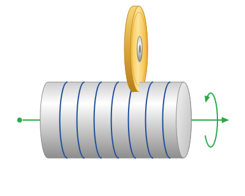

<strong>3d</strong> 平行な切り込みが平面内に生成されます。

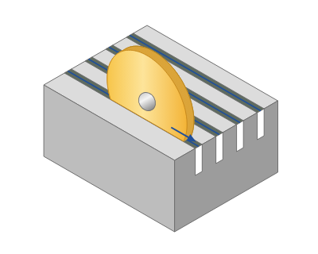

<strong>ステップ</strong> 隣接する切り込み（ストリング）間の距離です。距離、またはディスク直径に対する割合で入力します。デフォルトは20%です。軸方向のゾーンがステップで割り切れない場合は、切り込みが均等に配置されるようにステップが小さくなります。

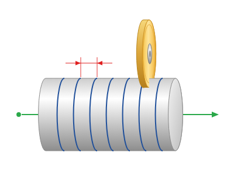

<strong>角度</strong> 平面内での切り込み方向を、X軸から測った角度で設定します。<strong>3d</strong>の場合のみ使用できます。

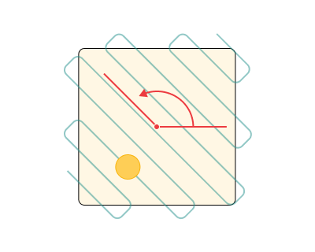

<strong>Change side</strong>（加工側の切り替え） 切り込みの位置を保ったまま工具軸を反転し、ツールパスの点をディスクの厚さ分だけ移動します。

詳細を表示

<strong>OFF</strong> 工具の元の位置です。

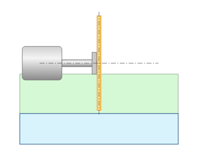

<strong>ON</strong> 工具は切り込みの反対側に配置されます。

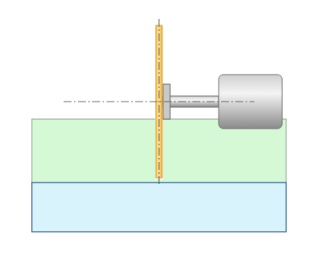

#### 荒加工：

各切り込み内での材料の除去方法を定義します。

詳細を表示

<strong>高さ優先</strong> 指定した切込み深さで、個別の層ごとに加工します。パーツおよびワークに対する周回パス（ターン）の形状は、<strong>ワーク</strong>によって決まります。

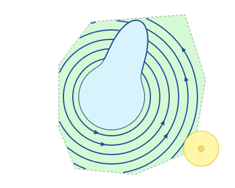

<strong>アダプティブ</strong> 切削幅を制限しながら、らせん状に材料を除去します。丸め半径によって、荒加工パス、リンク、およびツールパスのコーナーの滑らかさを制御します。

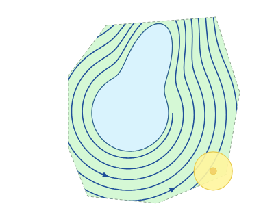

<strong>切込み深さ</strong> 1つの切り込み内で隣接する層の間の距離です。距離、またはディスク直径に対する割合で入力します。デフォルトは100%です。

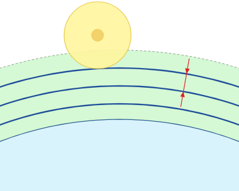

<strong>ワーク</strong> <strong>加工設定</strong>タブの<strong>荒加工</strong>内にあるパラメータです。<strong>荒加工</strong>が<strong>高さ優先</strong>に設定されている場合にのみ使用でき、各層の周回パスをワークに対してどのように生成するかを決定します。<strong>アダプティブ</strong>の場合、このパラメータは表示されず、ワークは常に考慮されます。

詳細を表示

- <strong>Use workpiece</strong>（ワークを使用） デフォルトのモードです。周回パスは、ワークの材料が存在する箇所にのみ生成されます。パーツが層より高い箇所では、周回パスが中断されます。中断されたセグメントは、アプローチと退避を伴うリンクで接続されます。

  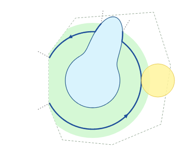

- <strong>Ignore workpiece</strong>（ワークを無視） 周回パスの生成時に、ワークと工具カバーを考慮しません。各周回パスは全長にわたって連続したパスになります。パーツが低い箇所では層に沿って、パーツが高い箇所ではパーツのサーフェスに沿って移動します。周回パス内に中断や退避はありません。層はワークの上端ではなく加工の上部高さによってのみ制限されるため、一部の周回パスが空間を通過する場合があります。

  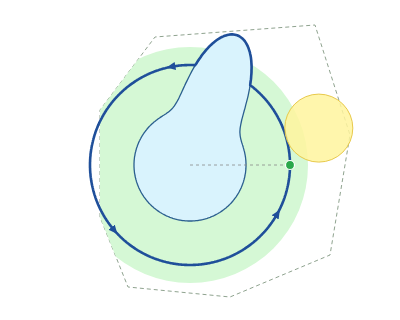

- <strong>Link feed outside</strong>（材料外ではリンク送り） <strong>Ignore workpiece</strong>モードと同様に、周回パスは連続します。ワークの材料が存在しない箇所では、工具はショートリンク送りで移動し、材料内では加工送りで移動します。材料の境界では送り速度のみが切り替わり、退避は行われません。図では、青い線が加工送り、オレンジ色の破線がショートリンク送りを示します。

  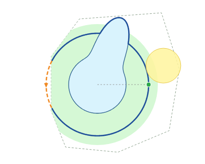

<strong>Minimum cut depth</strong>（最小切込み深さ） <strong>荒加工</strong>内のパラメータで、<strong>ワーク</strong>が<strong>Ignore workpiece</strong>または<strong>Link feed outside</strong>に設定されている場合にのみ使用できます。デフォルト値は0.1 mmです。周回パスの切込み深さとは、その層の上端から、その周回パスに沿ったパーツの最も低い点までの距離です。切込み深さが指定値より小さい周回パスは生成されません。これにより、ほぼ全体がパーツのサーフェスに沿って移動し、ごくわずかな材料しか除去しない下側の周回パスが除外されます。値を0にすると、すべての周回パスが生成されます。

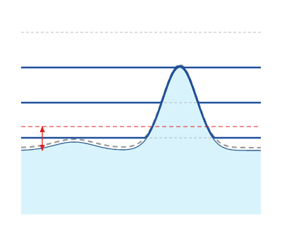

以下のパラメータは、<strong>アダプティブ</strong>荒加工の場合にのみ使用できます。

<strong>コーナーの円滑化</strong> パーツのサーフェス付近でツールパスのコーナーを滑らかにするための半径です。

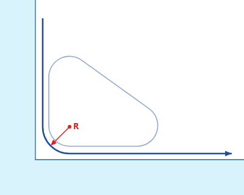

<strong>荒取りR半径</strong> 荒加工パスの丸め半径です。

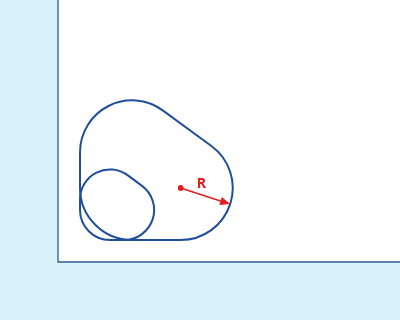

<strong>リンク半径</strong> パス間を接続する円弧の半径です。安全距離以上である必要があります。無効な値は、インスペクターでエラーとして表示されます。

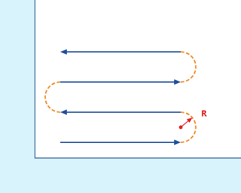

#### ジョブゾーン：

回転軸に沿った加工範囲と角度範囲を制限します。<strong>回転</strong>加工の場合にのみ使用できます。

詳細を表示

<strong>回転軸</strong> インスペクターまたはマウスで軸を設定します。<strong>方向</strong>は基準座標系のX、Y、Z、またはカスタム方向に従います。<strong>原点</strong>は軸の位置を定義します。<strong>基準座標系</strong>は<strong>Global CS</strong>（グローバル座標系）または<strong>WCS</strong>（ワーク座標系）です。

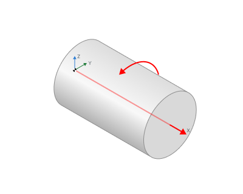

<strong>最小軸方向位置</strong> 軸方向の下限です。<strong>自動</strong>、または回転軸の原点から測った値を指定します。

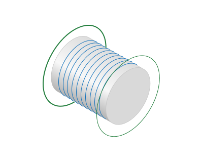

<strong>最大軸方向位置</strong> 軸方向の上限です。<strong>自動</strong>、または回転軸の原点から測った値を指定します。

<strong>角度範囲</strong> 1回転全体、または開始角度と終了角度の間の扇形（セクター）を選択します。範囲は、ドラッグするか、寸法線の横に値を入力して調整します。

<strong>全周</strong> 周回パスは全周にわたって生成されます。

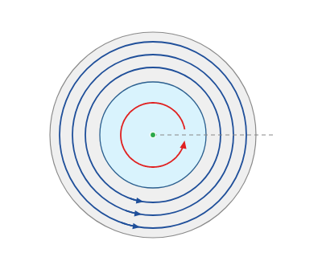

<strong>セクター</strong> 周回パスは指定した角度範囲に制限されます。

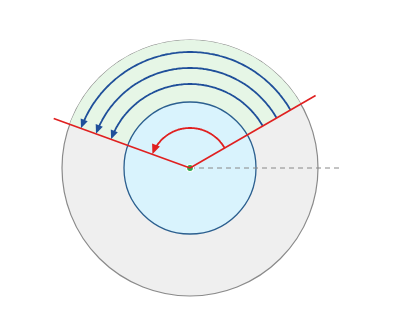

<strong>開始角度</strong> 角度ゼロの方向から測ったセクターの開始位置です。

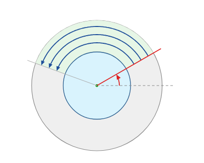

<strong>最終角度</strong> 角度ゼロの方向から測ったセクターの終了位置です。

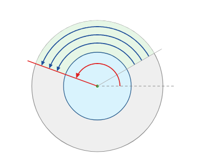

#### 軸方向：

軸に沿った切り込みの順序を定義します。<strong>回転</strong>加工の場合にのみ使用できます。

詳細を表示

<strong>前方</strong> 最小軸方向位置から最大軸方向位置へ、回転軸の方向に加工します。

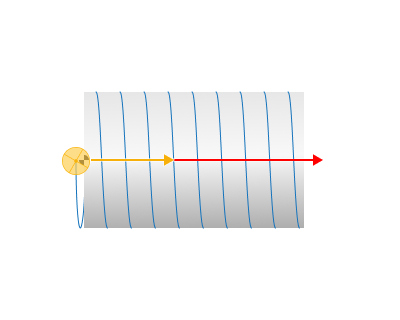

<strong>後方</strong> 最大軸方向位置から最小軸方向位置へ加工します。

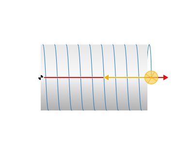

#### ミーリングタイプ：

詳細を表示

<strong>ダウンカット</strong> 接触部で、送り方向が切れ刃の運動方向と同じになります。

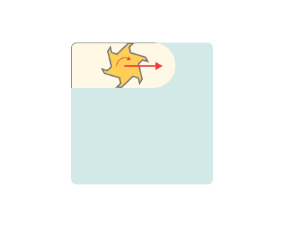

<strong>アップカット</strong> 接触部で、送り方向が切れ刃の運動方向と逆になります。

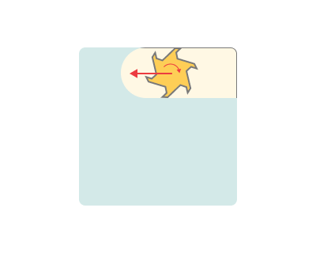

<strong>両方</strong> 両方の加工方向を使用できます。

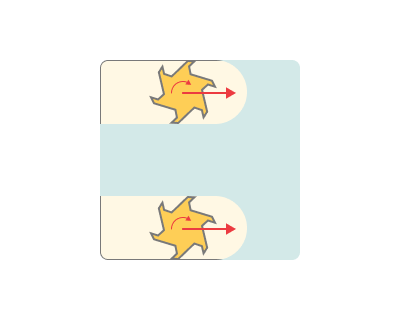

#### 並べ替え：

<strong>ツールパス結合モード</strong>は、ストリングと層の加工順序を定義します。

詳細を表示

<strong>高さ優先</strong> 各切り込みを全深さまで加工してから、次の切り込みの加工を開始します。

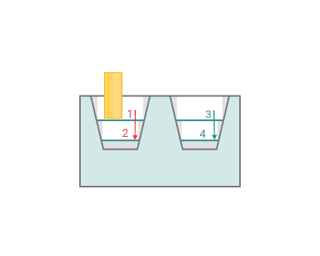

<strong>ストリング</strong> 1つの層をすべての切り込みにわたって加工してから、次の層の加工を開始します。層内では領域ごとに加工し、1つの領域を完了してから次の領域に移ります。

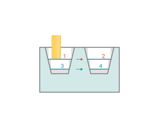

<strong>Link feed outside</strong>の場合、層は領域に分割されず、周回パスは連続したままになります。

<strong>Reverse odd strings</strong>（奇数ストリングの反転） 1つおきの切り込み（2番目、4番目、6番目など）の加工方向を反転します。

<strong>OFF</strong> 隣接するストリングは同じ方向に加工されます。

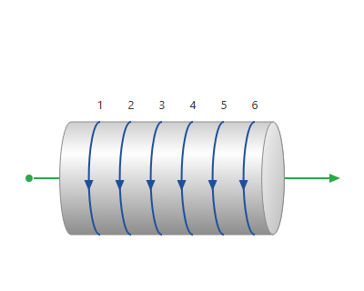

<strong>ON</strong> 隣接するストリングの方向が交互に切り替わります。

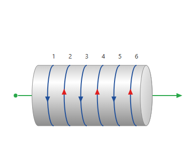

#### 加工高さ：

<strong>回転</strong>加工の場合、高さはZ方向の高さではなく、回転軸からの距離です。

詳細を表示

<strong>上部高さ</strong> 加工層の上限です。<strong>高さ優先</strong>荒加工の場合にのみ使用できます。

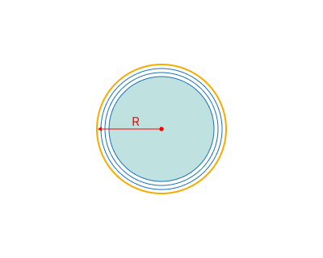

<strong>底部高さ</strong> 加工の下限です。これより下には周回パスは生成されません。

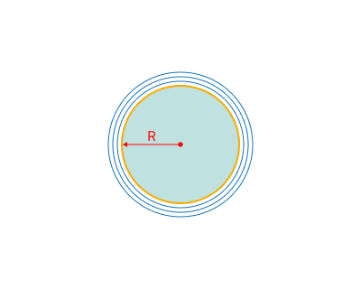

### パラメータ：

このタブには、パーツ、ワーク、治具などを制御し、ツールパスを変更するための主要なパラメータが含まれています。[詳細](100112.md)

### リンク／リード：

このタブでは、工具のアプローチとリターン、安全動作、および加工パス間のリンクを定義します。

詳細を表示

<strong>次の項目で構成されます。</strong>

<strong>アプローチ／リターン</strong> 工具交換位置から加工位置までの移動と、その復帰移動です。[詳細](100116.md)

<strong>安全動作</strong> 工具移動のための安全サーフェスと安全高さです。[詳細](100117.md)

<strong>高度なリンク設定</strong> リンクにおける回転軸の動作設定です。[詳細](100118.md)

<strong>リンク</strong> 進入／退出リンク、および高さ間とストリング間のリンクのルールです。[詳細](100130.md)

<strong>距離</strong> リンクのルールで送り速度を切り替えるために使用する距離です。[詳細](100140.md)

### 送り速度設定：

主軸回転速度とツールパスの各区間の送り速度を設定します。このオペレーションでは、<strong>加工開始パス送り速度</strong>と<strong>退避送り</strong>は使用できません。<strong>Link feed outside</strong>の場合、材料の外側では<strong>ショートリンク送り</strong>が使用されます。[詳細](100142.md)

### 変換：

計算されたツールパスに適用する座標変換です。[詳細](10168.md)

### パーツ：

パーツモデルは、加工する形状を定義し、干渉チェックの対象となります。[詳細](330.md)

### ワーク：

加工する素材のモデルです。[詳細](738.md)

### 治具：

加工時に考慮するクランプ装置やその他のオブジェクトです。[詳細](10283.md)
